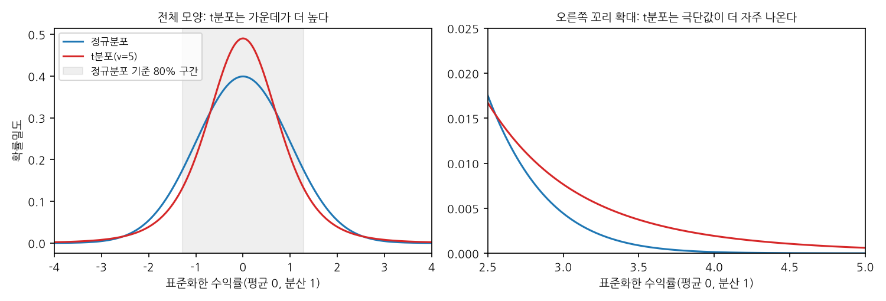
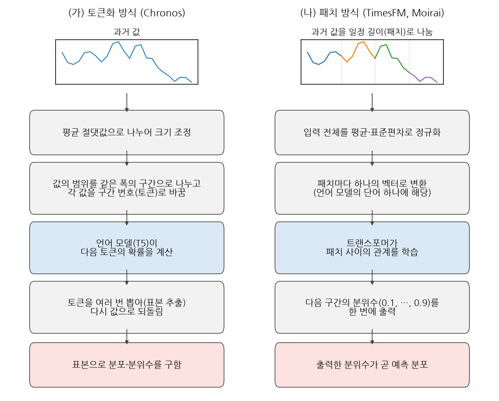
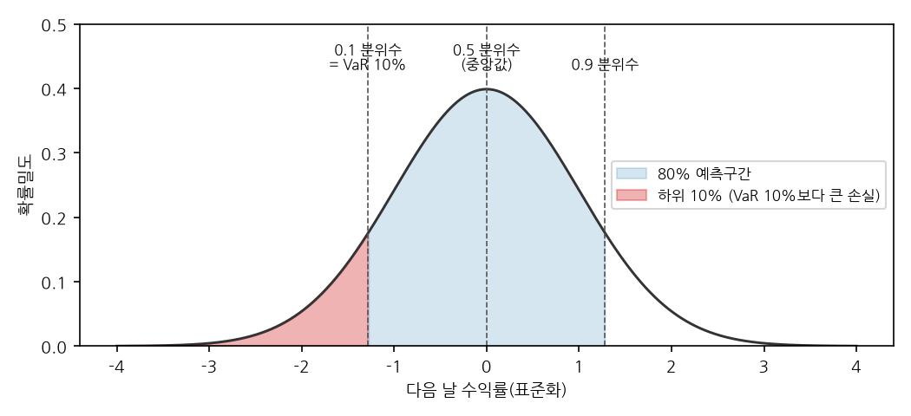
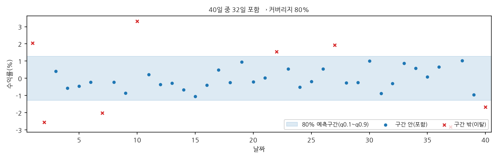
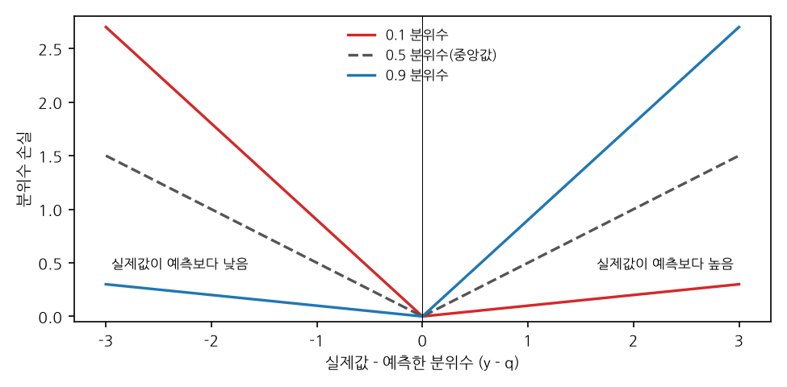
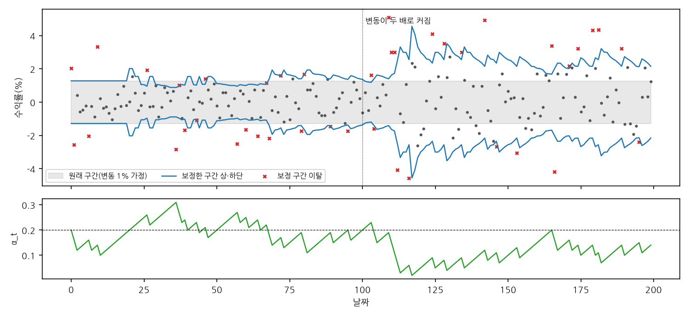
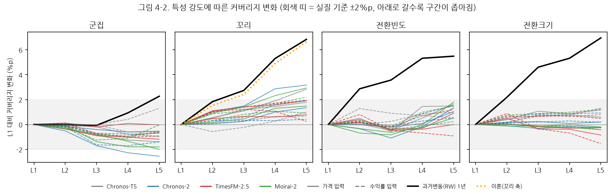

석사학위논문

# 사전학습 시계열 모델의 금융 수익률 예측구간: 오차의 출처와 재학습 없는 사후보정
## - 실측 기반 합성 데이터 통제 실험과 미국·한국 대형주 실증 -

### Prediction Intervals of Pretrained Time Series Foundation Models for Financial Returns: Sources of Error and Training-Free Post-hoc Calibration
#### - Controlled Experiments on Synthetic Data Calibrated to Real Markets and Evidence from U.S. and Korean Large-Cap Stocks -

김승민

한양대학교 인공지능융합대학원

2027년 2월

---

# 차례

- 국문요지
- 제1장 서론
- 제2장 이론적 배경과 관련 연구
- 제3장 연구 설계
- 제4장 금융 특성이 예측구간에 미치는 영향 (RQ1)
- 제5장 실제 주가에서의 예측구간 평가 (RQ2)
- 제6장 사후보정을 통한 커버리지 복원 (RQ3)
- 제7장 결론
- 참고문헌
- 부록 A. 실험 절차와 재현 정보
- 부록 B. 특성 강도 비교(L5 − L3)
- 부록 C. 종목별 실제 커버리지
- ABSTRACT

---

# 국문요지

시계열 파운데이션 모델(TSFM)은 추가 학습 없이 예측구간을 함께 내므로 금융 위험 관리에 쓰일 가능성이 크지만, 금융 수익률에서 그 구간이 명목 커버리지를 충족하는지는 체계적으로 검증되지 않았다. 본 연구는 TSFM의 80% 예측구간이 명목 수준에서 벗어나는 원인에 대하여, 이것이 금융 데이터의 특성에서 기인하는지 혹은 모델과 사용 설정에서 기인하는지를 진단하고, 실제 주식에서의 성능을 평가한 후 그 오차를 재학습 없는 사후보정으로 교정할 수 있는지를 검증하였다.

실제 미국·한국 대형주 10종목에서 측정한 변동성 군집, 두꺼운 꼬리, 국면 전환 빈도와 크기를 기준치로 삼아 합성 데이터 17개 시나리오를 만들고, 공통 난수로 특성 하나씩만 바꾸었다. TSFM 4종(Chronos-T5, Chronos-2, TimesFM-2.5, Moirai-2.0)을 과거 길이(21·252일)와 입력 형태(수익률·가격)의 4개 조건에서 다음 날 로그수익률에 대해 평가하고, 같은 절차를 2017~2026년 실제 10종목(24,132건)에 적용하였다. 가설과 판정 기준은 실험 전에 정해 두었다.

특성이 없는 합성 데이터에서 이미 TSFM 커버리지는 75~88%로 모델 및 설정마다 다르게 나타나 16개 조건 중 절반이 실질 기준을 벗어났다. 반면 특성을 실제 종목 중 가장 강한 수준(L5)으로 설정하더라도 대부분의 변화 폭은 3%p 이내였다. 특성별로는 변동성 군집만이 일부 조건에서 커버리지를 하락시켰고, 두꺼운 꼬리와 잦은 국면 전환 특성은 오히려 커버리지를 상승시켰다. 이 상승은 첨도가 높은 분포에서 분산 기반 80% 구간이 갖는 수학적 성질로 설명되며, 같은 성질 때문에 극단 분위수를 내는 Chronos-2의 98% 구간에서는 꼬리와 국면 전환이 오히려 커버리지를 낮추었다. 실험 과정에서는 Chronos-T5의 라이브러리 기본 샘플링 설정 하나가 수익률 입력의 커버리지를 14%까지 무너뜨리는 것도 발견하여 바로잡았으며, 이는 설정이 특성보다 큰 차이를 만든다는 또 하나의 사례이다. 실제 주가의 커버리지는 특성 없는 합성 데이터의 커버리지와 평균 1.1%p(최대 3.6%p) 차이를 보였다. 실제 주식에서 분위수 손실은 16개 조건 중 12개에서 과거 변동성 기반 정규분포(RW)보다 컸고, 과거 1년 조건은 모두 GARCH-t보다 컸다. 적응형 콘포멀 분위수 보정(ACI-CQR)은 합성 340개, 실제 19개 모델·조건 모두에서 평균 커버리지를 80%로 복원하였으며, 그에 상응하여 예측구간의 폭은 이상적인 구간보다 5~48% 넓어졌다. 탐색 분석에서 보정된 구간은 변동성 목표 전략의 실현 변동을 목표의 1.05~1.14배로, VaR 10% 한도의 위반율을 8.6~10.8%로 돌려놓았으나, 위반이 특정 시기에 몰려 오는 문제는 일부 조건에 남았다.

이러한 결과는 금융 수익률에 대한 TSFM 예측구간의 신뢰성이 금융 데이터의 특성보다 모델과 입력 설정에 의해 좌우되며, 크게 어긋나는 모델과 설정은 실측 기반 합성 데이터 실험으로 실제 주식에 쓰기 전에 가려낼 수 있음을 보여 준다. 분포의 정확도는 단순 기준 모형을 넘지 못하였고, 가장 나은 조건(네 모델의 1년·수익률)에서 같은 수준에 도달하였다. 따라서 현재의 TSFM은 수익률 예측기보다는 모델과 사용 설정을 점검하고 재학습 없는 사후보정을 거친 위험 측정 도구로 활용하는 것이 적절하다.

주제어: 시계열 파운데이션 모델, 예측구간, 커버리지, 합성 데이터 통제 실험, 콘포멀 예측, 주가 수익률

---

# 제1장 서론

## 1.1 연구 배경

시계열 파운데이션 모델(time series foundation model, TSFM)은 대량의 시계열로 미리 학습해 두고, 새로운 데이터에는 추가 학습 없이 바로 예측을 내는 모델이다. Chronos, TimesFM, Moirai 같은 모델이 2024년 이후 잇달아 공개되었고, 최근에는 Chronos-2, TimesFM-2.5, Moirai-2.0으로 개선판이 나왔다. 이 모델들이 주목받는 이유는 예측에 드는 수고를 크게 줄이기 때문이다. 기존에는 예측할 계열마다 모형을 정해 추정하거나 신경망을 새로 학습해야 했지만, TSFM은 공개된 모델을 내려받아 과거 자료를 넣기만 하면 예측을 얻을 수 있다. 수많은 종목과 지표를 다루는 금융 분야에서는 이런 범용성이 특히 매력적이어서, 금융 데이터에 TSFM을 적용하려는 연구도 빠르게 늘고 있다(Rahimikia 외, 2025; Noguer i Alonso, Franklin, 2026). 또한 이 모델들은 숫자 하나(점 예측)만이 아니라 "내일 값이 이 범위에 80% 확률로 들어간다" 같은 예측구간, 곧 확률 예측을 함께 낸다.

금융에서는 점 예측과 함께 예측구간도 중요한 역할을 한다. 일별 주가 수익률의 방향은 예측하기 어렵지만, 변동성은 지속되는 성질이 있어 내일 얼마나 크게 움직일지는 어느 정도 예측할 수 있고, 이것이 위험 한도(VaR), 포지션 크기 조절, 손절 기준 같은 실무 위험 관리의 기초가 된다. 은행의 시장위험 관리도 VaR로 손실 한도를 정하고, 실제 손실이 그 한도를 넘은 횟수로 모형을 점검한다(Basel Committee on Banking Supervision, 1996). 이때 중요한 것은 구간이 명목 수준을 충족하는가이다. 80% 구간이라고 했으면 실제로 열 번 중 여덟 번은 그 안에 들어와야 한다. 들어오는 비율(커버리지)이 60%라면 위험을 과소평가한 것이고, 95%라면 필요 이상으로 보수적인 것이다.

그런데 금융 분야의 TSFM 연구는 주로 점 예측의 정확도를 비교해 왔다. Rahimikia 외(2025)는 여러 나라의 일별 주식 수익률에서 Chronos·TimesFM을 그대로 쓰면 성과가 나쁘다고 보고했고, Noguer i Alonso와 Franklin(2026)은 미국 대형주 5종목에서 TSFM이 처음부터 학습한 신경망보다 대체로 낫지만 랜덤워크 대비 이득은 작다고 보고하였다. 두 연구 모두 예측구간의 커버리지는 평가하지 않았다. 한편 FinStressTS(Sun 외, 2026)는 금융 특성을 하나씩 조절한 합성 데이터로 예측 모델의 약점을 진단하는 방법을 제시했지만, 사전학습 TSFM의 제로샷 예측구간을 대상으로 하지는 않았다.

따라서 사전학습 TSFM의 금융 예측구간이 명목 커버리지를 충족하는지, 미달 또는 초과가 발생한다면 그 원인이 금융 시계열의 고유 특성(변동성 군집, 두꺼운 꼬리, 국면 전환)에 있는지 혹은 모델 및 입력 설정에 있는지, 나아가 재학습 없는 사후보정으로 이를 교정할 수 있는지에 대해서는 체계적인 검증이 필요한 시점이다.

## 1.2 연구 질문

본 연구는 세 질문에 답한다.

- RQ1 (진단): 금융 데이터의 특성(변동성 군집, 두꺼운 꼬리, 국면 전환의 빈도와 크기)이 강해질수록 TSFM 80% 예측구간의 커버리지가 떨어지는가, 아니면 모델과 입력 설정에서 이미 오차가 발생하는가? 특성 중에서는 어떤 것이 가장 불리한가?
- RQ2 (실증 평가): 실제 미국·한국 대형주에서 TSFM 예측구간의 커버리지와 분포 정확도는 어떠하며, 단순 기준 모형(과거 변동성 기반 정규분포, RW)보다 나은가?
- RQ3 (처방): 모델을 재학습하지 않는 온라인 사후보정(ACI-CQR)으로 커버리지를 80%로 복원할 수 있는가? 그에 수반되는 구간 폭의 확대는 어느 정도인가?

## 1.3 연구 방법 개요

RQ1은 합성 데이터 실험으로 답한다. 실제 10종목에서 측정한 특성 강도를 기준치로 삼아 합성 데이터 17개 시나리오(특성 없음 1개 + 4개 특성 × 4단계)를 만들고, 같은 난수와 같은 평균 변동 크기를 쓰되 특성 하나만 바꾸어 그 영향을 분리하였다. 데이터를 만든 참 분포를 알기 때문에 오라클 모형으로 채점 절차를 검증할 수 있다.

RQ2는 실제 주가 실증으로 답한다. 미국 5종목(AAPL, AMZN, GOOG, JPM, META)과 한국 5종목(삼성전자, SK하이닉스, 현대차, 한국전력, 현대모비스)의 2017년 1월~2026년 9월 매 거래일에 대해 다음 날 로그수익률의 분포를 예측하였다(24,132건).

두 환경 모두 같은 절차를 쓴다. TSFM 4종(Chronos-T5, Chronos-2, TimesFM-2.5, Moirai-2.0)을 과거 길이 2가지(21일, 252일) × 입력 형태 2가지(수익률, 가격) = 4개 조건에서 평가하고, RW와 GARCH(1,1)-t를 기준 모형으로 둔다. RQ3은 두 환경 모두에 같은 사후보정을 적용해 답한다.

가설과 판정 기준, 분석 코드는 실험 전에 정해 두었다(3.7절). 실험 과정에서 Chronos-T5의 수익률 구간이 비정상적으로 좁은 것을 발견하여 원인을 점검하였고, 라이브러리의 생성 설정이 모델의 분포를 잘라 내고 있음을 확인하여 바로잡은 설정으로 평가하였다(3.4절, 부록 A.3).

## 1.4 주요 결과와 기여

본 연구의 주요 결과는 다음과 같다.

1. 오차의 출처는 금융 특성보다 모델과 입력 설정이다. 특성이 전혀 없는 데이터에서 이미 TSFM의 80% 구간 커버리지는 75%에서 88%까지 퍼져 16개 조건 중 절반이 실질 기준(80% ± 2%p)을 벗어났고, 특성을 실제 종목 중 가장 강한 수준(L5)으로 설정해도 대부분 3%p 이내로만 움직였다. 커버리지 변동의 90%가 모델·조건의 차이로, 7%가 금융 특성의 차이로 설명된다. 변동성 군집만 일부 조건에서 커버리지를 낮췄고, 두꺼운 꼬리와 잦은 국면 전환 특성은 오히려 커버리지를 높였으며, 이는 80% 구간이 갖는 수학적 성질로 설명된다. 실험 과정에서는 Chronos-T5의 라이브러리 기본 샘플링 설정 하나가 수익률 입력의 커버리지를 14%까지 무너뜨리는 것도 발견하였는데(부록 A.3), 설정 하나가 어떤 특성보다 큰 차이를 만든 사례이다.
2. 합성 데이터 실험의 진단은 실제 주가에서 재현된다. 실제 10종목의 커버리지는 특성 없는 합성 데이터의 커버리지와 평균 1.1%p(최대 3.6%p) 차이였고, 크게 어긋나는 모델과 설정(TimesFM-2.5 1년·가격 88%, 기본 설정 Chronos-T5 14%)은 합성 데이터에서 이미 그대로 드러났다. 실제 데이터에 적용하기 전에 합성 데이터로 이런 모델과 설정을 미리 가려낼 수 있다는 뜻이다.
3. 사후보정은 모든 경우에 평균 커버리지를 80%로 복원한다. 합성 340개, 실제 19개 모델·조건에서 예외가 없었으며, 그에 상응하여 구간의 폭은 이상적인 구간보다 5~48% 넓어졌다. 탐색 분석에서는 VaR 10% 한도의 위반율 검정을 8종목 이상 통과한 조건이 보정 전 8개에서 보정 후 14개로 늘었다.
4. 분포 정확도는 단순 기준 모형 수준이다. 실제 주식에서 분위수 손실은 16개 조건 중 12개에서 RW보다 컸고, 가장 나은 조건(네 모델의 1년·수익률)에서 RW와 같은 수준이었으며, GARCH-t보다는 과거 1년 조건 모두 손실이 컸다(1년·수익률은 0.4~1.5%로 작은 차이). 점 예측 연구에서 보고된 한계가 분포 예측에서도 나타난 것으로, TSFM 예측구간의 쓸모가 수익률 예측보다 보정을 거친 위험 측정에 있음을 뜻한다.

이를 바탕으로 한 본 연구의 기여는 다음과 같다.

- 방법론: 실제 종목에서 측정한 특성 강도로 합성 데이터의 강도 단계를 설정하고, 공통 난수로 특성 하나씩만 바꾸는 통제 실험을 TSFM 예측구간 진단에 적용하였다. 이 설계로 합성 데이터 실험의 결과가 실제 주가에서 평균 1.1%p 차이로 재현됨을 확인하고, 크게 어긋나는 모델과 설정을 실제 데이터에 적용하기 전에 걸러내는 점검 절차로 쓸 수 있음을 보였다(5.4절). 이 점검과 사후보정은 모델 구조와 무관하므로 다른 사전학습 모델과 자산에도 같은 방식으로 적용할 수 있다.
- 평가 관점: 꼬리가 두꺼운 분포에서 분산 기반 80% 구간의 커버리지가 오히려 올라가고, 그 방향이 구간 수준에 따라 바뀜(99% 근처 구간에서는 하락)을 이론 계산으로 보이고, 극단 분위수를 내는 Chronos-2의 98% 구간에서 실제로 확인하였다. 단일 구간의 커버리지만으로 꼬리 위험을 판단하면 잘못된 결론에 이를 수 있다(4.3.2절).
- 실증: 최신 TSFM 4종을 두 시장, 약 10년, 4개 사용 조건에서 같은 절차로 평가하고, 가설과 판정 기준을 실험 전에 정해 둔 뒤 결과를 선택하지 않고 전체 표로 보고하였다.
- 실무: TSFM 예측구간을 위험 관리에 쓸 때 입력 설정 점검과 사후보정이 필요함을 보이고, 이것이 변동성 목표·VaR 같은 실제 의사결정에 어떤 차이를 만드는지 탐색하였다(5.5절).

## 1.5 논문 구성

본 논문의 구성은 다음과 같다. 제2장에서는 본 연구의 이론적 배경으로 금융 수익률의 통계적 성질, 시계열 예측 모델이 사전학습 모델로 발전해 온 과정, 확률 예측과 예측구간의 평가 방법, 위험 관리에서의 VaR와 백테스트, 콘포멀 예측에 기반한 사후보정을 정리하고, 관련 연구를 검토하여 본 연구의 위치를 밝힌다. 제3장에서는 실측 기반 합성 데이터의 설계와 생성, 실제 주식 데이터, 비교 모델, 사후보정 방법, 평가 지표와 가설, 실험 절차와 검산을 설명한다.

제4장에서는 합성 데이터 실험으로 오차가 금융 특성과 모델·입력 설정 중 어디에서 오는지 분석하여 RQ1에 답한다. 제5장에서는 미국·한국 대형주 10종목에서 커버리지와 분포 정확도를 평가하고, 합성 데이터 실험 결과와 대조하며, 예측구간을 투자·위험 관리 규칙에 적용한 탐색 분석을 함께 보고하여 RQ2에 답한다. 제6장에서는 재학습 없는 사후보정이 커버리지를 복원하는지와 그에 따른 구간 폭의 변화를 검증하여 RQ3에 답한다. 제7장에서는 연구 결과를 요약하고 실무적 시사점, 한계, 향후 연구 방향을 제시한다.

---

# 제2장 이론적 배경과 관련 연구

본 장에서는 본 연구를 이해하는 데 필요한 이론적 배경을 정리하고 관련 연구를 검토한다. 2.1절에서는 금융 수익률의 통계적 성질과 이를 표현하는 모형을, 2.2절에서는 시계열 예측 모델이 통계 모형에서 사전학습 모델로 발전해 온 과정과 본 연구가 평가하는 모델을 설명한다. 2.3절에서는 확률 예측과 예측구간을 평가하는 방법을, 2.4절에서는 위험 관리에서 예측구간이 쓰이는 방식과 그 검정 방법을 다룬다. 2.5절에서는 본 연구의 사후보정이 기반을 두는 콘포멀 예측을 설명하고, 2.6절에서 관련 연구를 검토하여 본 연구의 위치를 밝힌다.

## 2.1 금융 수익률의 통계적 성질

### 2.1.1 수익률과 예측 가능성

주가는 시간이 지남에 따라 수준 자체가 계속 바뀌므로, 금융 시계열 분석에서는 보통 가격 대신 수익률을 다룬다. t일의 종가를 P_t라 할 때 로그수익률은 다음과 같이 정의한다.

$$ r_t = ln(P_t / P_{t−1}) $$ (2.1)

로그수익률은 여러 날의 값을 더하면 그 기간의 수익률이 되고, 하루 변동이 작을 때에는 단순수익률 (P_t − P_{t−1}) / P_{t−1}과 거의 같다. 본 연구는 다음 날 로그수익률 r_{t+1}의 분포를 예측 대상으로 삼는다(3.1절).

효율적 시장 가설에 따르면 공개된 과거 가격 정보만으로는 미래 수익률의 방향을 체계적으로 예측할 수 없다(Fama, 1970). 실제로 일별 수익률의 자기상관은 0에 가깝고, 본 연구 표본에서도 종목별로 −0.10에서 +0.04 사이였다(5.5.1절). 그러나 수익률의 크기, 곧 변동성은 사정이 다르다. 다음 절에서 설명하는 성질 때문에 변동성은 과거 자료로 상당 부분 예측할 수 있으며, 이것이 방향을 맞히지 못하는 모델이라도 예측구간을 위험 관리에 활용할 수 있는 근거가 된다.

### 2.1.2 정형화된 사실

여러 시장과 기간에서 공통적으로 관찰되는 수익률의 통계적 성질을 정형화된 사실(stylized facts)이라 한다. Cont(2001)는 자기상관의 부재, 두꺼운 꼬리, 이익과 손실의 비대칭, 변동성 군집, 레버리지 효과 등 11가지를 정리하였다. 본 연구는 이 가운데 예측구간에 직접 영향을 줄 수 있는 변동성 군집과 두꺼운 꼬리, 그리고 위기와 평온기가 번갈아 나타나는 국면 전환을 다룬다. 국면 전환은 Cont(2001)의 목록에 따로 들어 있지는 않지만, 경기 순환이나 금융 위기에 따라 변동 수준이 크게 바뀌는 현상으로 금융계량에서 널리 다루어진다(Hamilton, 1989).

변동성 군집은 큰 변동 뒤에 큰 변동이, 작은 변동 뒤에 작은 변동이 이어지는 성질이다. Engle(1982)은 오늘의 분산이 어제의 충격에 따라 달라지는 ARCH 모형을 제안하였고, Bollerslev(1986)는 여기에 어제의 분산을 더한 GARCH 모형으로 일반화하였다. 가장 널리 쓰이는 GARCH(1,1)은 다음과 같다.

$$ r_t = σ_t z_t,   σ_t^{2} = ω + α r_{t−1}^{2} + β σ_{t−1}^{2} $$ (2.2)

여기서 z_t는 평균 0, 분산 1인 독립 충격이다. α는 어제의 충격이 오늘의 분산에 주는 영향을, β는 분산 자체의 지속성을 나타낸다. α + β < 1이면 분산은 장기 평균 ω / (1 − α − β)로 돌아가며, α + β가 1에 가까울수록 한 번 커진 변동성이 오래 유지된다. 변동성 충격이 절반으로 줄어드는 데 걸리는 기간(반감기)은 ln 0.5 / ln(α + β)로, α + β = 0.99이면 약 69일, 본 연구에서 가장 강한 단계로 쓴 0.996이면 약 173일이다(3.2.4절). 예를 들어 평소 하루 변동이 1% 안팎인 주식이 어느 날 5% 급락하면, GARCH 모형은 다음 날의 예상 변동을 평소보다 크게 잡고 그 뒤 서서히 평소 수준으로 되돌린다. 실제 주가에서 큰 움직임이 한동안 몰려 나타나는 모습은 3장의 그림 3-1에서 볼 수 있다.

두꺼운 꼬리는 극단적인 수익률이 정규분포에서 기대되는 것보다 훨씬 자주 나타나는 성질이다. 정규분포에서 평균으로부터 표준편차의 4배 이상 벗어나는 날은 약 1만 6천 거래일에 한 번이지만, 실제 주가에서는 이보다 훨씬 자주 관찰된다. 꼬리의 두께는 첨도로 나타내며, 정규분포의 첨도는 3이다. 금융계량에서는 꼬리가 두꺼운 분포로 흔히 자유도 ν의 Student-t 분포를 쓰는데, 그 첨도는 다음과 같다.

$$ κ = E[(r_t − μ)^{4}] / σ^{4},   κ_ν = 3 + 6 / (ν − 4)  (ν > 4) $$ (2.3)

ν가 작을수록 꼬리가 두껍고, ν → ∞이면 정규분포가 된다. ν ≤ 4이면 첨도가 정의되지 않을 만큼 꼬리가 두껍다. 본 연구는 분산을 1로 맞춘 표준화 t분포를 사용하므로(3.2.5절), ν를 바꾸어도 전체 분산은 같고 분포의 모양만 달라진다. 분산이 같을 때 꼬리가 두꺼운 분포는 극단값이 드물게 크게 나타나는 대신 중심부에 더 많은 값이 몰린다. 그림 2-1은 분산을 1로 같게 맞춘 정규분포와 자유도 5의 t분포를 비교한 것이다. t분포는 가운데 봉우리가 더 높고 꼬리가 길다. 그래서 정규분포를 기준으로 만든 80% 구간(회색)을 t분포를 따르는 자료에 적용하면 실제로는 약 84%가 구간 안에 들어오고, 그 대신 구간 밖으로 크게 벗어나는 극단값은 정규분포보다 자주 나타난다. 이 성질은 4.3.2절의 결과를 해석하는 데 쓰인다.

**그림 2-1. 분산이 같은 정규분포와 t분포(ν = 5)의 확률밀도**

국면 전환은 시장이 서로 다른 상태(국면)를 오가며 국면마다 수익률의 분포가 달라지는 성질이다. Hamilton(1989)의 마르코프 전환 모형에서는 관찰되지 않는 국면 S_t가 마르코프 과정을 따르고, 수익률은 그날의 국면에 따라 다른 분포에서 나온다.

$$ r_t | S_t = s ~ N(μ_s, σ_s^{2}),   P(S_t = j | S_{t−1} = i) = p_{ij} $$ (2.4)

국면 i에 머무는 기간의 기댓값은 1 / (1 − p_{ii})이다. 예를 들어 평온기에 다음 날도 머물 확률이 0.99이면 평온기는 평균 100일, 격변기에 머물 확률이 0.95이면 격변기는 평균 20일 이어진다. 국면마다 분산이 다르면, 국면을 구분하지 않고 전체를 하나의 분포로 볼 때 정규분포의 혼합이 되어 꼬리가 두꺼워진다. 이 성질은 4.3.3절의 결과를 해석하는 데 쓰인다.

세 성질은 실제 데이터에서 함께 나타나므로, 실제 주가만으로는 각 성질이 예측구간에 주는 영향을 분리하기 어렵다. 본 연구가 합성 데이터로 성질을 하나씩 통제하는 이유이다(3.2절).

## 2.2 시계열 예측 모델의 발전

### 2.2.1 통계적 시계열 모형

전통적인 시계열 예측은 데이터가 만들어지는 과정을 모형으로 가정하고, 예측할 계열마다 그 모형의 모수를 추정하는 방식이었다. ARIMA 모형(Box, Jenkins, 1970)은 계열의 수준이 과거 값과 과거 오차에 따라 움직이는 방식을, 2.1.2절의 ARCH·GARCH 모형은 분산이 움직이는 방식을 표현한다. 이 방식은 구조가 명확하여 해석이 쉽고 적은 자료로도 추정할 수 있지만, 계열마다 모형을 정하고 추정해야 하며 가정한 구조를 벗어나는 패턴은 표현하지 못한다. 본 연구의 기준 모형인 과거변동(RW)과 GARCH(1,1)-t는 이 계열에 속한다(3.4절).

### 2.2.2 딥러닝 예측 모델

2010년대 후반부터는 여러 계열을 한꺼번에 학습하는 신경망 예측 모델이 널리 쓰이기 시작하였다. DeepAR(Salinas 외, 2020)은 순환 신경망으로 여러 관련 계열을 함께 학습하고, 다음 시점 값의 확률분포를 출력하는 확률 예측 모델이다. 이후 자연어 처리에서 성공한 트랜스포머 구조(Vaswani 외, 2017)가 시계열에 도입되었고, PatchTST(Nie 외, 2023)는 시계열을 일정 길이의 조각(패치)으로 잘라 하나의 입력 단위로 다루는 방식을 제안하였다. 그러나 이 모델들은 예측할 데이터로 다시 학습해야 하므로, 자료가 적거나 계열이 자주 바뀌는 환경에서는 쓰기 어렵다.

### 2.2.3 시계열 파운데이션 모델

파운데이션 모델은 대규모 데이터로 미리 학습하여 다양한 하위 과제에 적용할 수 있는 모델을 말한다(Bommasani 외, 2021). 대규모 언어 모델은 문장에서 앞뒤 단어가 서로의 의미를 정하는 관계를 방대한 텍스트로 학습하여, 새로운 과제도 예시 몇 개나 지시만으로 수행할 수 있게 되었다(Brown 외, 2020). 시계열 파운데이션 모델(time series foundation model, TSFM)은 이 발상을 시계열에 옮긴 것이다. 시계열도 앞뒤 값이 서로 영향을 주고받는 순서 있는 자료이므로, 여러 분야의 시계열을 대량으로 학습하면 처음 보는 계열에서도 추가 학습 없이(제로샷) 다음 값을 예측할 수 있으리라는 것이다.

시계열을 언어 모델 구조에 넣으려면 연속된 실수 값을 모델이 다룰 수 있는 입력 단위로 바꾸어야 한다. 방식은 크게 두 가지이다. 하나는 값을 일정한 범위의 구간에 대응시켜 단어처럼 이산적인 토큰으로 바꾸는 방식(Chronos)이고, 다른 하나는 연속된 몇 개의 값을 묶은 패치를 하나의 입력 벡터로 쓰는 방식(TimesFM, Moirai)이다. 그림 2-2는 두 방식이 과거 값을 받아 예측 분포를 내기까지의 과정을 비교한 것이다. 토큰화 방식은 다음 토큰을 여러 번 뽑아 분포를 얻고, 패치 방식은 분위수를 한 번에 출력한다. 학습 데이터는 에너지, 교통, 날씨, 웹 트래픽 등 여러 분야의 공개 시계열과 합성 데이터로 구성되며, 금융 수익률의 비중은 작다. 예를 들어 Moirai의 학습 데이터(LOTSA)에서 경제·금융 분야는 약 0.1%이고(Woo 외, 2024), Chronos는 공개 시계열과 가우시안 과정으로 생성한 합성 데이터로 학습하였다(Ansari 외, 2024).

**그림 2-2. 시계열 파운데이션 모델의 두 가지 입력 방식**

본 연구가 평가하는 네 모델은 다음과 같다.

- Chronos(Ansari 외, 2024): 과거 구간의 평균 절댓값으로 값을 나눈 뒤(mean scaling) [−15, +15] 범위를 같은 폭의 구간으로 나누어 토큰으로 바꾸고(어휘 4,096개), 언어 모델(T5) 구조로 다음 토큰을 예측한다. 예측을 여러 번 표본 추출해 분포를 얻으며, 표본을 뽑을 때 확률 상위 몇 개 토큰으로 후보를 제한하는 생성 설정(top-k)이 있다. 이 설정이 수익률 입력에 주는 영향은 3.4절과 부록 A.3에서 다룬다. 저자들은 이처럼 평균 절댓값으로 나눈 뒤 고정 범위를 구간화하므로 입력 계열의 값 분포에 따라 표현 범위와 정밀도가 달라질 수 있다는 한계를 밝혔다.
- Chronos-2(Ansari 외, 2025): 단변량뿐 아니라 다변량·공변량 예측을 제로샷으로 지원하도록 확장한 모델로, 관련 계열 사이에 정보를 공유하는 그룹 어텐션을 사용하고 합성 데이터로 학습하였다. 0.01, 0.05, 0.1, …, 0.9, 0.95, 0.99의 21개 분위수를 직접 출력하며, 본 연구는 네 모델이 공통으로 출력하는 0.1~0.9의 9개 분위수만 사용하였다.
- TimesFM(Das 외, 2024): 시계열을 일정 길이의 패치로 나누어 디코더 구조(decoder-only)로 예측하는 모델이다. 본 연구는 개선판인 TimesFM-2.5(200M)를 사용하며, 이 모델은 평균과 0.1~0.9 분위수를 출력한다.
- Moirai(Woo 외, 2024)와 Moirai-2.0(Liu 외, 2025): Moirai 1.0은 여러 패치 크기와 혼합분포 출력을 사용하는 마스크 인코더 구조였으나, Moirai-2.0은 이를 단일 패치·디코더 구조·분위수 손실로 단순화하고 0.1~0.9의 9개 분위수를 출력한다. 3,600만 개 계열로 학습되었으며, 저자들은 이전 최고 버전(Moirai 1.0-Large)보다 약 2배 빠르고 30배 작다고 보고하였다. 본 연구에서 사용한 small 모델의 파라미터 수는 1,140만 개이다.

이 모델들의 성능은 주로 여러 분야를 모은 벤치마크(GIFT-Eval 등)의 정확도와 분위수 손실로 보고되었고, 금융 수익률에서 예측구간이 명목 커버리지를 충족하는지는 개발 단계에서 별도로 검증되지 않았다.

## 2.3 확률 예측과 예측구간의 평가

### 2.3.1 점 예측과 확률 예측

점 예측은 미래 값 하나(평균이나 중앙값)를 내놓고, 확률 예측은 미래 값의 분포 전체를 내놓는다. 분포는 누적분포함수 F나 분위수로 나타낼 수 있다. τ 분위수 q_τ는 실제값이 그보다 작거나 같을 확률이 τ인 값, 곧 P(Y ≤ q_τ) = τ를 만족하는 값이다. 두 분위수 사이의 구간이 예측구간이며, 본 연구의 80% 예측구간은 [q_{0.1}, q_{0.9}]이다. 명목 수준이 80%라는 것은 실제값이 이 구간 안에 들어올 확률이 80%라는 뜻이다.

곧 80% 예측구간은 실제값이 하단보다 낮을 확률 10%와 상단보다 높을 확률 10%를 양쪽에서 잘라 낸 가운데 구간이다. 그림 2-3은 이 관계를 분포 위에 나타낸 것이다. 가운데 칠한 부분이 80% 예측구간이고, 왼쪽 끝의 10%는 2.4.1절에서 설명하는 VaR 10%와 연결된다.

**그림 2-3. 분위수, 80% 예측구간, VaR 10%의 관계**

### 2.3.2 보정과 날카로움

Gneiting 외(2007)는 좋은 확률 예측의 조건으로 보정(calibration)과 날카로움(sharpness)을 제시하였다. 보정은 예측한 확률과 실제 빈도가 일치하는가이고, 날카로움은 예측 분포가 얼마나 좁은가이다. 언제나 아주 넓은 구간을 내면 보정은 쉽게 맞출 수 있지만 쓸모가 없으므로, 목표는 "보정을 지키는 범위에서 날카로움을 최대화"하는 것이다(Gneiting, Balabdaoui, Raftery, 2007, p. 8).

예측구간의 보정은 커버리지로 확인한다. 구간 [l_t, u_t]에 대한 n개의 예측 가운데 실제값 y_t가 구간 안에 든 비율이다.

$$ Ĉ = (1/n) Σ_{t=1}^{n} I(l_t ≤ y_t ≤ u_t) $$ (2.5)

여기서 I(·)는 조건을 만족하면 1, 아니면 0인 지시함수이다. 그림 2-4는 가상의 40일 예시이다. 80% 구간 안에 32일이 들어왔으므로 커버리지는 80%로 명목 수준과 같다. 만약 같은 40일 중 24일만 들어왔다면 커버리지는 60%로, 구간이 너무 좁아 위험을 과소평가한 것이 된다. 반대로 38일이 들어왔다면 커버리지 95%로, 구간이 필요 이상으로 넓은 것이다.

**그림 2-4. 예측구간과 커버리지의 예(가상 자료 40일)**

커버리지는 구간 하나만 평가하므로, 날카로움은 구간의 평균 폭으로 함께 본다.

### 2.3.3 적정 점수 규칙

분포 전체의 정확도는 점수 규칙으로 평가한다. 예측자가 자신이 믿는 분포를 그대로 내놓을 때 기대 점수가 가장 좋아지는 규칙을 적정(proper) 점수 규칙이라 하며(Gneiting, Raftery, 2007), 분위수 손실과 연속 순위 확률 점수(CRPS)가 대표적이다. τ 분위수 예측 q에 대한 분위수 손실은 분위수 회귀(Koenker, Bassett, 1978)에서 쓰는 비대칭 절댓값 손실이며, 그 모양 때문에 핀볼(pinball) 손실이라고도 한다.

$$ ρ_τ(y, q) = (y − q)(τ − I(y < q)) $$ (2.6)

실제값이 분위수보다 위에 있으면 τ의 비중으로, 아래에 있으면 1 − τ의 비중으로 오차를 벌한다. 0.9 분위수 예측은 실제값이 그보다 높을 확률을 10%로 본 것이므로, 실제값이 그보다 높게 나오면 크게 벌하고 낮게 나오면 작게 벌한다. 예를 들어 0.9 분위수를 1%로 예측했는데 실제값이 3%였다면 손실은 (3 − 1) × 0.9 = 1.8이고, 실제값이 −1%였다면 (−1 − 1) × (0.9 − 1) = 0.2이다. 이렇게 벌하면 손실이 가장 작아지는 예측이 정확히 실제 분포의 90% 지점이 되므로, 분위수 손실로 분위수 예측의 정확도를 잴 수 있다. 그림 2-5는 분위수마다 벌점의 기울기가 어떻게 다른지 보여 준다.

**그림 2-5. 분위수 수준에 따른 분위수 손실의 모양**

CRPS는 예측 누적분포함수와 실제값의 계단 함수 사이의 차이를 적분한 것이며, 모든 분위수 수준에 대한 분위수 손실을 평균한 것과 같다.

$$ CRPS(F, y) = ∫ (F(z) − I(y ≤ z))^{2} dz = 2 ∫_{0}^{1} ρ_τ(y, F^{−1}(τ)) dτ $$ (2.7)

본 연구는 네 모델이 공통으로 내는 9개 분위수(0.1, 0.2, …, 0.9)의 분위수 손실 평균을 CRPS의 근사로 사용한다(3.6.1절).

## 2.4 위험 관리에서의 예측구간

### 2.4.1 VaR

VaR(Value at Risk)은 일정 기간 동안 주어진 확률로만 넘어설 손실의 한도이다. 하루 수익률 분포의 p 분위수로 정의하며, 다음을 만족한다.

$$ P(r_{t+1} < VaR_t^{(p)}) = p $$ (2.8)

VaR 10%는 다음 날 수익률이 그보다 낮을 확률이 10%인 값으로, 80% 예측구간의 하단 q_{0.1}과 같다. 예를 들어 어떤 주식의 하루 VaR 10%가 −2%라면, 내일 2% 넘게 떨어질 확률이 10%, 곧 열흘 중 하루 정도라는 뜻이다. 그림 2-3의 왼쪽 끝 칠한 부분이 이 10%에 해당한다. VaR는 금융기관의 내부 위험 관리와 시장위험 자본 규제에 널리 쓰이며, 모형이 정한 한도를 실제 손실이 넘은 날(위반)의 횟수로 모형을 사후 점검한다. 이를 백테스트라 한다(Basel Committee on Banking Supervision, 1996).

### 2.4.2 VaR 백테스트

n일 가운데 위반이 x번 있었다면, 위반 확률이 목표 p와 같은지는 Kupiec(1995)의 비조건부 커버리지 검정으로 확인한다. 관측 위반율을 π = x / n이라 하면 검정 통계량은 다음과 같고, 위반 확률이 p라는 귀무가설 아래에서 자유도 1의 카이제곱 분포를 따른다.

$$ LR_{uc} = −2 ln[ (1 − p)^{n−x} p^{x} / ((1 − π)^{n−x} π^{x}) ] $$ (2.9)

예를 들어 250거래일 동안 VaR 10%를 썼다면 위반은 25번 안팎이 기대된다. 위반이 27번이면 LR_{uc} ≈ 0.17로 귀무가설이 기각되지 않지만, 40번이면 LR_{uc} ≈ 8.6으로 유의수준 5%의 기준값 3.84를 넘으므로 이 VaR가 위험을 과소평가한다고 판단한다.

위반의 비율이 맞더라도 위반이 특정 시기에 몰려 오면 위험 관리에 문제가 된다. Christoffersen(1998)은 위반 여부를 0과 1의 연속으로 보고, 어제 위반이 있었는지에 따라 오늘 위반할 확률이 달라지는지를 검정하였다. 전날 상태 i에서 오늘 상태 j로 넘어간 날의 수를 n_{ij}, 그 추정 확률을 π_{01} = n_{01} / (n_{00} + n_{01}), π_{11} = n_{11} / (n_{10} + n_{11})이라 하면, 독립성 검정 통계량은 다음과 같다.

$$ LR_{ind} = −2 ln( L_{0} / L_{1} ) $$ (2.10)

$$ L_{0} = (1 − π)^{n_{00}+n_{10}} π^{n_{01}+n_{11}} $$ (2.11)

$$ L_{1} = (1 − π_{01})^{n_{00}} π_{01}^{n_{01}} (1 − π_{11})^{n_{10}} π_{11}^{n_{11}} $$ (2.12)

L_0은 위반이 서로 독립이라 가정한 가능도, L_1은 어제의 상태에 따라 위반 확률이 다를 수 있다고 본 가능도이며, 통계량은 자유도 1의 카이제곱 분포를 따른다. 예를 들어 250일 중 위반이 25번으로 비율은 맞더라도, 그 대부분이 며칠 사이에 연달아 일어났다면 독립성 검정에서 기각된다. 본 연구는 5.5.3절에서 두 검정을 종목별로 적용한다.

### 2.4.3 변동성 목표 전략

예측구간은 손실 한도뿐 아니라 투자 비중을 정하는 데에도 쓰인다. 변동성 목표 전략은 예측한 변동성이 클 때 비중을 줄이고 작을 때 늘려 포트폴리오의 변동을 일정하게 유지하는 방법이며, 변동성이 높은 시기에 비중을 줄이면 위험 대비 성과가 개선된다는 보고가 있다(Moreira, Muir, 2017). 이때 예측구간이 실제보다 좁으면 변동을 작게 보아 필요 이상으로 큰 비중을 갖게 되고, 의도한 위험 수준을 넘게 된다. 예를 들어 목표 변동이 하루 1%인데 내일 예상 변동이 2%라면 비중을 50%로 줄이고, 0.5%라면 비중을 늘린다(차입하지 않으면 최대 100%). 본 연구는 5.5.2절에서 이 규칙으로 예측구간의 질이 만드는 실무적 차이를 살펴본다.

## 2.5 콘포멀 예측과 사후보정

### 2.5.1 콘포멀 예측

콘포멀 예측(Vovk 외, 2005)은 모델의 구조나 데이터의 분포에 대한 가정 없이 커버리지를 보장하는 예측구간을 만드는 방법이다. 가장 단순한 분할 콘포멀 예측(Lei 외, 2018)은 학습에 쓰지 않은 보정용 자료 n개에서 모델 오차의 크기를 점수 s_i로 기록하고, 새 예측에는 그 점수의 ⌈(n + 1)(1 − α)⌉번째로 작은 값만큼 여유를 둔 구간을 낸다. 보정용 자료와 새 자료가 교환 가능하면, 곧 자료의 순서를 바꾸어도 결합분포가 같으면 이 구간 C는 다음을 만족한다.

$$ P(Y_{n+1} ∈ C(X_{n+1})) ≥ 1 − α $$ (2.13)

이 보장은 모델이 얼마나 정확한지와 무관하다. 모델이 부정확하면 구간이 넓어질 뿐 커버리지는 지켜진다. 예를 들어 보정용 자료가 99개이고 α = 0.2이면 ⌈100 × 0.8⌉ = 80번째로 작은 점수를 여유로 쓴다. 과거 오차의 80%가 그 안에 들어왔으므로, 새 자료도 80% 이상의 확률로 그 안에 들어온다는 논리이다.

### 2.5.2 콘포멀 분위수 회귀

분할 콘포멀 예측은 모든 시점에 같은 크기의 여유를 더하므로, 변동이 큰 날과 작은 날을 구분하지 못한다. 콘포멀 분위수 회귀(conformalized quantile regression, CQR; Romano 외, 2019)는 모델이 낸 분위수 구간 [q_{lo}, q_{hi}]에서 출발하여, 실제값이 그 구간 밖으로 나간 정도를 점수로 쓴다.

$$ E_i = max( q_{lo}(X_i) − Y_i,  Y_i − q_{hi}(X_i) ) $$ (2.14)

점수는 실제값이 구간 안에 있으면 음수, 밖에 있으면 양수이다. 점수의 ⌈(n + 1)(1 − α)⌉번째로 작은 값 Q를 구해 구간을 [q_{lo} − Q, q_{hi} + Q]로 조정하며, Q가 음수이면 구간이 좁아진다. 예를 들어 모델이 [−1%, +1%] 구간을 냈고 Q = 0.5%p라면 보정한 구간은 [−1.5%, +1.5%]가 되고, Q = −0.2%p라면 [−0.8%, +0.8%]로 좁아진다. 모델의 구간이 변동의 크기를 반영하고 있다면 그 모양은 유지하면서 커버리지만 맞추는 셈이다. 본 연구는 점수를 그날 구간의 폭으로 나누어 기록하고 보정할 때 다시 그날 폭을 곱하므로(3.5.1절), 보정량이 원래 구간의 폭에 비례한다.

### 2.5.3 적응형 콘포멀 추론

금융 시계열은 시간에 따라 분포가 바뀌므로 교환 가능성 가정이 성립하지 않는다. Gibbs와 Candès(2021)의 적응형 콘포멀 추론(adaptive conformal inference, ACI)은 목표 수준을 고정하지 않고, 실제값이 구간을 벗어났는지(err_t = 1) 여부에 따라 매일 갱신한다.

$$ α_{t+1} = α_t + γ(α − err_t) $$ (2.15)

실제값이 구간을 벗어나면 α_t가 줄어 다음 구간이 넓어지고, 안에 들어오면 α_t가 늘어 구간이 좁아진다. γ는 갱신 속도이다. 예를 들어 α = 0.2, γ = 0.05에서 실제값이 구간을 벗어나면 다음 날의 α_t는 0.20 + 0.05 × (0.2 − 1) = 0.16으로 줄어 목표 커버리지를 84%로 높인 구간을 내고, 안에 들어오면 0.20 + 0.05 × 0.2 = 0.21로 늘어 구간을 조금 좁힌다.

그림 2-6은 이 과정을 보여 주는 가상의 예시이다. 모델은 하루 변동 1%를 가정한 같은 구간을 계속 내는데, 100일째부터 실제 변동이 두 배가 된다. 보정하지 않은 구간(회색)은 그 뒤 실제값을 자주 놓치지만, CQR 점수와 ACI 갱신으로 보정한 구간은 이탈이 이어지자 α_t를 낮추어 빠르게 넓어진다. 그 결과 보정한 구간의 커버리지는 변동이 바뀌기 전과 후 모두 80% 안팎으로 유지된다.

**그림 2-6. 적응형 콘포멀 추론에 따른 구간 조정의 예(가상 자료). 위: 수익률과 구간, 아래: 목표 수준 α_t**

이 갱신은 데이터 분포에 대한 가정 없이, 장기 평균 이탈률이 목표 α에 수렴함을 보장한다.

$$ | (1/T) Σ_{t=1}^{T} err_t − α | ≤ (max(α_1, 1 − α_1) + γ) / (γT) $$ (2.16)

이 보장은 평균에 대한 것이며, 위반이 특정 시기에 몰리는 것까지 막지는 않는다. 본 연구는 CQR의 점수와 ACI의 갱신을 결합한 ACI-CQR을 사용한다(3.5.1절). 두 방법 모두 모델의 출력만 조정하므로 재학습 없이 사전학습 모델에 그대로 적용할 수 있다.

## 2.6 관련 연구

### 2.6.1 금융에서의 TSFM 평가

Rahimikia 외(2025)는 94개 국가·지역의 일별 초과수익률(1990~2023)을 대상으로 TSFM을 제로샷, 미세조정, 처음부터 사전학습의 세 방식으로 평가하였다. 다음 날 초과수익률을 예측하는 과제에서 제로샷으로 사용한 Chronos(tiny~large 5종)와 TimesFM(4종)은 표본 외 R²가 음수였고(512일 과거 창에서 Chronos large −1.37%, TimesFM 500M −2.80%), CatBoost 같은 앙상블 모형보다 성능이 낮았다. 금융 데이터로 처음부터 사전학습하면 정확도와 포트폴리오 성과가 크게 향상되었으나, 설명력(R²)은 여전히 기준 모형에 미치지 못하였다. 평가 지표는 표본 외 R², 방향 정확도, 포트폴리오 성과였으며, 예측구간의 커버리지는 평가하지 않았다.

Noguer i Alonso와 Franklin(2026)은 미국 대형주 5종목(GOOG, AAPL, AMZN, JPM, META)의 일별 수익률에서 Chronos(v1), Chronos-2, TimesFM-2.5, Moirai-2.0 등 사전학습 모델을 처음부터 학습한 신경망(N-BEATS, PatchTST, iTransformer 등)과 비교하였다(2014-09~2026-02, 과거 512일, 20영업일 앞 예측). 사전학습 모델이 10개 과제 중 8개에서 우위를 보였으나 랜덤워크(수익률 0 예측) 대비 이득은 작았고, 단측 Diebold-Mariano 검정에서 랜덤워크보다 유의하게 나은 경우는 Chronos(v1)의 AMZN과 Moirai-2.0의 GOOG 두 건뿐이었다. 평가 지표는 예측 중앙값의 MAE였으며, 저자들은 CRPS·보정 곡선·분위수 커버리지가 "현재의 MAE 전용 벤치마크에 포함되지 않는다"고 밝혔다(p. 13). 이 연구는 확률 출력을 중앙값으로 축약하여 점 예측으로만 평가하였다. 본 연구의 미국 종목과 TSFM 구성은 이 연구와 동일하게 맞추었다.

두 연구는 결론의 강도가 다르지만, 제로샷 TSFM이 금융 수익률의 점 예측에서 단순 기준을 크게 넘지 못한다는 점에서는 일치한다. 그러나 두 연구 모두 예측구간의 신뢰성은 다루지 않았다. 2.1.1절에서 보았듯 방향을 맞히지 못하는 모델이라도 변동의 크기를 적절히 추정한다면 위험 관리에 활용할 수 있으므로, 예측구간의 신뢰성은 점 예측 평가와 별개로 검증할 필요가 있다.

### 2.6.2 합성 데이터를 이용한 진단

Sun 외(2026)는 FinStressTS 벤치마크를 통해 금융 시계열의 대표적 생성 메커니즘(변동성 군집, 다중 시간 척도 지속성, 두꺼운 꼬리 충격, 국면 전환, 자기 흥분 점프, 0 과다)을 조절한 30개 진단 환경에서 15개 예측 모델(HAR, VAR, PatchTST, iTransformer, DeepAR 등)을 평가하였다. 생성 메커니즘을 알고 있으므로 실패의 구조적 원인을 특정할 수 있다는 점을 강조하였으며, 점 예측(NMAE)과 확률 예측(CRPS)을 평가하였다. 그 결과 메커니즘에 따라 모델 간 우열이 달라지고, 변동성·꼬리·점프 환경에서는 자기회귀·선형 모형이 트랜스포머보다 경쟁력이 있다고 보고하였다. 평가 대상 15개 모델은 모두 해당 합성 데이터로 학습하는 예측 모델이며, 학습 데이터 양을 20~100%로 바꾼 학습 곡선도 함께 보고되었다. 사전학습 TSFM은 관련 연구에서 언급되었을 뿐 평가 대상에 포함되지 않았고, 확률 예측은 CRPS로만 평가되어 예측구간의 커버리지는 별도로 분석되지 않았다.

Wang 외(2025)는 모바일 게임 이용자 참여 예측에서 TSFM이 도메인 맞춤 모델보다 성능이 낮은 원인으로 사전학습 시 접하지 못한 주파수 성분(스펙트럼 이동)을 지목하고, 이를 합성 실험으로 확인하였다. 합성 실험은 사전학습 모델(MOMENT-small)의 인코더를 고정하고 회귀 헤드만 학습하는 방식으로 수행되었다. 금융 데이터를 다루지는 않았으나, TSFM의 실패 원인을 합성 데이터 통제 실험으로 분리한다는 접근을 본 연구와 공유한다.

본 연구는 FinStressTS의 진단 아이디어를 사전학습 TSFM의 예측구간에 적용하되, 두 가지를 보완한다. 첫째, 특성 강도의 단계를 실제 평가 종목에서 측정한 값으로 설정하여 합성 데이터 실험과 실제 주가 실증을 직접 연결한다. 둘째, 공통 난수와 고정된 평균 변동 크기를 사용하여 특성 하나의 효과만 분리한다.

### 2.6.3 본 연구의 위치

표 2-1은 관련 연구와 본 연구의 범위를 비교한다.

**표 2-1. 관련 연구 비교**

| 연구 | TSFM 제로샷 | 금융 수익률 | 합성 진단 | 구간 커버리지 | 사후보정 |
|---|---|---|---|---|---|
| Rahimikia 외(2025) | ○ | ○ (94개 국가·지역) | × | × | × |
| Noguer i Alonso, Franklin(2026) | ○ | ○ (미국 5종목) | × | × | × |
| Sun 외(2026) FinStressTS | × | 합성 | ○ (6개 메커니즘) | × (CRPS) | × |
| Wang 외(2025) | △ (고정 백본+학습 헤드) | × | ○ (주파수) | × | × |
| Gibbs, Candès(2021); Romano 외(2019) | × | 해당 없음 (방법론) | × | ○ | ○ |
| **본 연구** | ○ (4종 × 4조건) | ○ (미국·한국 10종목) | ○ (4축, 실측 모수) | ○ | ○ |

정리하면, 금융 TSFM 연구는 점 예측 정확도에, 합성 진단 연구는 학습형 모델에, 사후보정 연구는 방법 자체에 초점을 두었다. 본 연구는 이 세 흐름이 만나는 지점, 곧 사전학습 TSFM의 금융 예측구간이 명목 수준을 벗어나는 원인과 그 교정 방법을 다룬다.

---

# 제3장 연구 설계

본 장에서는 실험의 설계를 설명한다. 3.1절에서 예측 문제를 정의하고, 3.2절에서 합성 데이터, 3.3절에서 실제 주식 데이터를 다룬다. 3.4절은 비교 모델, 3.5절은 사후보정, 3.6절은 평가 지표와 가설 검정, 3.7절은 실험 절차와 검산을 설명한다. 합성 데이터 실험과 실제 주가 실증은 같은 예측 절차와 같은 지표를 쓰며, 다른 것은 데이터뿐이다.

## 3.1 예측 문제

본 연구가 평가하는 대상은 TSFM이 내놓는 내일 로그수익률의 80% 예측구간이다. 매 거래일 t에 과거 L일의 자료만 보고 다음 날 수익률 r_{t+1} = ln(P_{t+1}/P_t)의 분포를 예측하며, 일별 이동 창(rolling window) 방식으로 동일한 예측을 반복한다. 모델은 재학습하지 않는다(제로샷). 입력은 해당 종목의 일별 종가에서 얻은 단일 계열(단변량)이며, 거래량이나 다른 종목·거시 변수는 쓰지 않는다. 기준 모형(RW, GARCH-t)도 같은 정보만 쓰며, 선행연구(Rahimikia 외, 2025)도 단변량 설정에서 평가하였다. 예측 문제의 설정은 표 3-1과 같다.

**표 3-1. 예측 문제 설정**

| 항목 | 설정 | 근거 |
|---|:---|:---|
| 예측 대상 | 다음 날 로그수익률 | 일 단위 위험 관리(VaR 등)가 실무 표준이며, 선행연구(Rahimikia 외, 2025)도 다음 날을 예측함 |
| 출력 | 0.1, 0.2, …, 0.9 분위수 9개 | 비교 모델 네 개가 공통으로 낼 수 있는 분위수 범위 |
| 평가 구간 | 80% 구간 = [q_{0.1}, q_{0.9}] | 일부 모델(TimesFM-2.5, Moirai-2.0)이 0.1~0.9 분위수만 출력하므로 네 모델이 공유하는 가장 넓은 대칭 구간 |
| 과거 길이 L | 21일(약 한 달), 252일(약 1년) | 단기 정보만 쓰는 경우와 1년치 맥락을 쓰는 경우 비교 |
| 입력 형태 | ① 로그수익률 ② 가격 그대로 | TSFM은 입력을 내부에서 정규화하지만 입력 형태에 따라 출력이 달라질 수 있음. 가격 입력의 출력 분위수 q는 ln(q/P_t)로 바꿔 채점 |
| 에피소드 | 80일 = 준비 20일 + 채점 60일 | 준비 20일은 사후보정 기록을 시작하는 데만 쓰고, 모든 지표는 채점 60일로 계산 |

과거 길이 2가지와 입력 형태 2가지를 교차하여 TSFM마다 4개 조건(한 달·수익률, 한 달·가격, 1년·수익률, 1년·가격)을 구성하고, 모든 실험 결과는 조건별로 구분하여 제시한다.

에피소드 길이 80일은 다음 계산에서 정하였다. 80% 구간은 평균 다섯 날에 한 번 구간을 벗어나므로, 채점 60일 동안 약 12회의 이탈이 누적된다. 사후보정은 과거 이탈 기록을 바탕으로 구간을 조정하는 방식이므로, 이 정도의 이탈 기록이 있어야 보정 효과를 검증할 수 있다.

## 3.2 실측 기반 합성 데이터

### 3.2.1 설계 원칙

합성 데이터 실험의 목적은 금융 데이터의 특성 하나만 강하게 설정했을 때 예측구간이 어떻게 변하는지를 분리해서 보는 것이다. 이를 위해 세 가지 원칙을 지켰다.

첫째, 같은 난수를 공유한다(공통 난수, common random numbers). 계열 번호 s마다 난수(정규난수 z, 균등난수 u·v, 초기 상태 s_0)를 한 번만 뽑고, 모든 시나리오가 이를 함께 쓴다. 따라서 같은 계열 번호의 L1과 L5 차이는 우연이 아니라 특성 설정의 차이에서만 생긴다. 네 축의 L1 모수(α+β = 0, ν = ∞, 전환 없음, 변동비 1)로 데이터를 만들면 모두 같은 L1 계열이 되는지를 생성 코드가 실행할 때마다 점검한다.

둘째, 변동의 크기는 고정한다. 모든 시나리오의 무조건부 평균은 0, 하루 변동(무조건부 표준편차)은 2.11%로 같다. 바뀌는 것은 변동의 형태뿐이다.

셋째, 강도 단계는 실제 주식에서 정한다. 합성 단계를 연구자가 임의로 정하면 실제보다 지나치게 약하거나 강한 조건을 시험하게 된다. 본 연구는 실제 10종목(3.3절)에서 각 특성의 강도를 측정하고, 그 측정값으로 단계를 정하였다.

### 3.2.2 금융 데이터의 세 가지 특성

주식 수익률은 정규분포와 다른 세 가지 성질을 보인다고 널리 알려져 있다. 그림 3-1은 실제 주가에서 이 성질이 어떻게 나타나는지 보여 준다.

**그림 3-1. 실제 주식의 하루 수익률(2019-07 ~ 2021-06)**. 2020년 3월 전후로 큰 움직임이 몰려서 나타나고(변동성 군집), 평소 변동의 3배를 넘는 날(빨간 점)이 정규분포가 예상하는 것보다 훨씬 자주 나타난다(두꺼운 꼬리). 저변동기와 고변동기가 번갈아 나타나는 모습은 국면 전환으로도 볼 수 있다.

① 변동성 군집: 한 번 크게 움직이면 그 뒤 며칠에서 몇 주 동안 계속 크게 움직이는 성질이다. GARCH(1,1) 모형으로 표현하며, 지속성 α+β가 0이면 어제의 변동이 오늘에 영향을 주지 않고, 1에 가까울수록 변동의 영향이 오래 지속된다.

② 두꺼운 꼬리: 평소에는 변동이 작다가 간헐적으로 극단적인 일별 변동이 발생하는 성질이다. 군집과 달리 극단적인 수익률이 특정 시기에 집중되지 않고 무작위로 발생한다. Student-t 분포로 표현하며, 자유도 ν가 작을수록 극단적인 날이 잦다. 표 3-2의 실제 10종목에서 평소 변동의 3배를 넘은 날의 비율은 1.3~1.8%로, 정규분포라면 기대되는 0.27%의 5~7배였다. 5배를 넘은 날은 정규분포에서는 사실상 일어나지 않지만(약 2,900일에 0.002일) 실제로는 종목마다 5~11일 있었다.

③ 국면 전환: 시장이 평온한 상태와 격변 상태를 오가는 성질이다. 2국면 마르코프 전환 모형으로 표현한다. 본 연구는 이 특성을 두 축으로 나눈다. 전환 빈도(국면 지속 기간)와 전환 크기(국면 간 변동성 비율)를 구분하지 않으면 어느 쪽이 영향을 주는지 식별할 수 없기 때문이다. 그 결과 합성 축은 군집·꼬리·전환 빈도·전환 크기의 4개로 구성된다.

### 3.2.3 실제 10종목에서 특성 강도 측정

10종목(3.3절) 각각의 2015-01-02~2026-09-22 일별 로그수익률(×100)에 두 모형을 적합하였다.

- GARCH(1,1)-t, 상수 평균(arch 8.0.0): α+β(군집), ν(꼬리)를 얻는다.
- 2국면 마르코프 전환, 평균·분산 전환(statsmodels 0.15.0): 국면별 평균 지속일 1/(1 − p_ii)와 격변/평온 표준편차 비(변동비)를 얻는다. 무작위 시작값 30개로 추정하여 로그우도가 가장 큰 해를 택하였다.

국면 전환 추정에서 한 가지 문제가 있었다. 한국 종목은 호가 단위 때문에 종가가 전날과 같은 날이 4~7% 있고, 이런 날들이 모여 "분산이 0인 국면"이라는 퇴화해(degenerate solution)를 만들 수 있다. 이런 해는 우도가 무한히 커지는 수학적 특이해로서 실제 시장의 성질이 아니다. 이를 막기 위해 국면 표준편차가 표본 표준편차의 25% 미만인 해는 버리도록 했으며, 최종 추정에서는 10종목 × 30개 시작값 모두 정상 해로 수렴하였다. 거래량이 0인 날(삼성전자 2018년 액면분할 거래정지 3일)은 제외했고, 같은 규칙을 실제 주식 실험에도 적용하였다.

**표 3-2. 실제 10종목의 특성 측정값**

| 종목 | α+β (군집) | ν (꼬리) | 평온 지속(일) | 격변 지속(일) | 변동비 | 일변동(%) | ±3σ 초과(%) |
|---|---|---|---|---|---|---|---|
| AAPL | 0.976 | 4.32 | 19.4 | 7.1 | 2.55 | 1.81 | 1.49 |
| AMZN | 0.972 | 4.46 | 32.3 | 12.4 | 2.52 | 2.07 | 1.49 |
| GOOG | **0.996** | 3.90 | 18.9 | 7.5 | 2.50 | 1.82 | 1.46 |
| JPM | 0.952 | 4.70 | 39.5 | 6.4 | 3.08 | 1.70 | 1.36 |
| META | 0.991 | **3.56** | 24.3 | 5.9 | 3.11 | 2.41 | 1.32 |
| 삼성전자 | 0.993 | 6.51 | 166.6 | 16.8 | **3.19** | 2.11 | 1.67 |
| SK하이닉스 | 0.987 | **7.64** | **275.2** | 36.9 | **2.50** | 2.85 | 1.70 |
| 현대차 | 0.987 | 4.58 | 49.2 | 9.4 | 2.73 | 2.29 | 1.84 |
| 한국전력 | **0.946** | 4.11 | 20.7 | 6.3 | 2.68 | 2.10 | 1.43 |
| 현대모비스 | 0.977 | 4.28 | 40.1 | 6.8 | 2.74 | 2.35 | 1.56 |

굵은 글씨는 단계값의 출처가 된 최솟값·최댓값이다.

### 3.2.4 단계 규칙과 확정 단계값

단계 규칙은 측정 전에 정하여 실험 계획서에 기록하였다. L1은 특성 없음으로 4축이 공유하는 하나의 시나리오이다. L3은 10종목 중 가장 약한 값, L4는 중앙값, L5는 가장 강한 값이다. L2는 L1과 L3의 중간으로, 꼬리 축은 초과첨도 6/(ν−4)의 중간에 해당하는 ν를 쓴다. 전환 빈도 축의 L5만 예외로, 실측 최대 이탈확률의 2배로 정해 실측 범위를 넘는 스트레스를 주었다. 이 규칙으로 확정한 단계값은 표 3-3과 같다.

**표 3-3. 합성 데이터 단계값**

| 단계 | ① 군집 α+β (α:β = 1:9) | ② 꼬리 ν | ③ 전환 빈도 (평온/격변 일수) (변동비 2.70 고정) | ④ 전환 크기: 변동비 (지속 35.6/7.6일 고정) |
|---|---|---|---|---|
| L1 | 0 | ∞ (정규) | 전환 없음 | 1.00 |
| L2 | 0.473 | 11.28 | 550.4 / 117.5 | 1.75 |
| L3 | 0.946 (한국전력) | 7.64 (SK하이닉스) | 275.2 / 58.7 (SK하이닉스) | 2.50 (SK하이닉스) |
| L4 | 0.982 (중앙값) | 4.39 (중앙값) | 35.6 / 7.6 (중앙값) | 2.70 (중앙값) |
| L5 | 0.996 (GOOG) | 3.56 (META) | 9.5 / 2.0 (최대 이탈확률×2) | 3.19 (삼성전자) |

하루 변동은 10종목 중앙값 2.11%, 평온/격변 지속일 비는 중앙값 4.69로 고정하였다. ③과 ④의 L4는 같은 설정이다. ③의 L2·L3은 평온 지속이 계열 길이(532일)와 비슷하거나 길어서 한 계열 안에서 전환이 0~2번에 그친다. 따라서 이 두 단계는 "자주 바뀜"보다 "계열마다 변동 수준이 다름"에 가깝다. 이는 규칙을 그대로 적용한 결과이며, 결과 해석에서 고려한다.

### 3.2.5 생성식

모든 시나리오는 하루 변동 σ = 2.11%, 평균 0을 만족한다.

- 군집(CL): r_t = σ_t z_t, σ_t² = ω + α r_{t−1}² + β σ_{t−1}², α = 0.1(α+β), β = 0.9(α+β), ω = σ²(1 − α − β).
- 꼬리(TL): r_t = σ √((ν−2)/ν) · τ_t, τ_t = z_t / √(χ²_ν(v_t)/ν). 같은 z_t를 쓰므로 ν만 다르고 난수는 같다.
- 국면(RF·RS): 상태 S_t ∈ {평온, 격변}이 평균 지속일에 따른 확률로 바뀌고, r_t = σ_{S_t} z_t. 격변 σ = 변동비 × 평온 σ이며, 정상분포 기준 분산이 σ²가 되도록 두 값을 정한다. 두 국면의 평균은 모두 0이다.

계열 하나는 532일(워밍업 200일 + 과거 252일 + 에피소드 80일)이며, 시나리오 17개(L1 + 4축 × L2~L5) × 계열 100개를 만든다. 그림 3-2는 같은 난수로 만든 한 계열을 L1과 각 축의 L5로 비교한 것이다.

**그림 3-2. 같은 난수로 만든 계열의 L1과 축별 L5.** 군집 L5는 고변동 구간과 저변동 구간이 몰려 나타나고, 꼬리 L5는 극단적인 수익률이 시기와 무관하게 흩어져 나타난다. 전환 빈도 L5는 짧은 격변(음영)이 자주 나타나고, 전환 크기 L5는 격변 구간 안의 변동이 커진다.

### 3.2.6 생성 검증

데이터가 의도대로 만들어졌는지 100개 계열 전체(워밍업 200일을 제외한 계열당 332일 × 100개 = 시나리오당 33,200일)로 확인하였다(표 3-4).

**표 3-4. 합성 데이터 생성 검증**

| 확인 항목 | 목표 | 생성 결과 |
|:---|---|---|
| 하루 변동 (17개 시나리오) | 2.11% | 2.08~2.19% |
| L1의 ±3σ 초과일 비율 | 0.270% (정규분포) | 0.271% |
| 꼬리 L2~L5의 ±3σ 초과일 비율 | 0.676 / 0.879 / 1.264 / 1.379% (이론) | 0.663 / 0.877 / 1.268 / 1.386% |
| 군집 L2~L5의 제곱수익률 자기상관 | 단계가 오를수록 증가 | 0.045 / 0.122 / 0.151 / 0.165 |
| 국면 축의 격변 일수 비율 | 17.6% | 16.6~17.7% |
| 전환 크기 L2~L5의 변동비 | 1.75 / 2.50 / 2.70 / 3.19 | 1.76 / 2.52 / 2.72 / 3.21 |
| 전환 빈도 L4·L5의 평균 지속일 | 35.6/7.6, 9.5/2.0일 | 31.4/7.4, 9.2/2.0일 |

군집 축의 자기상관은 이론값과의 일치 대신 증가 방향만 확인하였다. 계열 길이(332일)에서는 표본 자기상관이 이론값보다 작게 나오고, L5는 4차 적률이 존재하지 않아 이론값 자체가 정의되지 않기 때문이다. 전환 빈도의 실제 지속일이 목표보다 약간 짧은 것도 관측 기간이 끝나면서 마지막 구간이 잘리기 때문이다. 격변 일수 비율과 변동비가 목표와 일치하므로 전환 확률이 의도대로 들어갔다고 판단하였다.

추가로, 생성 과정을 알고 있으므로 각 날짜의 참 조건부 분포(군집: 그날의 σ_t를 아는 정규분포, 꼬리: 스케일된 t분포, 국면: 어제 국면을 알 때 오늘 국면의 혼합정규분포)의 분위수를 계산할 수 있다. 이를 오라클 모형이라 부르며, 데이터 생성과 채점 과정의 오류를 점검하는 기준선으로 활용한다(4.1절).

## 3.3 실제 주식 데이터

실증에 사용한 종목, 가격 자료, 평가 기간은 표 3-5와 같다.

**표 3-5. 실제 주식 데이터**

| 항목 | 내용 |
|---|:---|
| 미국 5종목 | AAPL, AMZN, GOOG, JPM, META. Noguer i Alonso, Franklin(2026)과 같은 종목(그 연구는 20영업일 앞 중앙값을, 본 연구는 다음 날 분포를 예측하므로 수치를 직접 비교하지는 않음). 모두 2017년 초 미국 시가총액 상위 10위 안의 대형주 |
| 한국 5종목 | 삼성전자, SK하이닉스, 현대차, 한국전력, 현대모비스. 2017-01-02 KOSPI 보통주 시가총액 순위 위에서부터, 그 날 이전 거래 이력이 252일 이상인 종목 5개(우선주 제외, 4위 삼성전자우 제외). 순위 출처는 KRX 일별 시가총액 기록(FinanceData/marcap) |
| 가격 | 2015-01-02~2026-09-22 일별 종가. 미국 yfinance(분할 반영·배당 미반영), 한국 FinanceDataReader(pykrx와 2,878일 전부 일치, 분할 의심 0건) |
| 평가 | 2017-01-02부터 매 거래일 예측(종목당 2,381~2,443일, 총 24,132건). 종목별로 80일씩 연속 에피소드를 만들고, 끝에 80일이 안 되는 나머지는 주분석에서 제외(295개 에피소드, 채점 17,700건) |
| 보조 분석 | ① 에피소드를 끊지 않는 연속 보정 ② 모델 공개 이후 기간만 따로 본 학습 데이터 누출 점검 |

실제 주가는 끊기지 않은 긴 계열이지만, 주분석에서는 합성 데이터 실험과 같은 80일 에피소드(준비 20일, 채점 60일)로 나누어 평가하였다. 두 환경에서 보정에 쓰는 기록의 양과 채점 방식을 같게 맞추어 결과를 직접 비교하기 위해서이며, 실제 운용처럼 에피소드를 끊지 않고 이어서 보정한 결과는 보조 분석으로 함께 보고한다(6.2절).

한국 종목을 평가 시작 시점의 시가총액으로 고른 것은 사후 선택 편향을 막기 위해서이다. 2026년 기준으로 고르면 결과적으로 성장한 종목만 포함된다. 미국 종목은 선정 방식이 다르지만(선행연구와 같은 종목), 모두 같은 시점의 대형주이므로 두 시장 모두 "2017년 시점 대형주"라는 공통 기준을 만족한다. 업종 구성은 미국이 기술 4·금융 1, 한국이 기술 2·자동차 2·전력 1로 다르다.

## 3.4 비교 모델

**표 3-6. 비교 모델**

| 구분 | 모델 | 출력 방식 | 조건 |
|---|:---|:---|---|
| TSFM | Chronos-T5 base (amazon/chronos-t5-base) | 표본 200개 → 분위수(어휘 전체에서 추출) | 4조건 |
| TSFM | Chronos-2 (amazon/chronos-2) | 분위수 직접 출력 | 4조건 |
| TSFM | TimesFM-2.5 (google/timesfm-2.5-200m-pytorch) | 평균 + 0.1~0.9 분위수 | 4조건 |
| TSFM | Moirai-2.0-R-small (Salesforce/moirai-2.0-R-small) | 분위수 직접 출력 | 4조건 |
| 기준 모형 | 과거 변동 기준선(랜덤워크 가정, RW) | 과거 L일 수익률의 평균·표준편차를 갖는 정규분포 | 21·252일 |
| 기준 모형 | GARCH(1,1)-t | 매일 재추정한 1일 조건부 t분포 | 252일 |

표 3-6의 TSFM 네 개는 Noguer i Alonso와 Franklin(2026)이 평가한 모델과 맞추었다. 이하 표와 본문에서는 Moirai-2.0을 Moirai-2로 줄여 쓴다. Chronos-T5는 계산 자원(GPU 1장)의 제약으로 large 대신 base를 사용하였다. 사전 측정에서 large는 한 번 예측에 base의 약 4배(0.109초 대 0.028초)가 걸려, large 하나에만 약 19.4시간이 예상되어, 네 모델과 기준 모형 전체의 본 실행 시간(약 5.4시간)의 3배를 넘었다. 과거 21일 조건에서는 TimesFM-2.5와 Moirai-2.0이 패치 길이보다 짧은 입력을 패딩(padding)하여 처리한다.

Chronos-T5는 다음 값을 4,096개 칸(토큰) 가운데 하나로 뽑는 방식이며(2.2.3절), 라이브러리의 기본 생성 설정은 확률이 높은 상위 50칸 안에서만 뽑는다(top-k = 50). 실험 과정에서 이 설정으로 낸 수익률 입력의 80% 구간 커버리지가 합성 데이터에서 14~16%, 실제 주가에서 17~18%로 비정상적으로 낮은 것을 발견하여 원인을 점검하였다(부록 A.3). 다음 값의 퍼짐이 입력의 평균 절댓값에 비해 큰 수익률 입력에서는 상위 50칸이 분포의 양 끝을 잘라 내고 있었고, 가격 입력은 다음 값이 마지막 값 근처에 모여 영향을 받지 않았다(해제 전후 차이 0.01%p). 이는 모델의 예측이 아니라 그 예측을 잘라 내는 생성 설정의 문제이므로, 본 연구는 제한을 해제하여(어휘 전체에서 추출) Chronos-T5의 수익률 조건을 다시 예측하였고, 본문의 결과는 모두 이 설정에 따른 것이다. 다른 모델의 출력 방식 선택(예: TimesFM-2.5의 연속 분위수 헤드)은 라이브러리 권장값을 그대로 두었다. 모델별 설정은 표 A-1에, 점검 과정과 기본 설정의 결과는 부록 A.3에 싣는다.

과거 변동 기준선(RW)은 "주가는 예측 가능한 방향 없이 움직인다"는 랜덤워크 가정에 따라, 최근 변동 크기만으로 다음 날 수익률의 정규분포를 산출한다. 학습이나 패턴 분석이 전혀 없는 가장 단순한 기준이다. GARCH(1,1)-t는 변동성 군집을 직접 모형화하는 전통적 계량 모형이다. 추정이 실패하거나 값이 비정상이면(유한값이 아님, 분산 ≤ 0, ν ≤ 2) 그날만 RW와 같은 분포로 대체하도록 사전에 정하였다.

모델이 낸 9개 분위수가 오름차순이 아니면(분위수 교차) 오름차순으로 다시 정렬한 뒤 채점하고, 교차 비율을 함께 보고한다.

## 3.5 사후보정

### 3.5.1 ACI-CQR

모델은 그대로 두고 출력 구간만 고치는 사후보정으로 적응형 콘포멀 추론(ACI)과 콘포멀 분위수 회귀(CQR)를 결합한 방식을 쓴다. 전날까지의 구간 이탈 기록에 따라 당일 구간을 넓히거나 좁히는 방식이다.

1. 매일 이탈 점수 s_t = max(l_t − y_t, y_t − u_t) / (u_t − l_t)를 기록한다. 구간 [l_t, u_t] 안에 들어오면 음수, 밖으로 나가면 양수이며, 구간 폭으로 나누어 변동 크기와 무관하게 비교한다.
2. 준비 20일 동안은 점수만 기록한다.
3. 채점일에는 기록 n개 가운데 k = ⌈(n+1)(1−α_t)⌉번째로 작은 점수에 그날 구간 폭을 곱한 만큼 양쪽을 넓힌다(음수면 좁힌다). k > n이면 기록의 최댓값을 쓴다.
4. 실제값을 확인한 뒤 α_{t+1} = clip(α_t + γ(α − err_t), 0.02, 0.50)로 갱신한다(단, err_t는 실제값이 구간을 벗어나면 1, 구간 안에 있으면 0). 이탈이 발생하면 α가 줄어 다음 구간이 넓어지고, 이탈 없이 포함이 이어지면 α가 늘어 구간이 좁아진다.

설정은 α = 0.20, γ = 0.05로 고정하였다(γ에 대한 민감도는 6.2절). 보정은 에피소드마다 새로 시작하며, 실제 주식에서는 종목별로 끊지 않는 연속 보정을 보조 분석으로 함께 보고한다.

### 3.5.2 대조군

보정의 효과가 단순히 "구간을 넓혀서" 생긴 것인지 확인하기 위해, 원래 구간을 중심 기준으로 일괄 확대한 대조군을 둔다. 확대 배율은 같은 묶음(합성은 모델·조건·시나리오, 실제는 모델·조건) 채점일의 평균 보정폭과 같아지도록 정한다. 이 배율은 결과를 본 뒤에 정한 값이므로 실제 운용에서는 알 수 없다. 따라서 대조군은 미래 정보를 일부 사용한 비교 대상에 해당하며, 보정은 매일 그때까지의 실제값만으로 조정한다는 차이가 있다.

## 3.6 평가 지표와 가설 검정

### 3.6.1 지표

- 커버리지(주지표): 실제값이 80% 구간 안에 들어온 날의 비율. 목표는 80%이며, 80%보다 낮으면 구간이 좁아 위험을 과소평가한 것(과소), 높으면 불필요하게 넓은 것(과대)이다.
- 분위수 손실: 9개 분위수의 pinball 손실 평균(CRPS 근사). 구간이 정확하면서 좁을수록 작다.
- 구간 폭: 보조 지표.

모든 지표는 채점 60일로만 계산한다.

### 3.6.2 연구 질문과 가설

세 연구 질문에 대응하는 가설과 검정 방법은 표 3-7과 같다.

**표 3-7. 가설과 검정**

| 연구 질문 | 가설 | 내용 | 비교 | 검정 |
|---|---|:---|:---|:---|
| RQ1 | H1 | 군집이 강해질수록 커버리지 하락 | 같은 계열의 L5−L1, L5−L3 | Wilcoxon 부호순위(양측) |
| RQ1 | H2 | 꼬리가 두꺼울수록 하락 | 〃 | 〃 |
| RQ1 | H3a | 전환이 잦을수록 하락 | 〃 | 〃 |
| RQ1 | H3b | 전환 충격이 클수록 하락 | 〃 | 〃 |
| RQ1 | H4 | 고강도(L4·L5)에서 축마다 결손이 다르다 | 같은 계열 4축 | Friedman → 축 쌍별 Wilcoxon |
| RQ2 | H5 | 실제 주식에서 TSFM이 RW보다 분위수 손실이 작다 | 같은 날·종목, 같은 L | 달력 월 블록 평균 차이의 t검정(양측) |
| RQ3 | H6 | 보정 후 80% 복원 | 커버리지 90% 신뢰구간 ⊂ [0.77, 0.83] | 클러스터 부트스트랩 2,000회 |

H1~H3b는 금융 시계열의 특성이 예측 모델에 불리하게 작용한다는 기존 연구(Sun 외, 2026 등)의 관점을 그대로 가설로 둔 것으로, 이 관점이 사전학습 TSFM의 예측구간에도 성립하는지를 검정한다.

검정 단위는 서로 독립인 묶음이다. 합성은 계열 100개(같은 계열 번호끼리 대응), 실제는 달력 월이다. 같은 날 10종목의 예측은 서로 연관되어 있고 연속된 날도 독립이 아니므로, 날짜를 하나하나 독립 관측으로 쓰지 않는다.

유의성은 Holm 보정(Holm, 1979) 후 p < 0.05로 판단하며, Holm 묶음은 가설·비교마다 TSFM 4개 × 조건 4개 = 16개이다. 유의하더라도 효과가 실질 기준(커버리지 2%p, 분위수 손실 RW 대비 2%)보다 작으면 "통계적으로는 유의하나 작음"으로 구분한다. 커버리지 기준 2%p는 시나리오당 채점 6,000건의 표본 오차(95% 구간 약 ±1%p)보다 확실히 큰 차이로 정하였다. TSFM마다 4개 조건에서 각각 판정하여, 4조건 모두 성립하면 "조건과 무관", 일부만 성립하면 "조건에 따라 다름", 없으면 "미지지"로 정리한다. 시나리오·모델·조건을 골라서 보고하지 않고 전체 표를 보고한다.

## 3.7 실험 절차와 검산

본 연구는 결과를 본 뒤 가설이나 판정 기준을 바꾸는 일을 막기 위해, 실험 전에 연구 계획(가설·판정 기준)·코드·단계값을 정해 git 커밋으로 기록해 두었다(시점과 실행 환경은 부록 A.1·A.2). 예비 실험에서 확인한 설계상의 한계를 보완하여 본 실험을 설계하였으며, 실행 전에 다음을 확인하였다.

- 누출 점검: 실제·합성 과제 각 600건을 원자료에서 독립적으로 다시 계산하여, 모델에 주는 과거 자료가 예측 대상일 이전에서 끝나는지 확인
- 오라클 모형: 17개 시나리오 모두 커버리지 79.3~80.2%
- 보정기: 별도로 작성한 참조 구현과 200회 일치
- 예비 실행: 실제 GPU 환경에서 소규모 실행(스모크)으로 모든 모델의 호출 확인

실행 후에는 분석 코드와 독립적으로 작성한 코드로 원본 예측 파일에서 모든 지표와 검정을 다시 계산하여 일치함을 확인하였다(최대 차이 1.5×10⁻¹⁴).

실험 과정에서 밝혀 둘 사항과 조치는 다음과 같다. 첫째, 실행 전 전체 규모 사전 시험에서 기준 모형(RW, GARCH-t)의 실제 주가 결과가 함께 산출되었으나, 이를 본 뒤 설정은 바꾸지 않았다. 둘째, 검산에서 GARCH-t가 합성 데이터 136,000건 중 2건에서 비정상 값을 낸 것을 발견하였으며, 가설 검정에는 영향이 없고 민감도 분석을 6.5절에 보고한다. 셋째, Chronos-T5 수익률 입력의 구간이 비정상적으로 좁은 것을 발견하여 원인을 확인하고, 샘플링 설정 하나만 바로잡아 같은 과제·난수 시드·채점 코드로 다시 계산하였다(3.4절). 다른 모델의 가설 판정은 바뀌지 않았으며, 바로잡기 전의 결과는 부록 A.3에 함께 싣는다. 그 밖의 추가 점검은 부록 A.4에 정리한다.

실행 환경은 Python 3.11.17, PyTorch 2.5.1(CUDA 12.1), NVIDIA RTX 3080 10GB, chronos-forecasting 2.3.2, timesfm 3.0.2, uni2ts 2.0.0, arch 8.0.0이다. 주요 패키지 버전은 부록 A.2에 싣는다.

---

# 제4장 금융 특성이 예측구간에 미치는 영향 (RQ1)

본 장에서는 합성 데이터 실험을 통해 TSFM 80% 예측구간의 오차가 금융 시계열의 특성(군집·꼬리·국면 전환)과 모델·입력 설정 중 어디에서 기인하는지 분석한다. 4.1절에서 실험 절차의 타당성을 확인하고, 4.2절에서 특성을 하나도 넣지 않은 기준 상태(L1)의 결과를, 4.3절에서 특성을 하나씩 강하게 설정했을 때의 변화(H1~H3b)를, 4.4절에서 특성끼리의 비교(H4)를 본다. 4.5절에서 RQ1에 답한다.

모든 수치는 시나리오마다 100계열 × 채점 60일 = 6,000건으로 계산한 보정 전 커버리지이다. 보정 후 결과는 제6장에서 다룬다.

## 4.1 실험 절차 점검

결과를 해석하기 전에 실험 절차가 타당한지 다음 세 가지를 확인하였다.

- 오라클 모형: 데이터를 만든 참 분포의 분위수를 그대로 낸 오라클 모형은 17개 시나리오 모두에서 커버리지 79.3~80.2%였다(표 4-1 맨 아래 행). 따라서 채점 절차와 데이터 생성이 맞게 짝지어져 있고, 80%에서 벗어난 만큼은 모델의 책임이다.
- 분위수 교차: 9개 분위수의 순서가 뒤바뀐 비율은 모든 모델·조건에서 0~0.11%였다(Chronos-2 1년·가격 합성 0.11%가 최대). 정렬 후 채점 규칙이 결과에 주는 영향은 무시할 수준이다.
- 비정상 값: TSFM은 유한하지 않은 값을 한 건도 내지 않았다. GARCH-t는 136,000건 중 2건에서 추정 실패로 비정상적으로 큰 값(구간 끝이 수만~수천만 단위)을 냈다. 이는 커버리지에는 사실상 영향이 없고(79.31% → 79.31%) 평균 폭·손실 같은 서술용 평균값에만 영향을 준다. 가설 검정에는 GARCH-t를 쓰지 않으므로 결론은 바뀌지 않는다. 상세는 6.5절에 적는다.

## 4.2 기준 상태(L1)의 보정 전 커버리지

L1은 금융 특성이 하나도 없는 데이터이다. 매일 같은 크기(일 변동 2.11%)의 정규분포에서 독립적으로 추출하였으므로, 과거 변동성 기반 정규분포를 사용하는 단순 기준선(과거변동 RW)이 곧바로 정답에 가까워지는 가장 기본적인 환경이다. 그러나 표 4-1에서 보듯 TSFM의 절반은 이 기본적인 문제에서부터 이미 80%를 벗어났다.

**표 4-1. 기준 상태(L1)와 전체 시나리오의 보정 전 커버리지**

| 모델 | 조건 | L1 커버리지(%) [95% 구간] | 17개 시나리오 범위(%) | L1 평균 폭(%p) |
|---|---|---|---|---|
| Chronos-T5 | 한 달·수익률 | 76.0 [75.2, 76.8] | 75.3~78.6 | 5.35 |
| Chronos-T5 | 한 달·가격 | 75.3 [74.5, 76.1] | 74.5~78.1 | 5.50 |
| Chronos-T5 | 1년·수익률 | 78.6 [77.6, 79.6] | 78.1~81.1 | 5.34 |
| Chronos-T5 | 1년·가격 | 75.8 [74.8, 76.7] | 74.4~77.5 | 5.09 |
| Chronos-2 | 한 달·수익률 | 81.5 [80.8, 82.2] | 80.5~82.0 | 6.40 |
| Chronos-2 | 한 달·가격 | 79.8 [79.0, 80.7] | 79.2~81.2 | 6.25 |
| Chronos-2 | 1년·수익률 | 78.8 [77.8, 79.8] | 77.1~80.8 | 5.36 |
| Chronos-2 | 1년·가격 | 79.9 [78.6, 81.1] | 77.3~83.0 | 5.70 |
| TimesFM-2.5 | 한 달·수익률 | 77.5 [76.8, 78.3] | 76.5~79.5 | 5.65 |
| TimesFM-2.5 | 한 달·가격 | 77.2 [76.2, 78.1] | 76.0~79.1 | 5.97 |
| TimesFM-2.5 | 1년·수익률 | 78.8 [77.8, 79.8] | 77.3~80.0 | 5.31 |
| TimesFM-2.5 | 1년·가격 | 87.6 [86.5, 88.6] | 86.8~88.4 | 7.00 |
| Moirai-2 | 한 달·수익률 | 76.6 [75.9, 77.3] | 75.7~78.8 | 5.51 |
| Moirai-2 | 한 달·가격 | 77.5 [76.6, 78.3] | 75.4~80.4 | 6.18 |
| Moirai-2 | 1년·수익률 | 81.0 [80.1, 81.8] | 79.7~82.0 | 5.59 |
| Moirai-2 | 1년·가격 | 79.7 [78.5, 80.8] | 77.8~81.1 | 5.74 |
| 과거변동(RW) | 한 달·수익률 | 77.6 [76.8, 78.4] | 75.9~82.0 | 5.38 |
| 과거변동(RW) | 1년·수익률 | 79.4 [78.5, 80.5] | 79.4~86.4 | 5.40 |
| GARCH-t | 1년·수익률 | 78.7 [77.7, 79.8] | 78.4~80.1 | 5.34 |
| 오라클 모형 | - | 79.8 [78.7, 80.8] | 79.3~80.2 | 5.40 |

주: 평균 폭은 80% 구간의 폭(로그수익률, %p). 오라클 모형의 폭 5.40%p가 이 데이터에서 "올바른 폭"이다.

표 4-1에서 확인되는 주요 특징은 다음과 같다.

① 모델마다 오차의 방향과 크기가 다르다. Chronos-T5는 네 조건 모두 75.3~78.6%로 구간이 좁고, 1년·수익률(78.6%)을 뺀 세 조건은 실질 기준 하한(78%)에 못 미친다. 반대로 Chronos-2는 네 조건이 모두 실질 기준 안에 있다(③).

② 같은 모델에서도 입력 형태와 과거 길이에 따라 달라진다. TimesFM-2.5는 1년·가격에서만 87.6%로 구간이 지나치게 넓고(폭 7.00%p, 필요 폭의 1.3배), 같은 1년 과거를 수익률로 넣으면 78.8%로 오히려 약간 좁다. 이 과대는 추세가 없는(평균 0) 합성 데이터에서도 17개 시나리오 모두 86.8~88.4%로 나타나고 실제 주가(87.7%, 5.1절)와 크기가 같으므로, 표본 기간의 상승 추세 때문으로 볼 수 없다. 입력 창을 정규화하는 다른 패치 방식 모델인 Moirai-2(L1 79.7%)에는 나타나지 않아 TimesFM 고유의 현상으로 보인다. 분위수 출력 방식(연속 분위수 헤드)을 끄면 합성 83.4%, 실제 84.3%로 과대가 일부 줄어 원인의 일부는 출력 방식에 있으나, 나머지는 분리하지 못하였다(부록 A.4). Moirai-2는 한 달 조건(77% 안팎)에서 좁고 1년 조건(80~81%)에서는 목표에 가깝다.

③ 목표에 가장 가까운 것은 Chronos-2이다. 네 조건이 모두 78.8~81.5%로, 실질 기준(±2%p) 안에 있다.

설정이 커버리지를 얼마나 크게 바꿀 수 있는지는 실험 과정에서 발견한 Chronos-T5의 샘플링 설정에서도 드러났다. 이 모델을 라이브러리 기본 설정 그대로 쓰면 수익률 입력의 커버리지가 14~15%로 무너졌다(3.4절, 부록 A.3). 같은 모델과 같은 데이터에서 설정 하나로 커버리지가 60%p 넘게 달라진 것이다.

정리하면, 16개 TSFM 조건 중 L1에서 커버리지가 실질 기준(80% ± 2%p) 안에 든 것은 8개뿐이다. 금융 특성이 들어가기 전에 이미 모델과 입력 설정이 오차의 크기와 방향을 정하고 있다. 이를 수치로 나누어 보면, TSFM 16개 조건 × 17개 시나리오 커버리지의 변동 가운데 90%가 모델·조건의 차이로, 7%가 시나리오(금융 특성)의 차이로 설명된다(이원 분산 분해의 주효과 비율). 가장 크게 벗어난 TimesFM 1년·가격을 빼도 76% 대 18%로 모델·조건의 몫이 훨씬 크다. 그림 4-1은 이 사실을 17개 시나리오 전체로 보여 준다. 그림에서 색상은 세로(열, 모델·조건) 방향으로 뚜렷하게 구분되는 반면 가로(행, 시나리오) 방향으로는 거의 변하지 않는다. 시나리오(금융 특성)에 따른 변화는 미미하고 모델과 입력 설정이 커버리지 수준을 결정한다. 표 4-1의 "17개 시나리오 범위" 열도 같은 결과를 보여 준다. Chronos-T5 가격 입력(74~78%)과 TimesFM 1년·가격(87~88%)은 어떤 시나리오에서도 그 범위를 벗어나지 않는다.

**그림 4-1. 합성 데이터 시나리오별 보정 전 커버리지(%, 시나리오당 100계열 × 채점 60일)**

## 4.3 특성 강도에 따른 커버리지 변화 (H1~H3b)

이제 같은 계열 번호(같은 난수)에서 특성 하나만 L1에서 L5로 강하게 설정했을 때 커버리지가 얼마나 변하는지 본다. 가설은 네 특성 모두 "강해질수록 커버리지가 떨어진다(구간이 상대적으로 좁아진다)"였다. 표 4-2는 L5−L1의 변화량, 그림 4-2는 L1부터 L5까지의 변화 경로이다.

**표 4-2. 특성을 가장 강하게 설정했을 때(L5)의 커버리지 변화 (L5 − L1, %p)**

| 모델 | 조건 | H1 군집 | H2 꼬리 | H3a 전환빈도 | H3b 전환크기 |
|---|---|---|---|---|---|
| Chronos-T5 | 한 달·수익률 | -0.5 | +2.6▲ | +1.9△ | +1.0 |
| Chronos-T5 | 한 달·가격 | -0.7 | +2.8▲ | +1.5△ | +1.2 |
| Chronos-T5 | 1년·수익률 | +0.9 | +2.2▲ | +1.8△ | +1.4 |
| Chronos-T5 | 1년·가격 | -1.4 | +1.8△ | +1.7△ | +0.6 |
| Chronos-2 | 한 달·수익률 | -1.0 | +0.4 | +0.5 | +0.2 |
| Chronos-2 | 한 달·가격 | -0.5 | +1.4△ | +1.0 | +0.2 |
| Chronos-2 | 1년·수익률 | -1.4▽ | +2.0△ | +1.5 | +0.9 |
| Chronos-2 | 1년·가격 | -2.5▼ | +3.2▲ | +1.3 | -0.2 |
| TimesFM-2.5 | 한 달·수익률 | -0.9 | +1.9△ | +1.2△ | +0.5 |
| TimesFM-2.5 | 한 달·가격 | -1.2▽ | +1.9△ | +0.9 | -0.2 |
| TimesFM-2.5 | 1년·수익률 | -0.6 | +0.2 | -0.9 | -1.5 |
| TimesFM-2.5 | 1년·가격 | 0.0 | +0.8 | 0.0 | -0.8 |
| Moirai-2 | 한 달·수익률 | -0.6 | +2.2▲ | +1.5△ | +1.2 |
| Moirai-2 | 한 달·가격 | -2.0▼ | +2.9▲ | +1.8△ | -0.2 |
| Moirai-2 | 1년·수익률 | 0.0 | +0.9 | +0.2 | -0.4 |
| Moirai-2 | 1년·가격 | -1.8▽ | +1.5 | +0.5 | -0.4 |
| 과거변동(RW) | 한 달·수익률 | -1.7 | +4.5 | +3.2 | +1.5 |
| 과거변동(RW) | 1년·수익률 | +2.3 | +6.8 | +5.5 | +7.0 |
| GARCH-t | 1년·수익률 | -0.2 | +1.0 | +0.9 | +1.3 |

표시: ▼ 가설 방향(하락)으로 유의하고 실질 기준(2%p) 이상, ▽ 가설 방향으로 유의하나 작음, ▲ 반대 방향(상승)으로 유의하고 2%p 이상, △ 반대 방향으로 유의하나 작음, 표시 없음 = 유의하지 않음. 유의성은 Wilcoxon 부호순위 검정, Holm 보정(16개 묶음) 후 p < 0.05. 기준 모형(RW, GARCH-t)은 서술용으로 검정하지 않았다. 비교 L5 − L3의 결과는 부록 B에 싣는다(16개 조건 모두 가설 방향으로 실질 유의한 것 없음).

**그림 4-2. 특성 강도에 따른 커버리지 변화(L1 대비, %p). 회색 띠는 실질 기준 ±2%p**

### 4.3.1 변동성 군집(H1)의 영향

변동성 군집을 가장 강하게 설정하면(α+β = 0.996, GOOG 수준) 대부분의 TSFM에서 커버리지가 조금 떨어졌다(그림 4-2 왼쪽, 선 대부분이 0 아래). 그러나 하락 폭이 실질 기준 2%p를 넘으면서 유의한 것은 Chronos-2 1년·가격(−2.5%p)과 Moirai-2 한 달·가격(−2.0%p) 두 조건뿐이다. 세 조건(Chronos-2 1년·수익률, TimesFM 한 달·가격, Moirai-2 1년·가격)은 유의하지만 2%p보다 작다. 나머지 11개 조건은 유의하지 않다. 사전에 정한 판정 규칙에 따라 H1은 Chronos-2와 Moirai-2에서 "조건에 따라 다름", Chronos-T5와 TimesFM에서 "미지지"이다.

변동성 군집이 강하게 나타나면 최근 변동을 빨리 따라가지 못하는 모델은 격변기에 구간이 좁아진다. 결과는 TSFM이 이 추종에 약간 늦다는 것을 보여 주지만, 그 손실은 대부분 1~2%p 수준으로 L1에서 이미 있던 오차(표 4-1)보다 훨씬 작다.

### 4.3.2 두꺼운 꼬리(H2)의 영향

두꺼운 꼬리 특성을 강하게 설정하면(자유도 ν를 낮추면) 커버리지가 오히려 상승하였다. 16개 조건 중 11개에서 상승이 유의하였고(6개는 2%p 이상), 하락이 유의한 조건은 하나도 없다. 가설(H2)과 반대 방향이다.

이 결과는 80% 구간이 갖는 수학적 성질로 설명되며, 모델이 꼬리를 잘 다룬다는 뜻은 아니다. 분산을 동일하게 맞춘 정규분포와 두꺼운 꼬리를 갖는 t분포를 비교하면, t분포는 극단적인 관측치가 간헐적으로 발생하는 대신 중심부 밀도가 정규분포보다 높다. 따라서 분산이 동일한 정규분포 기반 80% 구간을 t분포 데이터에 적용하면 구간 내에 포함되는 비율이 80%를 상회하게 되며, 이론적 커버리지는 표 4-3과 같다.

**표 4-3. 분산이 같은 정규분포 기반 구간을 t분포 데이터에 적용했을 때의 이론 커버리지 (%)**

| 꼬리 단계 | ν | 80% 구간 | 95% 구간 | 99% 구간 | 99% 구간의 위반율 |
|---|---|---|---|---|---|
| L1 (정규) | ∞ | 80.0 | 95.0 | 99.0 | 1.0 |
| L2 | 11.28 | 81.5 | 94.7 | 98.4 | 1.6 |
| L3 | 7.64 | 82.4 | 94.7 | 98.2 | 1.8 |
| L4 | 4.39 | 84.9 | 94.9 | 97.8 | 2.2 |
| L5 | 3.56 | 86.6 | 95.2 | 97.8 | 2.2 |

과거 변동성 기반 정규분포를 사용하는 RW 1년이 정확히 이 경로를 따른다(그림 4-2 두 번째 칸, 검은 실선과 주황 점선이 거의 겹침. RW 1년 L5 86.3%, 이론 86.6%). TSFM의 상승 폭(0~3%p)은 RW보다 훨씬 작다. TSFM은 표본분산 기반 정규분포를 가정하는 방식보다는 꼬리 모양을 어느 정도 반영하지만, 완전히 반영하지는 못해 80% 구간이 약간 넓어진 것이다.

다만 이 결과는 80% 구간에 한정하여 해석해야 한다. 표 4-3에서 보듯 꼬리가 두꺼울 때의 효과는 구간 수준에 따라 방향이 바뀐다. 80% 구간에서는 커버리지가 올라가지만, 95% 근처에서 거의 변화가 없어지고, 99% 구간에서는 반대로 낮아진다. 99% 구간의 커버리지 하락은 1.2%p로 작아 보이지만, 위험 한도로 보면 한도를 넘는 날의 비율이 1%에서 2.2%로 두 배 넘게 늘어난다는 뜻이다. 따라서 "80% 구간에서 꼬리는 불리하지 않다"는 본 연구의 결과를 극단 위험(99% VaR 등)에 그대로 적용해서는 안 된다. 네 모델이 공통으로 내는 분위수는 0.1~0.9이지만, Chronos-2(Ansari 외, 2025)는 0.01~0.99 분위수도 직접 낸다. 이를 이용해 같은 과제를 분위수 21개로 다시 예측하여 90%·98% 구간에서 이 방향 전환이 실제로 나타나는지 확인하였다(표 4-4). 새 예측의 0.1·0.9 분위수는 본 실행과 같았다(부록 A.4).

**표 4-4. Chronos-2의 구간 수준별 커버리지와 특성 강화의 효과 (합성 데이터, %)**

| 조건 | L1 커버리지 80 / 90 / 98% 구간 | 꼬리 L5 − L1(%p) 80 / 90 / 98% 구간 | 전환 빈도 L5 − L1(%p) 98% 구간 | 전환 크기 L5 − L1(%p) 98% 구간 |
|---|---|---|---|---|
| 한 달·수익률 | 81.5 / 92.1 / 99.6 | +0.4 / −1.0* / −1.0* | −1.0* | −0.8* |
| 한 달·가격 | 79.9 / 92.1 / 99.6 | +1.4* / −0.7* / −0.8* | −0.7* | −0.6* |
| 1년·수익률 | 78.8 / 88.8 / 97.9 | +2.0* / +2.1* / 0.0 | −0.6* | −0.7* |
| 1년·가격 | 79.9 / 90.8 / 99.5 | +3.2* / +0.6 / −0.9* | −1.0* | −0.9* |
| 이론(정규 기준 구간) | 80.0 / 90.0 / 98.0 | +6.6 / +2.4 / −1.0 | - | - |

주: * Wilcoxon 부호순위 검정(계열 100개 대응), 같은 구간 수준·축의 4개 조건 Holm 보정 후 p < 0.05. 이론은 분산이 같은 정규분포 기반 구간을 꼬리 L5(ν = 3.56) 자료에 적용했을 때의 값(표 4-3과 같은 계산).

꼬리를 가장 강하게 설정하면 80% 구간 커버리지는 네 조건 중 세 조건에서 유의하게 올랐고(+1.4~+3.2%p), 98% 구간에서는 세 조건에서 유의하게 내려갔다(−0.8~−1.0%p). 국면 전환의 빈도와 크기도 98% 구간에서는 여덟 조건 모두 커버리지를 유의하게 낮추었다(−0.6~−1.0%p). 이론 계산이 예상한 대로 구간 수준이 높아질수록 꼬리와 국면 전환의 효과가 상승에서 하락으로 바뀌며, 98% 구간의 하락 폭(약 1%p)도 이론값과 비슷하다. 다만 Chronos-2의 98% 구간은 특성이 없는 L1에서 이미 97.9~99.6%로 넓은 편이어서, 하락한 뒤에도 98% 근처에 머문다. 실제 10종목에서 Chronos-2의 98% 구간 커버리지는 97.6~99.2%였다. 이 확인은 극단 분위수를 내는 Chronos-2 한 모델에 한정된다.

### 4.3.3 국면 전환 빈도(H3a)와 크기(H3b)의 영향

전환 빈도를 높이면 7개 조건에서 커버리지가 유의하게 올라갔고(모두 2%p 미만), 내려간 조건은 없다. 전환 크기는 어느 조건에서도 유의한 변화가 없었다. 두 가설 모두 모든 모델에서 "미지지"이다. 같은 데이터에서 과거변동(RW) 1년의 커버리지가 5.5~7.0%p 움직인 것과 비교하면, TSFM은 국면 전환의 영향을 2%p 안으로 줄였다.

꼬리와 같은 원리가 작동한다. 평온기와 격변기가 섞인 데이터는 전체로 보면 꼬리가 두꺼운 분포가 된다(정규분포의 혼합). 예를 들어 전환 크기 L4(변동비 2.70, 평온 35.6일·격변 7.6일)를 단일 분포로 간주하고 정규분포 기반 80% 구간을 적용하면 이론 커버리지는 86.2%이다(같은 계산으로 95% 구간 94.5%, 99% 구간 97.1%로, 꼬리 축과 같은 방향 전환이 나타난다). RW 1년이 이 방향으로 크게 움직이는 것(+5.5~7.0%p)이 그 증거이다. TSFM은 최근 자료로 현재 국면의 변동성 수준을 일정 부분 포착하므로, 혼합 효과의 대부분을 피하고 0~2%p만 움직였다.

전환 빈도 L2·L3은 제3장에서 밝혔듯 한 계열 안에서 전환이 0~2번에 그쳐 "자주 바뀜"보다 "계열마다 수준이 다름"에 가깝다. 이 단계들에서 변화가 거의 없는 것은 TSFM이 계열 수준 차이에는 잘 적응한다는 뜻으로 읽을 수 있다.

## 4.4 특성 간 결손 비교 (H4)

H4는 고강도(L4·L5 평균)에서 네 특성의 결손(80% − 커버리지)이 서로 다른지를 같은 계열끼리 비교한다. 특성별 결손은 표 4-5와 같다.

**표 4-5. 고강도(L4·L5)에서 특성별 결손 (80% − 커버리지, %p; 양수 = 구간이 좁음)**

| 모델 | 조건 | 군집 | 꼬리 | 전환빈도 | 전환크기 | 범위(%p) | 최대 결손 | Holm p | 판정 |
|---|---|---|---|---|---|---|---|---|---|
| Chronos-T5 | 한 달·수익률 | +4.6 | +1.5 | +2.5 | +2.8 | 3.1 | 군집 | 3.1e-06 | 축마다 다름 |
| Chronos-T5 | 한 달·가격 | +5.4 | +2.3 | +3.2 | +3.7 | 3.1 | 군집 | 1.3e-04 | 축마다 다름 |
| Chronos-T5 | 1년·수익률 | +0.9 | -1.0 | -0.4 | -0.2 | 1.8 | 군집 | 6.2e-01 | 미지지 |
| Chronos-T5 | 1년·가격 | +5.5 | +2.6 | +3.1 | +3.5 | 2.9 | 군집 | 1.1e-04 | 축마다 다름 |
| Chronos-2 | 한 달·수익률 | -0.6 | -1.9 | -1.9 | -1.7 | 1.3 | 군집 | 4.2e-02 | 유의하나 작음 |
| Chronos-2 | 한 달·가격 | +0.7 | -1.0 | -0.4 | 0.0 | 1.7 | 군집 | 7.8e-03 | 유의하나 작음 |
| Chronos-2 | 1년·수익률 | +2.7 | -0.6 | 0.0 | +0.3 | 3.3 | 군집 | 1.1e-04 | 축마다 다름 |
| Chronos-2 | 1년·가격 | +2.5 | -2.9 | -0.4 | +0.3 | 5.4 | 군집 | 2.6e-08 | 축마다 다름 |
| TimesFM-2.5 | 한 달·수익률 | +3.4 | +0.6 | +1.5 | +1.9 | 2.8 | 군집 | 1.9e-04 | 축마다 다름 |
| TimesFM-2.5 | 한 달·가격 | +3.9 | +1.1 | +2.5 | +3.1 | 2.8 | 군집 | 1.4e-07 | 축마다 다름 |
| TimesFM-2.5 | 1년·수익률 | +1.9 | +0.5 | +2.0 | +2.3 | 1.8 | 전환크기 | 1.6e-01 | 미지지 |
| TimesFM-2.5 | 1년·가격 | -7.6 | -8.3 | -7.4 | -7.0 | 1.3 | 전환크기 | 1.8e-01 | 미지지 |
| Moirai-2 | 한 달·수익률 | +4.2 | +1.4 | +2.1 | +2.3 | 2.7 | 군집 | 4.1e-04 | 축마다 다름 |
| Moirai-2 | 한 달·가격 | +4.2 | -0.1 | +1.7 | +2.7 | 4.3 | 군집 | 3.5e-11 | 축마다 다름 |
| Moirai-2 | 1년·수익률 | -0.4 | -2.0 | -1.0 | -0.7 | 1.6 | 군집 | 6.2e-01 | 미지지 |
| Moirai-2 | 1년·가격 | +2.1 | -1.0 | +0.2 | +0.7 | 3.2 | 군집 | 1.0e-03 | 축마다 다름 |
| 과거변동(RW) | 한 달·수익률 | +4.1 | -1.6 | +0.1 | +0.9 | 5.7 | 군집 | - | - |
| 과거변동(RW) | 1년·수익률 | -1.0 | -5.5 | -4.8 | -5.6 | 4.5 | 군집 | - | - |
| GARCH-t | 1년·수익률 | +1.6 | +0.3 | +0.1 | -0.1 | 1.6 | 군집 | - | - |

주: Friedman 검정(같은 계열 100개 대응), Holm 보정(16개 묶음). 범위 = 네 축 결손의 최댓값 − 최솟값. 판정은 Holm p < 0.05이고 범위가 실질 기준 2%p 이상이면 "축마다 다름". 기준 모형(RW, GARCH-t)은 서술용으로 검정하지 않았다.

16개 조건 중 10개에서 "축마다 다름"이 지지되었고, 2개는 유의하나 차이가 2%p 미만, 4개는 미지지였다. 특히 "축마다 다름"인 10개 조건에서는 모두 결손이 가장 큰 축이 군집이었다. 축 쌍별 비교(Wilcoxon, Holm 보정)에서도 유의한 조건 수가 군집−전환빈도 12개, 군집−꼬리 12개, 군집−전환크기 8개로 군집 특성이 포함된 쌍에 집중되었고, 군집이 없는 쌍은 꼬리−전환빈도 3개, 꼬리−전환크기 3개, 전환빈도−전환크기 1개였다.

이 결과는 4.3절과 함께 읽어야 한다. 군집이 "가장 불리하다"는 것은 군집이 구간을 크게 좁혀서라기보다, 다른 세 특성은 80% 구간을 오히려 넓히거나 거의 바꾸지 않는데 군집만 좁히는 쪽으로 작용하기 때문이다. 예를 들어 Chronos-2 1년·가격의 결손은 군집 +2.5, 꼬리 −2.9, 전환빈도 −0.4, 전환크기 +0.3%p이다. 실무적 의미는 다음과 같다. TSFM의 80% 구간이 금융 특성 때문에 위험을 과소평가하게 된다면, 그 원인으로 가장 먼저 의심할 것은 변동성 군집(최근 변동을 따라가는 속도)이다.

## 4.5 소결

첫 번째 연구 질문(RQ1)에 대한 실험 결과를 요약하면 다음과 같다.

1. 오차의 대부분은 특성이 아니라 모델·입력 설정에서 온다. 특성이 전혀 없는 L1에서 이미 TSFM 커버리지는 75%부터 88%까지 퍼져 있고(표 4-1), 16개 조건 중 절반이 실질 기준을 벗어났다. 특성을 가장 강하게 설정해도 그 위치는 거의 움직이지 않는다(그림 4-1). 모델에 따라, 같은 모델에서도 입력 형태와 과거 길이에 따라 결과가 달라지며, 실험 과정에서는 Chronos-T5의 샘플링 설정 하나가 커버리지를 14%까지 무너뜨린 사례도 확인되었다(부록 A.3).
2. 특성의 효과는 작고, 꼬리와 국면 전환은 통념과 달리 80% 구간에 불리하지 않았다. 군집만 예상한 방향(하락)이었고 실질적으로 큰 것은 2개 조건(−2.0~−2.5%p)이었다. 두꺼운 꼬리와 잦은 국면 전환 특성은 80% 구간의 커버리지를 오히려 높였으며, 이는 꼬리가 두꺼운 분포에서 분산 기반 80% 구간이 갖는 수학적 성질로 설명된다. 같은 성질 때문에 99% 근처 구간에서는 방향이 반대가 되며, 이는 Chronos-2의 98% 구간에서 실제로 확인되었다(표 4-3, 4-4). 따라서 이 결과를 극단 위험에 그대로 적용할 수는 없다.
3. 특성끼리 비교하면 군집이 가장 불리하다(H4, 10개 조건). 다만 이는 다른 특성이 반대 방향으로 작용한 결과이기도 하다.

이 결과가 실제 주가에서도 성립하는지는 제5장에서 확인한다. 합성 데이터 실험에서 오차의 주된 원인이 모델·설정이었다면, 실제 주가에서도 커버리지는 L1과 비슷한 위치에 있어야 한다.

---

# 제5장 실제 주가에서의 예측구간 평가 (RQ2)

본 장에서는 실제 10종목(미국 5, 한국 5)에 대해 2017년 1월부터 2026년 9월까지 매 거래일 산출한 예측을 평가한다. 5.1절은 커버리지, 5.2절은 정확도(분위수 손실)를 과거변동(RW)과 비교한 H5, 5.3절은 모델 공개 이후 기간만 본 점검, 5.4절은 합성 데이터 실험 결과와의 대응을 다룬다. 5.5절은 미리 고정한 가설 밖의 탐색 분석으로, 이 예측구간을 실제 투자 규칙에 썼을 때 어떤 차이가 생기는지를 본다. 5.6절에서 RQ2에 답한다.

## 5.1 보정 전 커버리지

표 5-1과 그림 5-1은 실제 10종목에서 측정한 보정 전 커버리지이다.

**표 5-1. 실제 10종목의 보정 전 커버리지 (채점 17,700건)**

| 모델 | 조건 | 전체(%) [95% 구간] | 미국(%) | 한국(%) | 종목별 범위(%) | 평균 폭(%p) |
|---|---|---|---|---|---|---|
| Chronos-T5 | 한 달·수익률 | 77.8 [76.8, 78.8] | 77.4 | 78.2 | 77.1~78.8 | 4.82 |
| Chronos-T5 | 한 달·가격 | 76.5 [75.6, 77.4] | 76.4 | 76.5 | 74.4~77.7 | 5.03 |
| Chronos-T5 | 1년·수익률 | 80.0 [78.5, 81.4] | 80.1 | 79.8 | 78.7~81.7 | 4.75 |
| Chronos-T5 | 1년·가격 | 76.2 [75.1, 77.3] | 76.6 | 75.8 | 74.0~78.0 | 4.33 |
| Chronos-2 | 한 달·수익률 | 81.8 [81.0, 82.6] | 82.0 | 81.6 | 81.0~82.2 | 5.75 |
| Chronos-2 | 한 달·가격 | 81.1 [80.3, 81.9] | 81.6 | 80.5 | 79.6~82.1 | 5.78 |
| Chronos-2 | 1년·수익률 | 79.1 [77.9, 80.3] | 79.1 | 79.1 | 78.0~80.1 | 4.65 |
| Chronos-2 | 1년·가격 | 80.0 [78.8, 80.9] | 79.8 | 80.1 | 78.3~80.9 | 5.02 |
| TimesFM-2.5 | 한 달·수익률 | 78.2 [77.2, 79.1] | 78.2 | 78.1 | 77.8~78.5 | 5.00 |
| TimesFM-2.5 | 한 달·가격 | 77.8 [76.9, 78.6] | 77.8 | 77.8 | 77.1~78.4 | 5.32 |
| TimesFM-2.5 | 1년·수익률 | 77.2 [75.6, 78.7] | 76.4 | 78.1 | 75.4~79.3 | 4.43 |
| TimesFM-2.5 | 1년·가격 | 87.7 [86.7, 88.6] | 87.1 | 88.4 | 86.0~89.2 | 6.27 |
| Moirai-2 | 한 달·수익률 | 77.1 [76.1, 78.0] | 77.3 | 76.8 | 76.3~77.9 | 4.85 |
| Moirai-2 | 한 달·가격 | 78.7 [77.9, 79.4] | 79.2 | 78.2 | 77.4~79.8 | 5.64 |
| Moirai-2 | 1년·수익률 | 79.8 [78.4, 81.3] | 80.1 | 79.6 | 78.6~81.1 | 4.69 |
| Moirai-2 | 1년·가격 | 82.1 [81.3, 82.9] | 83.0 | 81.2 | 80.3~83.8 | 5.20 |
| 과거변동(RW) | 한 달·수익률 | 79.6 [78.6, 80.7] | 79.9 | 79.3 | 78.7~80.3 | 4.93 |
| 과거변동(RW) | 1년·수익률 | 83.0 [81.2, 84.7] | 84.5 | 81.6 | 79.9~85.7 | 5.08 |
| GARCH-t | 1년·수익률 | 78.4 [77.2, 79.7] | 78.6 | 78.3 | 77.3~79.2 | 4.54 |

주: 95% 구간은 달력 월 클러스터 부트스트랩 2,000회. 종목별 범위는 10종목 각각의 커버리지 최솟값~최댓값.

**그림 5-1. 실제 10종목의 보정 전 커버리지(2017~2026, 17,700건). 점과 막대는 전체와 95% 구간, 옅은 띠는 종목별 범위**

실제 주가에서도 제4장의 패턴이 그대로 나타났다.

- TimesFM-2.5 1년·가격은 88%로 구간이 지나치게 넓다(10종목 모두 86~89%).
- Chronos-T5는 가격을 넣은 두 조건이 76.2~76.5%로 좁고, 수익률을 넣은 두 조건은 77.8~80.0%이다.
- 나머지 TSFM 조건은 77~82%이다. 가장 목표에 가까운 것은 Chronos-2(79~82%), Chronos-T5 1년·수익률(80.0%), Moirai-2 1년·수익률(79.8%)이다.
- 미국과 한국의 차이는 작다. 같은 TSFM 조건에서 두 시장의 커버리지 차이는 모두 2%p 이내이다. 종목별 범위도 대부분 4%p 폭 안에 들어온다. 시장이나 종목보다 모델·조건이 결과를 정한다. 16개 조건 × 10종목 커버리지의 변동 가운데 92%가 모델·조건의 차이로, 1%가 종목의 차이로 설명된다(TimesFM 1년·가격을 빼면 83% 대 1%).

기준 모형 중 RW 1년은 83.0%로 약간 넓고(미국 84.5%), RW 한 달은 79.6%, GARCH-t는 78.4%이다.

## 5.2 과거변동(RW) 대비 분위수 손실 (H5)

커버리지는 구간 하나만 본다. 분포 전체의 정확도는 9개 분위수의 분위수 손실로 본다. H5는 "TSFM이 같은 과거 길이의 RW보다 분위수 손실이 작다"는 가설이다. 결과는 표 5-2와 그림 5-2에 정리하였다.

**표 5-2. RW 대비 분위수 손실 개선율 (양수 = TSFM이 나음)**

| 모델 | 조건 | RW 대비 손실 개선(%) | Holm p | 판정 |
|---|---|---|---|---|
| Chronos-T5 | 한 달·수익률 | -1.7 | 1.7e-10 | 반대(RW 우위) |
| Chronos-T5 | 한 달·가격 | -5.5 | 3.2e-18 | 반대(RW 우위) |
| Chronos-T5 | 1년·수익률 | +0.1 | 1.0e+00 | 차이 없음 |
| Chronos-T5 | 1년·가격 | -0.8 | 3.2e-02 | 반대(RW 우위) |
| Chronos-2 | 한 달·수익률 | -7.3 | 1.7e-38 | 반대(RW 우위) |
| Chronos-2 | 한 달·가격 | -5.9 | 1.4e-15 | 반대(RW 우위) |
| Chronos-2 | 1년·수익률 | +0.9 | 5.4e-05 | 유의하나 작음 |
| Chronos-2 | 1년·가격 | -3.2 | 1.0e-08 | 반대(RW 우위) |
| TimesFM-2.5 | 한 달·수익률 | -4.7 | 1.1e-26 | 반대(RW 우위) |
| TimesFM-2.5 | 한 달·가격 | -9.8 | 6.5e-27 | 반대(RW 우위) |
| TimesFM-2.5 | 1년·수익률 | -0.1 | 1.0e+00 | 차이 없음 |
| TimesFM-2.5 | 1년·가격 | -3.7 | 1.9e-13 | 반대(RW 우위) |
| Moirai-2 | 한 달·수익률 | -3.8 | 2.0e-24 | 반대(RW 우위) |
| Moirai-2 | 한 달·가격 | -7.9 | 2.5e-16 | 반대(RW 우위) |
| Moirai-2 | 1년·수익률 | +0.3 | 2.6e-01 | 차이 없음 |
| Moirai-2 | 1년·가격 | -2.2 | 4.2e-06 | 반대(RW 우위) |

주: 개선율 = 1 − (TSFM 손실 / RW 손실). 검정은 달력 월별 평균 손실 차이(114개월)의 t검정(양측), Holm 보정(16개 묶음). 판정 기준 2%.

**그림 5-2. 과거변동(RW) 대비 분위수 손실 개선율(H5). 진한 막대는 Holm 보정 후 유의**

H5는 지지되지 않았다. 16개 조건 중 12개에서 TSFM의 분위수 손실이 RW보다 유의하게 컸고(개선율 −0.8 ~ −9.8%), 3개 조건(Chronos-T5·TimesFM·Moirai-2의 1년·수익률)은 차이가 없었으며, Chronos-2 1년·수익률만 개선율 +0.9%로 손실이 유의하게 작았으나 실질 기준(2%)에는 미치지 못하였다.

이 결과는 다음과 같이 해석할 수 있다. 첫째, 이 결과는 점 예측에서 보고된 결과(Rahimikia 외, 2025; Noguer i Alonso, Franklin, 2026)가 분포 예측에서도 성립함을 보여 준다. 일별 주가 수익률은 방향을 거의 예측할 수 없으므로(5.5.1절의 자기상관 참조), 정답에 가장 가까운 것은 최근 변동 크기를 기반으로 산출한 분포이며, RW가 바로 이에 해당한다. 둘째, 1년 과거를 수익률로 넣은 조건에서는 네 모델 모두 RW와 같은 수준에 도달하였다(−0.1 ~ +0.9%). TSFM은 별도 학습 없이도 이 단순하지만 강한 기준과 같은 정확도를 낼 수 있으나, 그보다 나아지지는 않았다. 반대로 과거 한 달만 보거나 가격을 넣은 12개 조건에서는 RW보다 손실이 0.8~9.8% 컸다.

같은 과거 1년을 쓰는 GARCH-t와 비교하면 결과는 더 분명하다. 미리 정한 가설(H5)에는 들어 있지 않은 추가 분석으로, H5와 같은 방법(같은 종목·날짜로 짝지은 손실 차이의 월 평균에 t검정, Holm 보정)을 적용하였다. GARCH-t 1년의 분위수 손실은 RW 1년보다 1.4% 작아 19개 모델·조건 가운데 가장 작았고, TSFM 1년 조건 8개는 모두 GARCH-t보다 손실이 유의하게 컸다(1년·수익률 0.4~1.5%, 1년·가격 2.2~5.1%). 1년·수익률 조건의 차이는 실질 기준(2%)보다 작아, TSFM은 이 조건에서 RW와 같고 GARCH-t에는 조금 못 미치는 수준이다.

## 5.3 모델 공개 이후 기간 점검

TSFM은 대규모 공개 시계열로 사전학습되었으므로, 평가 기간의 주가가 학습 데이터에 들어 있을 수 있다(누출). 이를 점검하기 위해 각 모델이 공개된 이후 기간만 따로 계산하였다(표 5-3).

**표 5-3. 모델 공개 이후 기간의 결과**

| 모델 | 조건 | 공개 후 시작일 | 예측 수 | 커버리지(%) (전체 → 공개 후) | RW 대비 개선(%) (전체 → 공개 후) |
|---|---|---|---|---|---|
| Chronos-T5 | 한 달·수익률 | 2024-04-01 | 4,291 | 77.8 → 76.8 | -1.7 → -1.9 |
| Chronos-T5 | 한 달·가격 | 2024-04-01 | 4,291 | 76.5 → 75.9 | -5.5 → -6.5 |
| Chronos-T5 | 1년·수익률 | 2024-04-01 | 4,291 | 80.0 → 77.5 | +0.1 → -0.5 |
| Chronos-T5 | 1년·가격 | 2024-04-01 | 4,291 | 76.2 → 74.6 | -0.8 → -2.1 |
| Chronos-2 | 한 달·수익률 | 2025-11-01 | 1,295 | 81.8 → 82.2 | -7.3 → -7.1 |
| Chronos-2 | 한 달·가격 | 2025-11-01 | 1,295 | 81.1 → 80.7 | -5.9 → -9.1 |
| Chronos-2 | 1년·수익률 | 2025-11-01 | 1,295 | 79.1 → 78.3 | +0.9 → +0.2 |
| Chronos-2 | 1년·가격 | 2025-11-01 | 1,295 | 80.0 → 79.2 | -3.2 → -5.0 |
| TimesFM-2.5 | 한 달·수익률 | 2025-10-01 | 1,478 | 78.2 → 77.0 | -4.7 → -4.5 |
| TimesFM-2.5 | 한 달·가격 | 2025-10-01 | 1,478 | 77.8 → 77.0 | -9.8 → -13.7 |
| TimesFM-2.5 | 1년·수익률 | 2025-10-01 | 1,478 | 77.2 → 71.8 | -0.1 → -0.8 |
| TimesFM-2.5 | 1년·가격 | 2025-10-01 | 1,478 | 87.7 → 84.0 | -3.7 → -6.6 |
| Moirai-2 | 한 달·수익률 | 2025-09-01 | 1,678 | 77.1 → 75.3 | -3.8 → -3.2 |
| Moirai-2 | 한 달·가격 | 2025-09-01 | 1,678 | 78.7 → 77.5 | -7.9 → -15.4 |
| Moirai-2 | 1년·수익률 | 2025-09-01 | 1,678 | 79.8 → 76.0 | +0.3 → +0.0 |
| Moirai-2 | 1년·가격 | 2025-09-01 | 1,678 | 82.1 → 80.8 | -2.2 → -2.5 |

공개 이후에도 패턴은 같다. TimesFM 1년·가격의 과대(84%)가 그대로 나타나고, RW 대비 손실은 전체 기간과 비슷하거나 약간 더 크다. 1년·수익률 조건 중 Chronos-T5(80.0 → 77.5%), TimesFM(77.2 → 71.8%), Moirai-2(79.8 → 76.0%)는 커버리지가 2.5~5.4%p 떨어졌다. 그러나 같은 기간에는 학습 데이터와 무관한 기준 모형도 함께 떨어졌다. 각 모델의 공개 이후 기간에서 RW 1년은 83.0%에서 79.2~81.3%로, GARCH-t는 78.4%에서 74.8~76.6%로 1.8~3.8%p 낮아졌다. 따라서 하락의 대부분은 공개 이후 기간의 시장 상황에서 온 것으로 보인다. 같은 기간 기준 모형과 비교하면 TSFM의 하락이 0.7~2.0%p 더 컸으므로 학습 데이터 중복의 영향을 완전히 배제할 수는 없지만, 공개 이후 기간이 1,300~4,300건(약 1~2.5년)으로 짧아 판단하기 어렵다.

## 5.4 합성 데이터 실험과 실증 결과의 대응

제4장의 합성 데이터 실험에서 오차는 대부분 모델·설정에서 오고 금융 특성의 효과는 작았다. 그렇다면 실제 주가의 커버리지는 특성이 하나도 없는 L1의 커버리지로 상당 부분 예측되어야 한다. 분석 결과는 이를 뒷받침한다.

- 16개 TSFM 조건과 기준 모형 3개를 합한 19개에서 합성 L1 커버리지와 실제 커버리지의 차이는 평균 1.1%p, 최대 3.6%p(RW 1년: 79.4 → 83.0%)이다.
- 두 값의 상관은 0.90이다. 다만 이 값은 L1에서 크게 벗어난 TimesFM 1년·가격(87.6 → 87.7%) 한 조건의 영향이 커서, 이를 빼면 0.78이다. 이 조건처럼 L1에서 벗어난 조건은 실제 주가에서도 같은 방향, 비슷한 크기로 벗어났다.
- 비교 기준으로, 모든 조건의 실제 커버리지를 명목 수준 80%로 짐작하면 평균 차이는 2.1%p(TimesFM 1년·가격을 빼면 1.8%p)이다. 합성 L1은 19개 중 12개 조건에서 이보다 실제에 가까웠으나, 조건 수가 적어 이 차이는 통계적으로 확실하지 않다(Wilcoxon 부호순위 검정 p = 0.07). 합성 점검이 분명하게 쓸모 있는 것은 크게 어긋나는 경우이다. TimesFM 1년·가격(87.6 → 87.7%)과 기본 설정 Chronos-T5의 수익률 구간(합성 14~16%, 실제 17~18%, 부록 A.3)은 합성 데이터에서 이미 그대로 드러났다.

그림 5-3은 19개 모델·조건에서 두 커버리지를 비교한 것이다. 점들이 합성과 실제가 같은 값을 뜻하는 대각선 가까이에 모여 있다.

**그림 5-3. 특성 없는 합성 데이터(L1)와 실제 10종목의 보정 전 커버리지 비교. 점선은 두 값이 같은 선, 음영은 80% ± 2%p**

실제 주가에는 군집·꼬리·국면 전환이 모두 섞여 있는데도, 정규분포(L1)에서 측정한 커버리지와 평균 약 1%p의 차이만을 보인다. 이는 예측구간의 오차를 정하는 것이 금융 특성보다 모델과 입력 설정이라는 제4장의 결론을 실제 데이터가 뒷받침한다는 뜻이다. 또한 실측 기반 합성 데이터 실험이 실제 주가의 커버리지를 평균 1.1%p(최대 3.6%p) 차이로 재현했다는 것은, 새 모델이나 입력 설정을 실제 데이터에 쓰기 전에, 적어도 크게 어긋나는 모델과 설정은 합성 데이터 점검으로 미리 가려낼 수 있다는 뜻이다. 2%p 안쪽의 작은 어긋남까지 합성 점검으로 맞힌다고 보기는 어렵다. 다만 이 대응은 본 연구의 10종목과 80% 구간에서 확인한 것이다.

## 5.5 탐색 분석: 예측구간과 투자 성과

> 이 절은 가설 검정과 별개인 탐색 분석이다. 분석 규칙은 계산 전에 별도 분석 계획으로 정해 두었고, 새 예측 없이 본 실행의 실제 주식 예측만 사용하였다.

예측구간의 통계적 평가와 별개로, 그 구간이 실제 투자와 위험 관리 규칙에서 어떻게 작동하는지도 확인할 필요가 있다. 이 절은 "예측구간의 질이 투자 성과와 어떻게 연결되는가"를 세 가지 단순한 규칙으로 살펴본다. 공통 가정은 다음과 같다. 전날까지의 정보로 그날 비중을 정해 전날 종가에 체결하고, 10종목에 같은 금액을 나눈다. 거래비용은 미국 0.01%(한쪽), 한국은 수수료 0.015%(한쪽)에 매도 시 증권거래세·농특세를 날짜별 세율(0.30%에서 시작해 2025년 0.15%, 2026년 0.20%)로 적용하였다. 보정 구간은 실제 운용과 같은 정보 조건이 되도록 종목별로 끊지 않고 연속 적용하였다. 표본은 2017년 2월부터 2026년 9월까지이다.

### 5.5.1 방향 매매

규칙: 예측 중앙값(q_{0.5})이 0보다 크면 그날 보유(비중 1), 아니면 현금(비중 0). 결과는 표 5-4와 같다.

**표 5-4. 방향 매매 결과 (10종목 동일비중 포트폴리오)**

| 전략 | 조건 | 연수익률(%) (비용 반영) | 연수익률(%) (비용 제외) | 샤프 | 최대낙폭(%) | 평균 비중 | 연회전율(배) |
|---|---|---|---|---|---|---|---|
| 계속 보유 | - | 25.4 | 25.4 | 1.25 | -33.5 | 1.00 | 0 |
| Chronos-T5 | 한 달·수익률 | 3.0 | 10.4 | 0.30 | -43.5 | 0.55 | 95 |
| Chronos-T5 | 한 달·가격 | -1.0 | 5.8 | -0.03 | -36.0 | 0.45 | 93 |
| Chronos-T5 | 1년·수익률 | 5.6 | 11.6 | 0.53 | -22.2 | 0.49 | 81 |
| Chronos-T5 | 1년·가격 | 0.6 | 9.1 | 0.11 | -36.0 | 0.53 | 115 |
| Chronos-2 | 한 달·수익률 | 2.1 | 8.3 | 0.24 | -38.2 | 0.49 | 81 |
| Chronos-2 | 한 달·가격 | 3.8 | 8.6 | 0.40 | -27.5 | 0.43 | 64 |
| Chronos-2 | 1년·수익률 | 16.4 | 18.4 | 1.10 | -25.1 | 0.65 | 21 |
| Chronos-2 | 1년·가격 | 6.0 | 11.0 | 0.55 | -34.1 | 0.51 | 64 |
| TimesFM-2.5 | 한 달·수익률 | 2.9 | 9.2 | 0.31 | -36.6 | 0.53 | 80 |
| TimesFM-2.5 | 한 달·가격 | 5.7 | 11.8 | 0.50 | -32.3 | 0.47 | 77 |
| TimesFM-2.5 | 1년·수익률 | 8.3 | 11.8 | 0.69 | -28.1 | 0.58 | 47 |
| TimesFM-2.5 | 1년·가격 | 3.3 | 8.4 | 0.34 | -31.5 | 0.49 | 66 |
| Moirai-2 | 한 달·수익률 | 1.4 | 6.9 | 0.19 | -41.2 | 0.44 | 74 |
| Moirai-2 | 한 달·가격 | 2.5 | 7.5 | 0.29 | -31.9 | 0.41 | 66 |
| Moirai-2 | 1년·수익률 | 6.0 | 10.7 | 0.51 | -29.7 | 0.59 | 55 |
| Moirai-2 | 1년·가격 | 8.7 | 12.9 | 0.68 | -34.9 | 0.65 | 48 |
| 과거변동(RW) | 한 달·수익률 | 12.0 | 13.9 | 0.99 | -29.8 | 0.57 | 23 |
| 과거변동(RW) | 1년·수익률 | 16.7 | 17.1 | 1.08 | -25.4 | 0.69 | 5 |
| GARCH-t | 1년·수익률 | 20.7 | 21.2 | 1.27 | -23.1 | 0.66 | 4 |

모든 TSFM 방향 매매가 계속 보유보다 못하였다. 비용을 넣으면 연 −1.0~16.4%로 계속 보유(25.4%)에 크게 못 미쳤고, 비용을 빼도 5.8~18.4%였다. 방향을 맞힌 비율은 49.3~51.6%로, 매일 "오른다"고 답했을 때의 적중률(실제 상승일 비율 50.1%)과 다르지 않다. 실제 수익률의 하루 자기상관은 종목별로 −0.10~+0.04로, 어제의 움직임이 오늘의 방향을 거의 알려 주지 않는다. 방향 신호가 자주 바뀌어 연 회전율이 21~115배에 달하므로 비용이 성과를 크게 깎는다.

한편 기준 모형 중 RW 1년(연 16.7%)과 GARCH-t(20.7%)의 성과가 TSFM보다 높은 것은 방향을 더 잘 맞혀서가 아니라 규칙이 다르게 작동했기 때문이다. 두 모형의 중앙값은 각각 과거 252일의 평균 수익률과 그 기간에서 추정한 상수 평균이므로, 이 규칙은 지난 1년의 평균 수익률이 양수이면 보유하는 느린 추세추종이 된다. 그래서 연 회전율이 4~5배로 낮고, 상승 종목이 많았던 표본 기간에 오래 보유하여 비용을 덜 내고 상승을 더 누렸다. 과거 21일 평균을 쓰는 RW 한 달은 회전율이 23배로 높아지고 성과도 연 12.0%로 낮아진다.

### 5.5.2 변동성 목표 비중 조절

규칙: 80% 구간 폭으로 내일의 변동(σ̂ = 폭 ÷ 2.5631)을 추정하고, 비중을 w = min(1, 1% ÷ σ̂)로 정한다. 하루 변동을 1% 안팎으로 맞추려는 변동성 목표 전략이며, 차입은 하지 않는다. 이 규칙은 방향이 아니라 이 연구가 평가한 대상인 구간의 폭을 직접 쓴다. 결과는 표 5-5와 같다.

**표 5-5. 비중 조절(변동성 목표 1%) 결과 (비용 반영, 원래 구간 / 보정 구간)**

| 전략 | 조건 | 샤프 | 최대낙폭(%) | 실현변동/목표 | RW 대비 샤프 차(보정) [95% 구간] |
|---|---|---|---|---|---|
| 계속 보유 | - | 1.25 | -33.5 | 2.26 | - |
| Chronos-T5 | 한 달·수익률 | 1.28 / 1.30 | -21.7 / -21.8 | 1.14 / 1.10 | -0.05 [-0.11, +0.02] |
| Chronos-T5 | 한 달·가격 | 1.17 / 1.15 | -22.4 / -22.1 | 1.12 / 1.06 | -0.20 [-0.32, -0.09] ✕ |
| Chronos-T5 | 1년·수익률 | 1.16 / 1.23 | -21.7 / -22.9 | 1.12 / 1.12 | -0.09 [-0.16, -0.02] ✕ |
| Chronos-T5 | 1년·가격 | 1.20 / 1.24 | -25.1 / -23.5 | 1.22 / 1.12 | -0.09 [-0.19, +0.00] |
| Chronos-2 | 한 달·수익률 | 1.30 / 1.33 | -19.0 / -19.8 | 0.99 / 1.05 | -0.02 [-0.11, +0.06] |
| Chronos-2 | 한 달·가격 | 1.21 / 1.23 | -22.6 / -24.0 | 1.03 / 1.07 | -0.12 [-0.27, +0.04] |
| Chronos-2 | 1년·수익률 | 1.26 / 1.32 | -21.3 / -22.5 | 1.15 / 1.13 | -0.01 [-0.09, +0.07] |
| Chronos-2 | 1년·가격 | 1.20 / 1.25 | -22.6 / -23.5 | 1.09 / 1.09 | -0.07 [-0.16, +0.01] |
| TimesFM-2.5 | 한 달·수익률 | 1.33 / 1.33 | -20.8 / -20.2 | 1.09 / 1.07 | -0.02 [-0.08, +0.05] |
| TimesFM-2.5 | 한 달·가격 | 1.32 / 1.30 | -20.7 / -21.3 | 1.09 / 1.05 | -0.05 [-0.17, +0.07] |
| TimesFM-2.5 | 1년·수익률 | 1.27 / 1.31 | -21.1 / -22.0 | 1.20 / 1.12 | -0.01 [-0.07, +0.04] |
| TimesFM-2.5 | 1년·가격 | 1.21 / 1.30 | -17.1 / -23.1 | 0.88 / 1.10 | -0.03 [-0.12, +0.06] |
| Moirai-2 | 한 달·수익률 | 1.30 / 1.32 | -22.2 / -20.6 | 1.14 / 1.08 | -0.02 [-0.11, +0.06] |
| Moirai-2 | 한 달·가격 | 1.20 / 1.21 | -24.9 / -24.4 | 1.08 / 1.07 | -0.14 [-0.29, +0.02] |
| Moirai-2 | 1년·수익률 | 1.27 / 1.37 | -19.7 / -21.6 | 1.12 / 1.13 | +0.04 [-0.01, +0.10] |
| Moirai-2 | 1년·가격 | 1.27 / 1.28 | -20.8 / -22.2 | 1.04 / 1.10 | -0.04 [-0.14, +0.05] |
| 과거변동(RW) | 한 달·수익률 | 1.32 / 1.35 | -20.4 / -20.5 | 1.12 / 1.12 | 비교 기준(한 달) |
| 과거변동(RW) | 1년·수익률 | 1.18 / 1.33 | -21.4 / -21.0 | 1.09 / 1.14 | 비교 기준(1년) |
| GARCH-t | 1년·수익률 | 1.29 / 1.31 | -21.0 / -22.6 | 1.17 / 1.14 | -0.02 [-0.09, +0.05] |

주: 각 칸은 '원래 구간 / 보정 구간'. RW 대비는 같은 과거 길이의 RW 보정 구간을 쓴 같은 전략과 비교(달력 월 블록 부트스트랩 2,000회). ✕ = 95% 구간이 0보다 작음(RW보다 낮음), ○ = 0보다 큼(해당 없음). 원래 구간끼리의 비교에서 유의하게 낮은 경우는 Chronos-T5 한 달·가격 1건이다. 계속 보유의 실현변동/목표는 참고값.

비중 조절은 수익률을 낮추는 대신 위험을 크게 줄였다. 계속 보유의 최대 낙폭 −33.5%가 비중 조절에서는 −17~−25%로 줄었고, 샤프 비율은 1.15~1.37로 계속 보유(1.25)와 비슷하거나 높았다. 그러나 TSFM 구간을 쓴 경우가 RW 구간을 쓴 경우보다 나은 조건은 없었고(샤프 차이의 95% 구간이 0보다 큰 경우 0개), 보정 구간 기준으로 Chronos-T5의 2개 조건(한 달·가격, 1년·수익률)에서는 샤프 비율이 유의하게 낮았다(원래 구간 기준으로는 한 달·가격 1개). 5.2절에서 TSFM의 분포 정확도가 RW 수준이었던 것과 같은 결과이다.

여기서 구간이 맞지 않을 때의 비용이 드러난다. TimesFM 1년·가격의 원래 구간은 지나치게 넓어 "내일 변동이 크다"고 판단하므로 평균 비중이 0.47로 가장 낮았고, 실현 변동은 목표의 0.88배, 연수익률은 9.0%로 위험을 덜 쓴 만큼 수익도 낮았다. 같은 예측에 사후보정을 하면 실현 변동이 목표의 1.10배, 연수익률이 11.9%로 다른 조건과 같은 수준이 되었다. 반대로 구간이 크게 좁으면 위험을 과다하게 진다. 기본 샘플링 설정의 Chronos-T5 수익률 구간(커버리지 17~18%)으로 같은 규칙을 쓰면 늘 비중 1을 택해 실현 변동이 목표의 2.2배였고 낙폭도 계속 보유와 비슷하였다(−34%, 부록 A.3). 위험 관리에 쓰는 구간에서 커버리지가 맞지 않으면, 전략은 의도한 위험 수준을 지키지 못한다.

### 5.5.3 VaR 10% 백테스트

규칙: 80% 구간의 하단(q_{0.1})을 "10% 확률로만 이보다 더 잃는다"는 위험 한도(VaR 10%)로 쓰고, 실제로 넘은 날의 비율(위반율)을 검정한다. 위반율이 10%인지는 Kupiec 검정, 위반이 몰려 오지 않는지는 Christoffersen 독립성 검정으로 보았다(종목별, 유의수준 5%).

**표 5-6. 위험 한도(VaR 10%) 백테스트 (보정 전 → 보정 후)**

| 모델 | 조건 | 위반율(%) (목표 10%) | 위반율 검정 통과 (종목 수) | 독립성 검정 통과 (종목 수) |
|---|---|---|---|---|
| Chronos-T5 | 한 달·수익률 | 11.0 → 10.1 | 6 → 10 | 8 → 8 |
| Chronos-T5 | 한 달·가격 | 9.8 → 8.6 | 10 → 2 | 9 → 8 |
| Chronos-T5 | 1년·수익률 | 9.8 → 9.7 | 10 → 10 | 10 → 9 |
| Chronos-T5 | 1년·가격 | 11.7 → 9.9 | 4 → 10 | 9 → 9 |
| Chronos-2 | 한 달·수익률 | 8.8 → 9.9 | 5 → 10 | 8 → 7 |
| Chronos-2 | 한 달·가격 | 9.3 → 9.5 | 5 → 7 | 0 → 3 |
| Chronos-2 | 1년·수익률 | 10.3 → 10.0 | 10 → 10 | 8 → 9 |
| Chronos-2 | 1년·가격 | 9.0 → 9.1 | 6 → 7 | 2 → 6 |
| TimesFM-2.5 | 한 달·수익률 | 10.3 → 9.7 | 10 → 9 | 7 → 5 |
| TimesFM-2.5 | 한 달·가격 | 9.8 → 9.0 | 10 → 5 | 0 → 0 |
| TimesFM-2.5 | 1년·수익률 | 11.3 → 10.0 | 5 → 10 | 8 → 10 |
| TimesFM-2.5 | 1년·가격 | 5.5 → 9.0 | 0 → 6 | 5 → 8 |
| Moirai-2 | 한 달·수익률 | 11.9 → 10.5 | 0 → 10 | 6 → 7 |
| Moirai-2 | 한 달·가격 | 10.1 → 9.4 | 7 → 8 | 0 → 0 |
| Moirai-2 | 1년·수익률 | 10.8 → 10.8 | 9 → 10 | 10 → 10 |
| Moirai-2 | 1년·가격 | 9.2 → 10.2 | 8 → 9 | 6 → 9 |
| 과거변동(RW) | 한 달·수익률 | 9.8 → 9.9 | 10 → 10 | 4 → 6 |
| 과거변동(RW) | 1년·수익률 | 8.5 → 10.0 | 3 → 10 | 3 → 9 |
| GARCH-t | 1년·수익률 | 10.6 → 9.9 | 7 → 10 | 7 → 10 |

주: 검정 통과 종목 수는 10개 종목 중 유의수준 5%에서 기각되지 않은 종목의 수. 위반율 검정은 Kupiec, 독립성 검정은 Christoffersen.

결과는 사후보정의 실무적 의미를 보여 준다. 원래 하단의 위반율은 5.5~11.9%로 조건마다 달랐다. 구간이 넓은 TimesFM 1년·가격은 5.5%로 한도가 지나치게 보수적이어서 통과 종목이 없었고, 보정 후 9.0%(6종목 통과)로 다가갔다. 위반이 많은 Moirai-2 한 달·수익률은 11.9%(통과 0종목)에서 10.5%(10종목 통과)로 돌아왔다. 19개 모델·조건 가운데 10종목 중 8종목 이상이 위반율 검정을 통과한 조건은 보정 전 8개에서 보정 후 14개로 늘었고, 보정 후 위반율은 8.6~10.8%였다. 다만 보정 전에 이미 위반율이 맞던 일부 조건(Chronos-T5 한 달·가격, TimesFM 한 달·가격)은 보정 후 위반율이 8.6~9.0%로 오히려 10%보다 낮아져 통과 종목이 줄었다(10 → 2, 10 → 5). 보정은 이탈 기록에 따라 구간을 계속 조정하므로, 이미 맞던 구간에는 작은 흔들림을 더할 수 있다. 반면 한 달·가격 조건(Chronos-2, Moirai-2, TimesFM)은 보정 후에도 위반이 몰려 오는 문제(독립성 통과 0~3종목)가 남았다. 사후보정은 위반의 비율은 맞추지만 위반이 언제 오는지까지는 고치지 못한다.

그림 5-4는 방향 매매와 비중 조절(보정 구간)의 누적 수익을 계속 보유와 비교한 것이다.

**그림 5-4. 10종목 동일비중 포트폴리오의 누적 수익(2017-02~2026-09, 탐색 분석)**

### 5.5.4 해석과 한계

세 분석을 합치면 다음과 같다. 예측 중앙값의 부호로 매매하는 단순 규칙으로는 거래비용을 반영한 뒤 계속 보유를 넘는 수익을 내기 어려웠다(5.5.1절). 그러나 예측구간을 위험 크기 측정에 쓰면 낙폭을 줄이는 실질적 효과가 있었다(5.5.2절). 이 효과는 TSFM 구간과 RW 구간이 비슷하였고(RW보다 나은 조건 없음), 구간의 커버리지가 맞을 때에만 의도대로 나타났다(5.5.2~5.5.3절). 이것이 이 연구가 방향이 아닌 예측구간을 평가한 이유이며, 제6장의 사후보정이 실무적으로 중요한 이유이다.

이 분석은 탐색적이며 다음 한계가 있다. 전날 종가 체결은 실제보다 유리한 가정이고, 시장 충격 비용과 세금 외 비용은 넣지 않았다. 대상은 2017년 기준 대형주 10종목이며 표본 기간에 강세장(계속 보유 연 25.4%)이 포함되어 있어, 현금 비중을 갖는 전략은 수익률에서 불리할 수밖에 없다.

## 5.6 소결

두 번째 연구 질문(RQ2)에 대한 실증 결과를 요약하면 다음과 같다.

1. 실제 주가에서도 오차는 모델과 입력 설정에서 온다. 실제 10종목의 보정 전 커버리지는 76~88%로, 특성 없는 합성 데이터(L1)의 커버리지와 평균 1.1%p(최대 3.6%p) 차이였다. 미국과 한국, 종목 간 차이는 모델·조건 간 차이보다 작았다(5.1절, 5.4절).
2. 분포 정확도는 RW 수준이다. 분위수 손실은 16개 조건 중 12개에서 RW보다 컸고, 네 모델 모두 1년·수익률 조건에서 RW와 같은 수준이었다(H5 미지지). 변동성 군집을 직접 모형화하는 GARCH-t보다는 1년 조건 모두 손실이 컸다(0.4~5.1%). 모델 공개 이후 기간만 보아도 RW 대비 손실의 양상은 같았다(5.2~5.3절).
3. 예측구간은 위험 측정에 쓸 때 의미가 있다. 탐색 분석에서 중앙값 부호로 매매하는 규칙은 계속 보유보다 못했지만, 구간 폭으로 비중을 조절하면 최대 낙폭이 −33.5%에서 −17~−25%로 줄었다. 이 효과는 구간의 커버리지가 맞을 때에만 의도대로 나타났다(5.5절).

이 결과는 제6장의 질문으로 이어진다. 오차가 모델과 설정에서 온다면, 모델을 고치지 않고 출력 구간만 조정해 이를 바로잡을 수 있는가?

---

# 제6장 사후보정을 통한 커버리지 복원 (RQ3)

제4장과 제5장에서 TSFM 예측구간의 커버리지는 모델·입력 설정에 따라 75%에서 88%까지 다양하였고, 16개 조건 중 절반이 실질 기준을 벗어났다. 오차의 원인이 모델 내부에 있다면 모델을 고치거나 다시 학습시켜야 할 것처럼 보이지만, 실무에서 사전학습 모델을 고치는 것은 어렵다. 본 장에서는 모델은 그대로 두고 출력 구간만 조정하는 사후보정(ACI-CQR, 3.5절)이 이 오차를 바로잡는지를 검증한다(H6). 6.1절은 합성 데이터, 6.2절은 실제 주식, 6.3절은 보정의 비용(구간 폭), 6.4절은 대조군, 6.5절은 GARCH-t 비정상 값 2건의 민감도를 다룬다.

판정 기준(실험 전에 정함): 보정 후 커버리지의 90% 신뢰구간이 [77%, 83%] 안에 완전히 들어오면 "복원"이다. 여기서 복원은 채점 기간 전체의 평균(비조건부) 커버리지를 기준으로 한 것이며, 위반이 특정 시기에 몰려 오는지(조건부 커버리지)는 이 판정에 포함되지 않는다. 이 문제는 5.5.3절의 독립성 검정 결과와 함께 6.6절에서 다룬다.

## 6.1 합성 데이터에서의 보정 결과

**표 6-1. 합성 데이터의 보정 전후 커버리지 (17개 시나리오의 범위)**

| 모델 | 조건 | 보정 전(%) | 보정 후(%) | 복원 시나리오 | 대조군(%) | 폭 배율(보정/원래) |
|---|---|---|---|---|---|---|
| Chronos-T5 | 한 달·수익률 | 75.3~78.6 | 80.0~80.4 | 17/17 | 82.0~84.7 | 1.14~1.24 |
| Chronos-T5 | 한 달·가격 | 74.5~78.1 | 79.8~80.4 | 17/17 | 81.7~83.8 | 1.14~1.24 |
| Chronos-T5 | 1년·수익률 | 78.1~81.1 | 80.0~80.4 | 17/17 | 81.6~85.3 | 1.04~1.17 |
| Chronos-T5 | 1년·가격 | 74.4~77.5 | 80.0~80.4 | 17/17 | 81.8~84.9 | 1.14~1.28 |
| Chronos-2 | 한 달·수익률 | 80.5~82.0 | 80.0~80.3 | 17/17 | 82.2~84.9 | 1.01~1.10 |
| Chronos-2 | 한 달·가격 | 79.2~81.2 | 80.1~80.3 | 17/17 | 82.2~84.2 | 1.06~1.12 |
| Chronos-2 | 1년·수익률 | 77.1~80.8 | 80.1~80.4 | 17/17 | 81.7~85.0 | 1.06~1.18 |
| Chronos-2 | 1년·가격 | 77.3~83.0 | 80.1~80.5 | 17/17 | 81.1~84.5 | 0.99~1.15 |
| TimesFM-2.5 | 한 달·수익률 | 76.5~79.5 | 79.9~80.4 | 17/17 | 82.1~84.7 | 1.10~1.22 |
| TimesFM-2.5 | 한 달·가격 | 76.0~79.1 | 80.2~80.5 | 17/17 | 82.2~84.6 | 1.12~1.24 |
| TimesFM-2.5 | 1년·수익률 | 77.3~80.0 | 80.0~80.4 | 17/17 | 81.5~85.7 | 1.04~1.28 |
| TimesFM-2.5 | 1년·가격 | 86.8~88.4 | 80.2~80.5 | 17/17 | 81.3~84.6 | 0.81~0.92 |
| Moirai-2 | 한 달·수익률 | 75.7~78.8 | 80.2~80.4 | 17/17 | 82.5~84.5 | 1.14~1.22 |
| Moirai-2 | 한 달·가격 | 75.4~80.4 | 79.8~80.5 | 17/17 | 81.9~84.4 | 1.08~1.22 |
| Moirai-2 | 1년·수익률 | 79.7~82.0 | 80.0~80.3 | 17/17 | 81.8~85.5 | 1.01~1.16 |
| Moirai-2 | 1년·가격 | 77.8~81.1 | 80.1~80.7 | 17/17 | 81.6~84.4 | 1.05~1.19 |
| 과거변동(RW) | 한 달·수익률 | 75.9~82.0 | 80.2~80.4 | 17/17 | 82.1~84.4 | 1.03~1.17 |
| 과거변동(RW) | 1년·수익률 | 79.4~86.4 | 80.0~80.3 | 17/17 | 81.4~85.3 | 0.87~1.06 |
| GARCH-t | 1년·수익률 | 78.4~80.1 | 80.0~80.4 | 17/17 | 67.2~85.2 | 0.74~1.16 |
| 오라클 모형 | - | 79.3~80.2 | 80.1~80.4 | 17/17 | 81.6~83.3 | 1.05~1.09 |

주: 폭 배율 = 보정 후 평균 폭 ÷ 보정 전 평균 폭. 대조군은 6.4절 참조.

모든 경우가 복원되었다. TSFM 16개 조건 × 17개 시나리오 = 272개, 기준 모형 3개를 더한 323개, 오라클 모형까지 340개 모두에서 보정 후 커버리지는 79.8~80.7%였다. 보정 전 74%(Chronos-T5 가격)든 88%(TimesFM 1년·가격)든, 각 금융 특성의 강도와 무관하게 모두 80% 수준으로 복원되었다. 기본 샘플링 설정에서 14%로 무너졌던 Chronos-T5 수익률 구간도 보정 후 80%로 돌아왔다(부록 A.3).

특히 중요한 것은 방향이 반대인 두 오차를 같은 방법이 고쳤다는 점이다. 구간이 너무 좁은 경우(Chronos-T5 가격, 한 달 조건들)에는 넓히고, 너무 넓은 경우(TimesFM 1년·가격)에는 좁혔다(폭 배율 0.81~0.92). 사후보정은 구간을 일률적으로 넓히는 방법이 아니라 실제 이탈 기록에 따라 양방향으로 조정하는 방법이다. 그림 6-1은 모델·조건별 보정 전후 커버리지를 합성 데이터와 실제 주식에 대해 함께 보여 준다.

**그림 6-1. 사후보정(ACI-CQR) 전후 커버리지. 빈 점은 보정 전, 찬 점은 보정 후**

## 6.2 실제 주식에서의 보정 결과

실제 10종목의 보정 전후 커버리지는 표 6-2와 같다.

**표 6-2. 실제 10종목의 보정 전후 커버리지**

| 모델 | 조건 | 보정 전(%) | 보정 후(%) [90% 구간] | 판정 | 대조군(%) | 연속 보정(%) | 폭 배율(연속) |
|---|---|---|---|---|---|---|---|
| Chronos-T5 | 한 달·수익률 | 77.8 | 80.2 [79.6, 80.8] | 복원 | 83.1 | 80.0 | 1.11 |
| Chronos-T5 | 한 달·가격 | 76.5 | 80.1 [79.6, 80.6] | 복원 | 83.0 | 80.0 | 1.14 |
| Chronos-T5 | 1년·수익률 | 80.0 | 80.2 [79.6, 80.8] | 복원 | 82.8 | 80.0 | 1.05 |
| Chronos-T5 | 1년·가격 | 76.2 | 80.2 [79.5, 80.8] | 복원 | 83.2 | 80.0 | 1.18 |
| Chronos-2 | 한 달·수익률 | 81.8 | 80.2 [79.6, 80.7] | 복원 | 83.2 | 80.0 | 1.00 |
| Chronos-2 | 한 달·가격 | 81.1 | 80.0 [79.6, 80.5] | 복원 | 83.1 | 80.0 | 1.02 |
| Chronos-2 | 1년·수익률 | 79.1 | 80.1 [79.5, 80.7] | 복원 | 83.2 | 80.0 | 1.08 |
| Chronos-2 | 1년·가격 | 80.0 | 80.2 [79.7, 80.8] | 복원 | 82.8 | 80.0 | 1.05 |
| TimesFM-2.5 | 한 달·수익률 | 78.2 | 80.1 [79.5, 80.8] | 복원 | 82.8 | 80.0 | 1.09 |
| TimesFM-2.5 | 한 달·가격 | 77.8 | 80.2 [79.7, 80.7] | 복원 | 83.1 | 80.0 | 1.12 |
| TimesFM-2.5 | 1년·수익률 | 77.2 | 80.2 [79.6, 80.9] | 복원 | 83.1 | 79.9 | 1.12 |
| TimesFM-2.5 | 1년·가격 | 87.7 | 80.2 [79.6, 80.8] | 복원 | 82.9 | 80.0 | 0.83 |
| Moirai-2 | 한 달·수익률 | 77.1 | 80.2 [79.6, 80.8] | 복원 | 83.3 | 80.0 | 1.12 |
| Moirai-2 | 한 달·가격 | 78.7 | 80.1 [79.6, 80.7] | 복원 | 83.2 | 80.0 | 1.08 |
| Moirai-2 | 1년·수익률 | 79.8 | 80.3 [79.6, 80.9] | 복원 | 83.3 | 80.0 | 1.06 |
| Moirai-2 | 1년·가격 | 82.1 | 79.9 [79.4, 80.4] | 복원 | 83.5 | 80.0 | 1.01 |
| 과거변동(RW) | 한 달·수익률 | 79.6 | 80.0 [79.3, 80.8] | 복원 | 82.9 | 80.0 | 1.04 |
| 과거변동(RW) | 1년·수익률 | 83.0 | 80.2 [79.4, 80.9] | 복원 | 82.5 | 79.8 | 0.96 |
| GARCH-t | 1년·수익률 | 78.4 | 80.1 [79.5, 80.7] | 복원 | 83.2 | 80.0 | 1.10 |

주: 보정 후 90% 구간은 달력 월 클러스터 부트스트랩 2,000회. 연속 보정은 에피소드를 끊지 않고 종목별로 처음부터 끝까지 이어서 적용한 보조 분석(23,932건). 폭 배율은 연속 보정 기준.

실제 주가에서도 19개 모델·조건이 모두 복원되었다(보정 후 79.9~80.3%). 미국과 한국을 나눠 보아도 19개 모두 복원이다(미국 79.8~80.2%, 한국 79.9~80.4%). 에피소드를 끊지 않고 이어서 보정한 경우에도 79.8~80.0%로, 사후보정의 효과는 에피소드 길이 설정에 의존하지 않는다. 갱신 속도 γ에도 민감하지 않았다. 추가 민감도 분석으로 γ를 0.005~0.1로 바꾸어도 실제 19개 모델·조건이 모두 복원되었고(보정 후 79.8~80.9%), γ가 클수록 구간이 이탈에 빨리 반응하는 대신 평균 폭이 조금 넓어졌다(에피소드 보정의 폭 배율 0.84~1.19배 → 0.90~1.27배, 부록 A.4).

이로써 RQ3의 핵심 가설 H6은 합성·실제 모두에서 예외 없이 지지되었다. 제4장과 제5장의 결론과 합치면, TSFM 예측구간의 오차는 크고 모델·설정마다 방향이 다르지만, 그 오차는 단순한 사후보정으로 일관되게 고칠 수 있다.

## 6.3 보정에 따른 구간 폭 변화

커버리지를 복원하는 데에는 구간 폭의 확대가 수반되며, 이를 원래 구간과 이상적인 구간의 두 기준으로 비교하였다.

① 원래 구간과 비교(폭 배율, 표 6-1·6-2)

- 이미 목표에 가까웠던 조건(Chronos-2, Moirai-2 1년 등)은 폭이 거의 변하지 않았다(1.0~1.2배). 보정은 필요 없는 곳에서 구간을 크게 바꾸지 않는다.
- 약간 좁았던 조건(TSFM 한 달 조건 대부분, Chronos-T5 가격)은 1.1~1.3배 넓어졌다.
- 너무 넓었던 TimesFM 1년·가격은 0.8~0.9배로 좁아졌다. 보정으로 목표에 맞으면서 더 좁은 구간을 얻었다.

② 이상적인 구간과 비교(합성 데이터, 오라클 모형 폭 대비)

합성 데이터에서는 참 분포를 알므로 "80%를 맞추는 가장 좁은 구간"인 오라클 모형의 폭과 비교할 수 있다. 보정 후 TSFM 구간의 폭은 시나리오에 따라 오라클 모형의 1.05~1.48배였다. 보정된 구간은 80%를 맞추지만 이상적인 구간보다 5~48% 넓다. 과거 1년 조건(1.05~1.24배)이 한 달 조건(1.14~1.48배)보다 이상에 가까웠고, 오라클 모형 자체에 보정을 적용한 경우도 1.05~1.09배로 약간 넓어졌다. 이 차이는 정확한 구간을 모르는 상태에서 과거 이탈 기록만으로 80%를 맞추는 데 따르는 비용이다.

다만 이 비용 비교는 80% 구간의 상·하한(양 끝 분위수)에 한정된 결과이다. 보정은 나머지 분위수를 바꾸지 않으므로 분포 전체의 정확도(제5장 H5)는 개선되지 않는다. 또한 보정 후 구간의 폭은 원래 폭에 그날의 공통 배율(1 + 2 × 점수 분위수)을 곱한 것이므로(3.5.1절), 날마다 폭이 상대적으로 넓어지고 좁아지는 양상은 원래 모델의 것을 그대로 따른다. 보정은 평균 수준을 80%에 맞출 뿐 변동의 변화를 따라가는 능력을 더해 주지는 않는다. 변동성 목표 전략에서 보정한 Chronos-T5 구간이 2개 조건(한 달·가격, 1년·수익률)에서 같은 과거 길이의 RW보다 샤프 비율이 유의하게 낮았던 것(표 5-5, −0.20, −0.09)은 이 때문으로 해석된다.

## 6.4 일괄 확대 대조군과의 비교

보정의 효과가 단순히 구간을 넓힌 결과인지 확인하기 위해, 원래 구간을 일괄 확대해 평균 폭을 보정 후 구간과 같게 만든 대조군과 비교하였다(3.5.2절). 대조군의 배율은 결과를 본 뒤에야 알 수 있는 값이므로, 대조군은 미래 정보를 일부 쓴, 보정보다 유리한 비교 대상에 해당한다.

대조군의 커버리지는 합성 81~86%, 실제 82~83%로 80%보다 높았다(표 6-1, 6-2). 같은 평균 폭으로 더 많이 맞혔다는 뜻이므로, 폭을 쓰는 효율만 보면 일괄 확대가 보정보다 낫다. 보정은 이탈 기록에 따라 매일 폭을 넓히고 좁히는데, 이 흔들림의 일부는 커버리지에 기여하지 못하고 폭만 늘린다.

그러나 일괄 확대는 실제로는 쓸 수 없다. 몇 배로 넓혀야 하는지는 결과를 보기 전에는 알 수 없고, 필요한 배율은 모델·조건에 따라 0.8배에서 1.3배까지 다르며 좁혀야 하는 경우와 넓혀야 하는 경우가 섞여 있다(6.3절). 기본 샘플링 설정의 Chronos-T5 수익률처럼 구간이 무너진 경우에는 8~9배로 넓혀야 했다(부록 A.3). 보정의 가치는 이 배율을 모르는 상태에서 매일의 실제값만 보고 80%에 도달한다는 데 있다. 동시에 이 결과는 보정의 폭 효율을 높일 여지가 있음을 보여 준다(제7장 향후 연구).

한편 표 6-1에서 GARCH-t의 합성 대조군 최솟값이 67.2%로 낮게 나타난 것은 6.5절에서 다룰 비정상 추정치 2건이 평균 폭과 확대 배율을 왜곡한 결과이다.

## 6.5 GARCH-t 비정상 값에 대한 민감도 분석

4.1절에서 밝혔듯 GARCH-t는 합성 데이터 136,000건 중 2건(전환크기 L3 계열 79의 66일째, 꼬리 L2 계열 86의 64일째)에서 추정 실패로 구간 끝이 −25,042 또는 1,954만 같은 값을 냈다. 사전에 정한 대체 규칙(유한하지 않음, 분산 ≤ 0, ν ≤ 2)에 걸리지 않는 형태였으며, 두 건 모두 채점일이다. 민감도 분석으로 이 2건만 같은 날의 RW 1년 예측으로 바꾸어 다시 계산하였다(표 6-3).

**표 6-3. GARCH-t 비정상 값 2건 대체 전후 비교 (합성 데이터 17개 시나리오 전체)**

| 항목 | 정해 둔 규칙 그대로 | 2건 대체 |
|---|---|---|
| 커버리지 | 79.31% | 79.31% |
| 평균 구간 폭(%p) | 17,318 | 4.87 |
| 평균 분위수 손실(×100) | 3,953 | 0.612 |

커버리지는 사실상 같고, 평균 폭과 손실 같은 평균값만 2건에 의해 크게 왜곡되었다. 가설 검정(H1~H5)에는 GARCH-t를 쓰지 않았으므로 결론은 바뀌지 않는다. 본문 표의 GARCH-t 커버리지는 그대로 사용하며, 평균 폭·손실이 필요한 곳에는 대체 후 값을 함께 적는다.

## 6.6 실무적 의미

제5.5절의 탐색 분석은 보정의 의미를 투자 규칙으로 보여 준다. VaR 10% 백테스트에서 위반율 검정을 8종목 이상 통과한 조건은 보정 전 8개에서 보정 후 14개로 늘었고, 지나치게 넓던 TimesFM 1년·가격의 위반율은 5.5%에서 9.0%로, 위반이 많던 Moirai-2 한 달·수익률은 11.9%에서 10.5%로 10%에 다가갔다. 변동성 목표 전략에서는 보정 후 실현 변동이 모든 모델·조건에서 목표의 1.05~1.14배였다. 기본 샘플링 설정의 Chronos-T5 수익률처럼 구간이 무너진 경우에는 위반율이 40% 안팎에서 10% 수준으로, 실현 변동이 목표의 2.2배에서 1.1배로 돌아왔다(부록 A.3). 사후보정은 통계 지표만이 아니라 구간을 실제로 쓰는 의사결정에서도 오차를 바로잡는다.

반면 사후보정의 한계도 확인된다. 보정은 위반의 비율은 맞추지만 위반이 몰려 오는 문제(한 달·가격 조건)는 고치지 못했고, 80% 구간의 양 끝만 조정할 뿐 나머지 분위수(중앙값 등)는 바꾸지 않으므로 분포 전체의 정확도(H5)를 높이지는 않는다. 한편 1년·수익률 조건에서는 보정 후 4개 TSFM 모두 위반율 검정(10종목)과 독립성 검정(9~10종목)을 함께 통과하여 보정의 효과가 가장 안정적이었다(표 5-6).

평균 커버리지만으로 복원을 판정하면 평온기의 과대와 위기의 과소가 서로 상쇄되어도 80%가 될 수 있다. 이를 확인하기 위해 실제 10종목의 예측을 종목·달력 월별 실현 변동성(그달 일별 수익률의 표준편차)의 5분위로 나누어, 가장 평온한 달(하위 20%, 일별 표준편차 1.24% 이하)과 가장 변동이 큰 달(상위 20%, 2.50% 이상)의 커버리지를 비교하였다(표 6-4, 실제 운용과 같은 연속 보정).

**표 6-4. 변동성 수준별 보정 전후 커버리지 (실제 10종목, %)**

| 구분 | 평온한 달 (보정 전 → 후) | 변동이 큰 달 (보정 전 → 후) |
|---|---|---|
| TSFM 한 달·수익률 | 80.9~85.4 → 81.1~81.4 | 74.5~79.7 → 79.3~79.8 |
| TSFM 한 달·가격 | 79.5~84.1 → 80.3~81.0 | 75.6~79.6 → 79.8~80.5 |
| TSFM 1년·수익률 | 85.3~89.0 → 82.3~83.2 | 67.0~73.6 → 77.5~78.9 |
| TSFM 1년·가격 | 83.3~91.8 → 82.0~82.7 | 69.0~82.4 → 78.5~78.9 |
| 과거변동(RW) 한 달 | 83.6 → 81.0 | 76.9 → 79.7 |
| 과거변동(RW) 1년 | 93.3 → 83.6 | 70.4 → 76.5 |
| GARCH-t 1년 | 85.7 → 82.7 | 71.9 → 78.6 |

주: TSFM은 네 모델의 범위. 각 분위는 종목·달 단위로 나누었으며 분위마다 약 4,800건이다.

보정 전에는 평온한 달에 구간이 넓고 변동이 큰 달에 좁아, 특히 과거 1년을 쓰는 조건에서 두 시기의 차이가 컸다(최대 22.8%p). 1년치 과거로 정한 구간이 최근의 변동 변화를 늦게 따라가기 때문이다. 보정 후에는 이 차이가 19개 모델·조건 평균 10.1%p에서 2.9%p로 줄었다. 보정은 이탈이 이어지면 구간을 넓히므로 변동이 큰 시기의 과소를 상당 부분 메우지만, 1년 조건에서는 변동이 큰 달의 커버리지가 보정 후에도 76~79%로 목표보다 조금 낮게 남았다. 1년·수익률 조건이 VaR 백테스트의 위반율·독립성 검정을 함께 통과한 것(표 5-6)과 함께 보면, 위반이 연달아 몰리지는 않지만 변동이 큰 시기에는 위반이 다소 잦다는 뜻이다.

## 6.7 소결

세 번째 연구 질문(RQ3)에 대한 실험 결과를 요약하면 다음과 같다.

1. 사후보정은 모든 경우에 평균 커버리지를 80%로 복원한다. 합성 340개, 실제 19개 모델·조건 모두 예외가 없고, 연속 적용에서도 같다. 평온한 달과 변동이 큰 달의 커버리지 차이도 평균 10.1%p에서 2.9%p로 줄었다. 다만 1년 조건에서 변동이 큰 달의 약간의 과소와, 한 달·가격 조건의 위반 몰림은 남는다(6.6절).
2. 오차의 방향과 무관하다. 좁은 구간은 넓히고, 넓은 구간은 좁힌다.
3. 비용은 구간 폭이다. 보정 후 구간은 이상적인 구간보다 5~48% 넓고, 과거 1년 조건이 한 달 조건보다 비용이 작다. 목표에 가까웠던 모델은 원래 구간을 거의 바꾸지 않고 80%를 맞춘다.
4. 폭 효율에는 개선 여지가 있다. 결과를 본 뒤 정한 배율로 일괄 확대하면 같은 평균 폭으로 더 높은 커버리지(81~86%)를 얻는다. 보정은 폭 효율이 이보다 낮지만, 필요한 배율을 미리 몰라도 80%에 도달한다.

제4장에서 오차의 주된 원인이 금융 특성이 아니라 모델·설정임을 보였고, 이 장에서 그 오차가 모델을 고치지 않고도 바로잡힌다는 것을 보였다. 두 결과는 함께 하나의 실무 지침이 된다. TSFM을 금융 위험 측정에 쓸 때는 모델과 입력 설정을 먼저 점검하고, 사후보정을 기본으로 덧붙여야 한다.

---

# 제7장 결론

## 7.1 연구 요약

본 연구는 사전학습 시계열 모델(TSFM)이 내는 금융 수익률 80% 예측구간이 명목 커버리지를 충족하는지, 지키지 못한다면 원인이 무엇이고 어떻게 고칠 수 있는지를 실측 기반 합성 데이터 통제 실험과 미국·한국 대형주 10종목 평가로 검증하였다. 표 7-1은 세 연구 질문에 대한 답을 정리한다.

**표 7-1. 연구 질문별 가설 판정과 발견**

| 연구 질문 | 가설 | 판정 및 핵심 발견 | 근거 |
|---|:---|:---|:---|
| RQ1 진단 | H1 군집 → 하락 | 일부 지지(2개 조건 실질 하락). 커버리지를 낮춘 특성은 군집뿐 | −2.0~−2.5%p |
| | H2 꼬리 → 하락 | 미지지, 반대 방향(11개 조건 유의한 상승). 80% 구간의 수학적 성질로 설명(98% 구간에서는 하락, Chronos-2) | t분포 이론 커버리지 82~87% |
| | H3a 전환 빈도 → 하락 | 미지지, 반대 방향(7개 조건 작은 상승). 혼합분포 효과로 설명 | RW 1년 +5.5%p, TSFM 2%p 이내 |
| | H3b 전환 크기 → 하락 | 미지지(유의한 변화 없음). 전환 크기는 커버리지에 영향 없음 | Wilcoxon, Holm 보정 |
| | H4 축마다 다름 | 16개 중 10개 지지. 10개 모두 군집이 가장 불리 | Friedman, Holm 보정 |
| RQ2 실증 평가 | H5 TSFM이 RW보다 정확 | 미지지(12개 조건 RW보다 손실 큼, 3개 차이 없음, 1개 작은 우위). 네 모델 모두 1년·수익률 조건은 RW 수준, GARCH-t보다는 1년 조건 모두 손실 큼 | 분위수 손실 −9.8~+0.9% |
| RQ3 처방 | H6 보정 후 80% 복원 | 전면 지지(합성 340개, 실제 19개). 평균 커버리지 기준이며 위반 몰림은 일부 조건에 남음 | 보정 후 79.8~80.7% |

가설 H1~H3b가 대부분 지지되지 않은 것은 실험의 실패가 아니라, 금융 특성보다 모델과 입력 설정이 오차를 정한다는 RQ1의 답 그 자체이다. 세 결과를 하나로 묶으면 다음과 같다. TSFM 예측구간의 오차는 크고 모델·설정마다 방향도 다르지만, 그 대부분은 금융 데이터의 특성이 아니라 모델과 입력 설정에서 오며, 크게 어긋나는 모델과 설정은 실측 기반 합성 데이터 실험으로 미리 가려낼 수 있다. 이 오차는 재학습 없는 사후보정으로 평균 커버리지 기준에서 일관되게 바로잡힌다. 분포의 정확도는 RW 수준이고 GARCH-t에는 조금 못 미치므로, TSFM 예측구간은 수익률 예측보다 보정을 거친 위험 측정에 쓰는 것이 적절하다.

## 7.2 실무적 시사점

1. 모델과 사용 설정을 먼저 점검해야 한다. 같은 데이터에서도 모델과 입력 설정에 따라 커버리지가 75%에서 88%까지 달라졌다(TimesFM-2.5 1년·가격 88% 대 1년·수익률 77~79%, Chronos-T5 가격 76%). 라이브러리의 기본 설정도 점검 대상이다. Chronos-T5를 기본 샘플링 설정 그대로 수익률에 쓰면 80% 구간이 실제 주가에서 17~18%만 맞았는데, 이 붕괴는 특성이 없는 합성 데이터 점검(14~15%)에서 이미 드러났다(부록 A.3). 특성이 없는 합성 데이터에서 커버리지를 사전에 측정해 보면 실제 주가에서의 커버리지를 평균 1.1%p(최대 3.6%p) 차이로 가늠할 수 있었고, 크게 어긋나는 모델과 설정은 합성 데이터에서 이미 그대로 드러났다(본 연구의 10종목, 5.4절). 따라서 실제 데이터에 쓰기 전에 간단한 점검으로 이런 모델과 설정을 미리 가려낼 수 있다.
2. 사후보정을 기본으로 붙여야 한다. ACI-CQR은 모델을 바꾸지 않고, 계산 비용이 거의 없으며, 모든 경우에 평균 커버리지를 80%로 복원하였다. 변동성 목표와 VaR 같은 실제 규칙에서도 보정 전후의 차이가 분명하였다(5.5절, 6.6절).
3. TSFM 예측구간은 방향 예측이 아니라 위험 측정에 쓰고, 입력 설정은 모델마다 점검해 골라야 한다. 일별 수익률에서 TSFM은 RW보다 나은 분포를 내지 못했고, 중앙값 부호로 매매하는 규칙도 계속 보유보다 못하였다. 네 모델 모두 1년·수익률 조건에서 RW와 같은 정확도를 보였지만 GARCH-t보다는 조금 낮았고(0.4~1.5%), 과거 한 달이나 가격 입력에서는 RW보다 손실이 0.8~9.8% 컸다. TSFM 예측구간의 쓸모는 위험 크기 측정에 있으며, 설정 점검과 보정을 거쳤을 때 의도대로 작동한다.
4. 새 예측 모델을 위험 관리에 들일 때의 검증 절차로 쓸 수 있다. 금융기관은 위험 측정에 쓰는 모형을 도입 전에 독립적으로 검증하고(Board of Governors of the Federal Reserve System, 2011), VaR 모형은 실제 위반 횟수로 사후 점검한다(Basel Committee on Banking Supervision, 1996). 본 연구의 절차, 곧 실측 기반 합성 데이터로 설정을 미리 점검하고, 실제 데이터에서 커버리지와 VaR 백테스트를 확인한 뒤, 필요하면 사후보정을 붙이는 순서는 모델 구조와 무관하다. 따라서 사전학습 모델처럼 내부 구조를 들여다보기 어려운 모델을 이 검증 체계에 넣을 때 그대로 활용할 수 있다.

## 7.3 한계

1. 주분석은 80% 구간에 한정된다. 일부 모델이 0.1~0.9 분위수만 내기 때문에 네 모델을 같은 조건으로 비교할 수 있는 가장 넓은 구간이 80%였다. 극단 구간은 극단 분위수를 내는 Chronos-2 한 모델로만 확인하였으며, 이론 계산(표 4-3)대로 꼬리와 국면 전환이 98% 구간의 커버리지는 낮추었다(표 4-4). 따라서 본 연구의 "꼬리는 불리하지 않다"는 결과를 극단 위험에 그대로 적용해서는 안 된다.
2. 표본 범위가 제한적이다. 다음 날 예측만 다루었으므로 여러 날 앞 예측에서는 오차 누적과 군집의 영향이 다르게 나타날 수 있다. 대상은 2017년 기준 미국·한국 대형주 10종목이며(미국은 선행연구와 같은 종목, 한국은 2017년 초 시가총액 순위로 선정), 소형주, 다른 자산(채권, 환율, 암호화폐), 다른 시장으로의 일반화는 확인하지 않았다. 합성 데이터의 단계값도 이 10종목에서 측정했으므로 특성이 더 극단적인 자산에서는 효과가 더 클 수 있고, 특성 간 상호작용은 실제 데이터로 간접 확인하는 데 그쳤다.
3. 평가한 모델과 입력 길이가 제한적이다. Chronos-T5는 계산 자원의 제약으로 large 대신 base를 사용하였고, Moirai-2.0은 small 크기만 평가하였다. 미세조정이나 금융 데이터로 사전학습한 모델은 다루지 않았다. 과거 길이는 기준 모형과 맞추어 최대 252일로 하였다. TSFM은 더 긴 과거(예: 512일)를 받을 수 있으나, Chronos-T5를 독립 정규 계열로 점검했을 때 512일과 252일의 커버리지는 78.3%와 78.6%로 같았다(부록 A.3). 다른 모델과 실제 주가에서 512일은 확인하지 않았다.
4. 입력 정보가 종가에서 얻은 단변량 계열뿐이다. 주분석에서는 거래량 같은 외부 변수를 넣지 않았다. 따라서 분포 정확도가 RW 수준에 그친 결과(H5)는 같은 정보를 쓴 비교에 한정된다. Chronos-2에 로그 거래량을 과거 공변량으로 넣어 확인한 결과 1년·수익률의 RW 대비 손실 개선율은 넣기 전과 같은 +1.0%였고(차이 유의하지 않음), 한 달·수익률은 −7.3%에서 −6.4%로 조금 나아졌으나 여전히 RW보다 나빴다(부록 A.4). 한 모델과 한 가지 변수만 확인한 결과라는 한계는 남는다. 그러나 커버리지 오차는 거래량이 존재하지 않는 합성 데이터에서도 같은 크기로 나타났으므로, 오차의 출처에 대한 결론(RQ1)은 이 한계의 영향을 받지 않는다.
5. 사후보정의 적용 범위가 구간 양 끝에 한정된다. 보정은 80% 구간의 양 끝만 조정하므로 분포 전체의 정확도를 높이지 않고, 날마다의 폭 변화 양상은 원래 모델의 것을 따르므로 변동 추종 능력을 더해 주지 않으며(6.3절), 위반이 몰려 오는 문제(한 달·가격 조건)는 고치지 못하였다. 또한 결과를 본 뒤 정한 배율로 일괄 확대한 대조군보다 폭 효율이 낮았다.
6. 경제적 가치 분석은 탐색적이다. 가설 검정에 포함되지 않는 보조 분석이며, 전날 종가 체결과 단순한 비용 가정을 사용하였고, 표본 기간이 강세장을 포함한다.

## 7.4 향후 연구

1. 극단 분위수(1%, 5%)를 내는 다른 모델과 설정에서 꼬리·국면 전환 특성의 영향 재검증
2. 여러 날 앞 예측과 다른 자산군으로의 확장
3. TimesFM-2.5 1년·가격 조건의 구간 과대 원인 규명(분위수 출력 방식으로 설명되지 않는 나머지)
4. 보정의 폭 효율 개선: 갱신 속도(γ)의 적응적 조정, 변동 크기에 따른 조건부 보정, 위반 몰림을 줄이는 방법
5. 금융 데이터로 미세조정·사전학습한 모델과의 비교(Rahimikia 외, 2025의 방향)
6. 거래량 외의 외부 변수(실현변동성, 내재변동성 등)와 다른 모델의 공변량 입력으로 예측구간의 정확도가 RW를 넘는지 검증

## 7.5 맺음말

금융 분야에서 새로운 예측 모델을 도입할 때는 점 예측의 정확도에 앞서 예측구간이 명목 신뢰수준을 충족하는지를 검증해야 한다. 본 연구의 결과에 따르면 TSFM 예측구간의 신뢰성은 금융 데이터의 특성보다 모델과 사용 설정, 그리고 사후보정 여부에 의해 좌우된다. 본 연구의 의의는 TSFM이 기존의 단순 모형보다 낫다는 것을 보이는 데 있지 않고, TSFM 예측구간이 금융 데이터에서 얼마나, 왜 어긋나는지(같은 데이터에서도 모델과 설정에 따라 75~88%, 16개 조건 중 절반이 실질 기준 밖)와 이를 모델을 재학습하지 않고 어떻게 미리 점검하고 교정하는지를 보인 데 있다. 이 점검과 보정은 모델 구조와 무관하므로 앞으로 공개될 모델에도 그대로 적용할 수 있다. 따라서 사전학습 시계열 모델의 예측구간을 실무 위험 관리에 활용할 때에는 모델과 사용 설정에 대한 사전 점검과 온라인 사후보정을 필수적인 절차로 결합해야 한다.

---

# 참고문헌

Ansari, A. F., Shchur, O., Küken, J., Auer, A., Han, B., Mercado, P., et al. (2025). Chronos-2: From univariate to universal forecasting. arXiv:2510.15821.

Ansari, A. F., Stella, L., Turkmen, C., Zhang, X., Mercado, P., Shen, H., et al. (2024). Chronos: Learning the language of time series. *Transactions on Machine Learning Research* (10/2024). arXiv:2403.07815.

Basel Committee on Banking Supervision. (1996). *Supervisory framework for the use of "backtesting" in conjunction with the internal models approach to market risk capital requirements*. Bank for International Settlements.

Board of Governors of the Federal Reserve System. (2011). *Supervisory guidance on model risk management* (SR Letter 11-7).

Bollerslev, T. (1986). Generalized autoregressive conditional heteroskedasticity. *Journal of Econometrics*, 31(3), 307–327.

Bommasani, R., Hudson, D. A., Adeli, E., Altman, R., Arora, S., von Arx, S., et al. (2021). On the opportunities and risks of foundation models. arXiv:2108.07258.

Box, G. E. P., & Jenkins, G. M. (1970). *Time series analysis: Forecasting and control*. Holden-Day.

Brown, T., Mann, B., Ryder, N., Subbiah, M., Kaplan, J., Dhariwal, P., et al. (2020). Language models are few-shot learners. *Advances in Neural Information Processing Systems*, 33.

Christoffersen, P. F. (1998). Evaluating interval forecasts. *International Economic Review*, 39(4), 841–862.

Cont, R. (2001). Empirical properties of asset returns: Stylized facts and statistical issues. *Quantitative Finance*, 1(2), 223–236.

Das, A., Kong, W., Sen, R., & Zhou, Y. (2024). A decoder-only foundation model for time-series forecasting. *Proceedings of the 41st International Conference on Machine Learning (ICML)*. arXiv:2310.10688.

Engle, R. F. (1982). Autoregressive conditional heteroscedasticity with estimates of the variance of United Kingdom inflation. *Econometrica*, 50(4), 987–1007.

Fama, E. F. (1970). Efficient capital markets: A review of theory and empirical work. *The Journal of Finance*, 25(2), 383–417.

Gibbs, I., & Candès, E. (2021). Adaptive conformal inference under distribution shift. *Advances in Neural Information Processing Systems*, 34.

Gneiting, T., & Raftery, A. E. (2007). Strictly proper scoring rules, prediction, and estimation. *Journal of the American Statistical Association*, 102(477), 359–378.

Gneiting, T., Balabdaoui, F., & Raftery, A. E. (2007). Probabilistic forecasts, calibration and sharpness. *Journal of the Royal Statistical Society: Series B*, 69(2), 243–268.

Hamilton, J. D. (1989). A new approach to the economic analysis of nonstationary time series and the business cycle. *Econometrica*, 57(2), 357–384.

Holm, S. (1979). A simple sequentially rejective multiple test procedure. *Scandinavian Journal of Statistics*, 6(2), 65–70.

Koenker, R., & Bassett, G. (1978). Regression quantiles. *Econometrica*, 46(1), 33–50.

Kupiec, P. H. (1995). Techniques for verifying the accuracy of risk measurement models. *The Journal of Derivatives*, 3(2), 73–84.

Lei, J., G'Sell, M., Rinaldo, A., Tibshirani, R. J., & Wasserman, L. (2018). Distribution-free predictive inference for regression. *Journal of the American Statistical Association*, 113(523), 1094–1111.

Liu, C., Aksu, T., Liu, J., Liu, X., Yan, H., Pham, Q., et al. (2025). Moirai 2.0: When less is more for time series forecasting. arXiv:2511.11698.

Moreira, A., & Muir, T. (2017). Volatility-managed portfolios. *The Journal of Finance*, 72(4), 1611–1644.

Nie, Y., Nguyen, N. H., Sinthong, P., & Kalagnanam, J. (2023). A time series is worth 64 words: Long-term forecasting with transformers. *International Conference on Learning Representations (ICLR)*. arXiv:2211.14730.

Noguer i Alonso, M., & Franklin, R. P. (2026). Pretrained time-series foundation models for financial return forecasting. arXiv:2606.27100.

Rahimikia, E., Ni, H., & Wang, W. (2025). Re(Visiting) time series foundation models in finance. arXiv:2511.18578.

Romano, Y., Patterson, E., & Candès, E. (2019). Conformalized quantile regression. *Advances in Neural Information Processing Systems*, 32.

Salinas, D., Flunkert, V., Gasthaus, J., & Januschowski, T. (2020). DeepAR: Probabilistic forecasting with autoregressive recurrent networks. *International Journal of Forecasting*, 36(3), 1181–1191.

Sun, J., Koa, K. J. L., Ni, R., Liu, Y., Chen, H., & Huang, K.-W. (2026). FinStressTS: A parametric synthetic benchmark for time-series forecasting in finance. *Proceedings of the 32nd ACM SIGKDD Conference on Knowledge Discovery and Data Mining (KDD '26)*. arXiv:2606.03184.

Vaswani, A., Shazeer, N., Parmar, N., Uszkoreit, J., Jones, L., Gomez, A. N., et al. (2017). Attention is all you need. *Advances in Neural Information Processing Systems*, 30.

Vovk, V., Gammerman, A., & Shafer, G. (2005). *Algorithmic learning in a random world*. Springer.

Wang, T., Ennadir, S., Pertoft, J., Zarzar Gandler, G., Cao, L., Senane, Z., et al. (2025). Frequency matters: When time series foundation models fail under spectral shift. NeurIPS 2025 Workshop on Recent Advances in Time Series Foundation Models. arXiv:2511.05619.

Woo, G., Liu, C., Kumar, A., Xiong, C., Savarese, S., & Sahoo, D. (2024). Unified training of universal time series forecasting transformers. *Proceedings of the 41st International Conference on Machine Learning (ICML)*. arXiv:2402.02592.

(소프트웨어) chronos-forecasting 2.3.2, timesfm 3.0.2, uni2ts 2.0.0, arch 8.0.0. 데이터: yfinance, FinanceDataReader, FinanceData/marcap.

---

# 부록 A. 실험 절차와 재현 정보

## A.1 실험 기록과 조치

- 일정: 설계 확정·단계값 측정·사전 시험(2026-10-13) → 고정 커밋 `8f55c57`(2026-10-14 01:43 KST) → 본 실행(GPU 추론, 01:44~07:06, 약 5.4시간) → 독립 검산 및 분석.
- 고정 후의 변경은 변경 사유를 기록하고 새 커밋으로만 허용하였다.
- 고정 전 사전 시험: 실제 GPU 환경과 같은 패키지 버전으로 전체 규모를 시험하였다. 이때 TSFM 대신 더미(dummy) 모델을 사용하였으나, 기준 모형(RW, GARCH-t)은 실제 모델이므로 실제 주가에 대한 기준 모형 결과(커버리지 등)가 시험 출력에 함께 산출되었다. 이를 본 뒤 설정과 코드는 바꾸지 않았고, 본 실행에서 같은 값을 다시 계산하였다.
- 검산에서 발견: GARCH-t 합성 2건(전환크기 L3 계열 79의 66일째, 꼬리 L2 계열 86의 64일째)이 사전 대체 규칙(유한값 아님, 분산 ≤ 0, ν ≤ 2)에 걸리지 않는 비정상 값을 냈다. 민감도는 6.5절.
- Chronos-T5 샘플링 설정(2026-10-20~21): 본 실행 결과를 점검하던 중 수익률 입력의 구간이 비정상적으로 좁은 것을 발견하여 원인을 확인하고(A.3), 샘플링 제한(top-k)만 해제하여 수익률 조건 2개를 다시 예측하였다. 과제·난수 시드·배치·후처리·채점과 분석 코드는 본 실행과 같다. 본문의 모든 표와 그림은 해제 후 결과이며, 해제 전 결과는 A.3에 싣는다.
- 가설 번호: 실험 계획서의 H5(보정 후 복원)와 H6(RW 대비 분위수 손실)은 본문에서 연구 질문 순서에 맞추어 각각 H6과 H5로 부른다. 가설의 내용과 판정 기준은 같다.

## A.2 실행 환경 및 패키지 버전

- 실행 환경: Python 3.11.17, PyTorch 2.5.1(CUDA 12.1), NVIDIA RTX 3080 10GB, chronos-forecasting 2.3.2, timesfm 3.0.2, uni2ts 2.0.0, arch 8.0.0, numpy 1.26.4, pandas 2.1.4, scipy 1.11.4, pyarrow 20.0.0

표 A-1은 모델별 추론 설정이다. 표에 적지 않은 설정은 각 라이브러리의 기본값을 그대로 썼다. 네 모델 모두 다음 날 하나(예측 길이 1)를 예측하며, 9개 분위수의 순서가 뒤바뀌면 오름차순으로 정렬하고, 가격 입력의 분위수는 ln(q / P_t)로 수익률 단위로 바꾸어 채점한다.

**표 A-1. 모델별 추론 설정**

| 모델 | 분위수를 얻는 방식 | 명시한 설정 |
|---|:---|:---|
| Chronos-T5 base | 다음 값을 200번 뽑은 표본의 분위수 | bfloat16, 표본 200개, temperature 1, top-p 1, top-k 4,096(어휘 전체, 기본값 50에서 변경) |
| Chronos-2 | 분위수 직접 출력 | 분위수 수준 0.1~0.9 |
| TimesFM-2.5 | 분위수 직접 출력(평균과 함께) | 최대 과거 길이 256, 입력 정규화 사용, 연속 분위수 헤드 사용 |
| Moirai-2.0-R-small | 분위수 직접 출력 | 과거 길이 = L(21 또는 252), 모든 과거 관측을 유효로 표시 |

Chronos-T5의 샘플링 설정은 바로잡고 TimesFM-2.5의 출력 방식은 그대로 둔 기준은 다음과 같다. top-k 제한은 모델이 낸 다음 값의 분포를 확률 상위 50칸에서 잘라 내는 생성 설정이어서, 모델의 예측을 그대로 평가하려면 풀어야 하는 제약이다. 반면 TimesFM-2.5의 연속 분위수 헤드는 라이브러리가 제공하는 두 출력 방식 가운데 권장 방식을 고른 것이고, 끄더라도 과대가 일부만 줄어(A.4) 모델의 출력을 왜곡하는 설정으로 볼 근거가 없으므로 바꾸지 않았다.

## A.3 Chronos-T5 샘플링 설정의 점검과 조치

Chronos-T5는 입력을 평균 절댓값으로 나눈 뒤 [−15, +15]를 4,096칸으로 나누고, 다음 칸을 확률적으로 뽑는다(2.2.3절). 라이브러리의 기본 생성 설정은 확률이 높은 상위 50칸에서만 뽑는데(top-k = 50), 한 칸의 폭은 평균 절댓값의 약 0.0073배이다. 수익률처럼 평균이 0 근처인 계열은 다음 값의 표준편차가 평균 절댓값의 약 1.25배이므로 80% 구간을 담으려면 수백 칸이 필요하지만, 상위 50칸은 그 일부만 덮는다. 가격 입력은 다음 값의 퍼짐이 평균 절댓값의 2% 안팎이어서 몇 칸 안에 들어오므로 이 제한의 영향을 받지 않는다.

이 설명이 맞는지 본 실행 후 표 A-2의 점검으로 확인하였다. 모두 합성 데이터이고, 비교하는 설정 외의 조건은 같게 두었다.

**표 A-2. Chronos-T5 샘플링 설정 점검(합성 데이터, 80% 구간 커버리지)**

| 점검 항목 | 입력과 과거 길이 | 예측 수 | 결과(%) |
|---|:---|---|:---|
| 수익률 입력 | L1 수익률, 252일 | 8,000 | 기본 14.0 → 해제 78.7 |
| 값의 크기 | 위 입력을 100배로 키움, 252일 | 8,000 | 기본 14.0 |
| 가격 입력 | L1 가격, 252일 | 8,000 | 기본 75.34 → 해제 75.35 |
| 원 논문 조건 | 독립 N(0,1), 252일 | 8,000 | 기본 13.5 → 해제 78.6 |
| 원 논문 과거 길이 | 독립 N(0,1), 512일 | 2,400 | 기본 14.2 → 해제 78.3 |
| 평균이 0이 아닌 계열 | 독립 N(100, 10²), 512일 | 2,400 | 기본 73.8 |
| 난수 시드 | L1 수익률, 252일, 해제 | 8,000 / 6,000 | 점검 78.7, 재실행 78.6(시드 다름) |
| 표본 수 | L1 수익률, 252일, 해제 | 2,000 | 표본 200개 78.60, 1,000개 78.85 |

주: 기본 = 라이브러리 기본 설정(top-k = 50), 해제 = 어휘 전체에서 추출(top-k = 4,096). 예측 수 8,000은 계열 100개 × 80일, 2,400은 30개 × 80일, 2,000은 25개 × 80일.

기본 설정의 붕괴는 값의 크기와 무관하였고, 평균이 0 근처인 입력에서만 나타났다. 원 논문(Ansari 외, 2024의 그림 12a)은 N(0,1) 계열에서 80% 구간이 맞는다고 보고하였으나, 과거 길이를 원 논문과 같은 512일로 늘려도 기본 설정에서는 무너졌으므로 그 차이는 과거 길이로 설명되지 않는다. 그 밖의 설정 차이는 확인하지 못하였다. 해제한 설정의 결과는 시드를 바꾸어도, 표본을 1,000개로 늘려도 거의 같았다. 표본 수에 따른 차이 0.25%p는 계열 단위 표준오차 0.35%p보다 작았고, 평균 구간 폭은 0.8% 넓어지는 데 그쳤다.

표 A-3은 Chronos-T5 수익률 조건의 해제 전후 결과이다. 가설 판정은 다른 모델에서는 하나도 바뀌지 않았고, Chronos-T5 수익률 조건에서 다음이 바뀌었다. 꼬리(H2)와 전환 빈도(H3a)의 커버리지 상승이 유의해져 반대 방향 유의 조건이 각각 9개에서 11개, 5개에서 7개로 늘었고, 전환 크기(H3b)의 유의한 변화는 1개에서 0개가 되었다. 축마다 다름(H4)은 9개에서 10개, RW 대비 손실이 큰 조건(H5)은 13개에서 12개가 되었다. 모델별 최종 판정(조건 규칙)은 바뀌지 않았다.

**표 A-3. Chronos-T5 수익률 조건의 샘플링 제한 해제 전후**

| 항목 | 한 달·수익률 (기본 → 해제) | 1년·수익률 (기본 → 해제) |
|---|---|---|
| 합성 L1 커버리지(%) | 14.7 → 76.0 | 14.0 → 78.6 |
| 합성 17개 시나리오 범위(%) | 14.1~15.7 → 75.3~78.6 | 13.9~15.3 → 78.1~81.1 |
| 실제 10종목 커버리지(%) | 16.9 → 77.8 | 17.6 → 80.0 |
| RW 대비 분위수 손실 개선(%) | −19.5 → −1.7 | −16.1 → +0.1 |
| 보정 후 커버리지(실제, %) | 80.3 → 80.2 | 80.4 → 80.2 |
| 보정 폭 배율(합성, 에피소드) | 8.52~9.44 → 1.14~1.24 | 8.03~9.44 → 1.04~1.17 |
| 보정 폭 배율(실제, 연속) | 7.68 → 1.11 | 7.50 → 1.05 |
| VaR 10% 위반율(원래 구간, %) | 42.4 → 11.0 | 39.5 → 9.8 |
| 변동성 목표 실현변동/목표(원래 구간) | 2.21 → 1.14 | 2.23 → 1.12 |
| 변동성 목표 최대낙폭(원래 구간, %) | −34.0 → −21.7 | −34.2 → −21.7 |

기본 설정의 무너진 구간에도 사후보정은 작동하였다. 보정 후 커버리지는 합성 17개 시나리오에서 79.7~80.5%, 실제 10종목에서 80.3%·80.4%였고, VaR 10% 위반율은 42.4%·39.5%에서 9.9%·9.2%로, 변동성 목표의 실현변동/목표는 2.21배·2.23배에서 1.11배·1.14배로 돌아왔다(한 달·수익률, 1년·수익률 순). 다만 그만큼 구간을 8~9배로 넓혀야 했다.

## A.4 그 밖의 추가 점검

결과의 해석을 확인하기 위해 다음을 추가로 점검하였다. 본 실행과 같은 과제를 쓰고, 기본 설정 결과가 본 실행과 같게 재현되는 것을 먼저 확인하였다(차이 0.00%p).

- 거래량 공변량(Chronos-2, 실제 10종목): 로그 거래량을 과거 공변량으로 함께 넣었다. RW 대비 분위수 손실 개선율은 1년·수익률 +1.03% → +0.98%(넣기 전후 차이 유의하지 않음), 한 달·수익률 −7.30% → −6.35%(유의하게 개선되었으나 여전히 RW보다 나쁨)였고, 가격 입력과 커버리지(변화 1%p 안팎)도 결론을 바꾸지 않았다.
- 보정의 갱신 속도 γ(실제 10종목, 19개 모델·조건, 에피소드 보정): γ = 0.005, 0.01, 0.02, 0.05(본문), 0.1에서 보정 후 커버리지는 각각 80.3~80.9%, 80.2~80.8%, 80.1~80.5%, 79.9~80.3%, 79.8~80.1%였고, 다섯 경우 모두 19개가 복원 판정 기준([77%, 83%], 월 블록 부트스트랩 90% 구간)을 만족하였다. 폭 배율은 0.84~1.19배(γ = 0.005)에서 0.90~1.27배(γ = 0.1)로 γ가 클수록 조금 넓어졌다.
- TimesFM-2.5 1년·가격의 구간 과대: 입력 정규화를 끄거나, 마지막 값 기준으로 크기를 바꾸거나, 로그 가격을 넣어도 합성 L1 커버리지는 87.4~87.7%로 같았다. 연속 분위수 헤드를 끄면 합성 83.4%, 실제 84.3%로 과대가 일부 줄었다. 같은 모델의 1년·수익률은 헤드와 무관하였다(78.6% 대 79.8%).
- Chronos-2의 90%·98% 구간(4.3.2절, 표 4-4): 본 실행과 같은 과제·환경(RTX 3080, 같은 패키지 버전)에서 분위수 수준만 0.01~0.99의 21개로 늘려 다시 예측하였다. 새 예측의 0.1·0.9 분위수는 본 실행과 같았고, 가격 입력에서 분위수 교차를 정렬하는 순서가 달라진 3~17건(전체의 0.02% 이하)만 차이가 났다. 80% 구간 커버리지 차이는 최대 0.01%p였다.
- GARCH-t 대비 분위수 손실(실제 10종목, 5.2절): H5와 같은 방법으로 TSFM 1년 조건 8개를 GARCH-t 1년과 비교하였다. 8개 모두 손실이 유의하게 컸다(Holm 보정 후 p < 0.001; 1년·수익률 0.4~1.5%, 1년·가격 2.2~5.1%). RW 1년도 GARCH-t보다 1.4% 컸다.
- 커버리지 변동의 분해(4.2절, 5.1절): 조건과 시나리오(또는 종목)의 주효과 제곱합 비율은 합성 90% 대 7%, 실제 92% 대 1%였다(TimesFM 1년·가격 제외 시 76% 대 18%, 83% 대 1%).
- 다중 비교 보정의 범위(4.3절): 가설·비교마다 16개씩 하던 Holm 보정을 H1~H3b의 두 비교 전체 128개로 넓혀도, 2%p 이상의 실질 효과는 L5 − L1 기준(군집 2개, 꼬리 6개) 모두 유의하였고, L5 − L3 기준으로는 전환 빈도 3개 중 1개만 유의하지 않게 되었다(부록 B). 2%p 미만의 작은 효과는 일부 유의하지 않게 되어 L5 − L1 기준 유의한 조건이 군집 5개 → 2개, 꼬리 11개 → 8개, 전환 빈도 7개 → 1개로 줄었다. 특성의 효과가 작다는 결론은 바뀌지 않는다.

---

# 부록 B. 특성 강도 비교(L5 − L3)

제4장 표 4-2와 같은 방식으로, 각 특성을 실측 범위의 가장 약한 값(L3)에서 가장 강한 값(L5)으로 바꿨을 때의 커버리지 변화(%p)를 표 B-1에 제시한다. 표시는 표 4-2와 같다(▼▽ 가설 방향 유의, ▲△ 반대 방향 유의, 큰 기호는 2%p 이상, Holm 보정 16개 묶음). 기준 모형은 서술용이다.

**표 B-1. 특성을 L3에서 L5로 강하게 설정했을 때의 커버리지 변화 (L5 − L3, %p)**

| 모델 | 조건 | H1 군집 | H2 꼬리 | H3a 전환빈도 | H3b 전환크기 |
|---|---|---|---|---|---|
| Chronos-T5 | 한 달·수익률 | +0.1 | +0.8 | +1.6△ | 0.0 |
| Chronos-T5 | 한 달·가격 | -0.5 | +1.7△ | +2.1▲ | +0.1 |
| Chronos-T5 | 1년·수익률 | +1.5 | +0.5 | +1.2 | -0.1 |
| Chronos-T5 | 1년·가격 | -0.5 | +0.6 | +2.1▲ | -0.1 |
| Chronos-2 | 한 달·수익률 | -0.3 | +0.1 | +0.6 | 0.0 |
| Chronos-2 | 한 달·가격 | -0.1 | +1.1△ | +1.2△ | 0.0 |
| Chronos-2 | 1년·수익률 | +0.2 | +1.4△ | +1.9△ | +0.1 |
| Chronos-2 | 1년·가격 | -0.9 | +1.7△ | +2.4 | +0.1 |
| TimesFM-2.5 | 한 달·수익률 | -0.2 | +0.5 | +1.4△ | -0.2 |
| TimesFM-2.5 | 한 달·가격 | -0.3 | +0.5 | +1.3 | -0.1 |
| TimesFM-2.5 | 1년·수익률 | +0.2 | -1.0 | -0.4 | -1.2▽ |
| TimesFM-2.5 | 1년·가격 | +0.2 | +0.1 | +0.4 | -0.5 |
| Moirai-2 | 한 달·수익률 | +0.1 | +1.1△ | +1.7△ | +0.3 |
| Moirai-2 | 한 달·가격 | -1.2▽ | +1.5△ | +2.6▲ | -0.1 |
| Moirai-2 | 1년·수익률 | +1.2 | +0.1 | +0.6 | -0.3 |
| Moirai-2 | 1년·가격 | -0.4 | +1.0△ | +1.1 | -0.3 |
| 과거변동(RW) | 한 달·수익률 | -0.1 | +2.5 | +3.2 | +0.1 |
| 과거변동(RW) | 1년·수익률 | +2.3 | +4.1 | +1.9 | +2.3 |
| GARCH-t | 1년·수익률 | -0.2 | +0.2 | +1.3 | +0.1 |

주: 2%p 이상이지만 기호가 없는 칸(예: Chronos-2 1년·가격 H3a +2.4, Holm 보정 p = 0.060)은 보정 후 유의하지 않은 경우이다.

---

# 부록 C. 종목별 실제 커버리지

표 5-1의 보정 전 커버리지를 종목별로 구분하여 제시한다(%, 종목당 29~30개 에피소드, 채점 1,740~1,800건). 표 C-1은 미국 5종목, 표 C-2는 한국 5종목이다.

**표 C-1. 미국 종목별 보정 전 커버리지 (%)**

| 모델 | 조건 | AAPL | AMZN | GOOG | JPM | META |
|---|---|---|---|---|---|---|
| Chronos-T5 | 한 달·수익률 | 77.1 | 77.5 | 77.2 | 77.8 | 77.4 |
| Chronos-T5 | 한 달·가격 | 76.7 | 75.8 | 75.9 | 76.9 | 76.7 |
| Chronos-T5 | 1년·수익률 | 79.1 | 81.7 | 80.4 | 79.8 | 79.4 |
| Chronos-T5 | 1년·가격 | 75.9 | 76.0 | 78.0 | 77.3 | 75.8 |
| Chronos-2 | 한 달·수익률 | 82.2 | 82.1 | 81.6 | 82.2 | 82.1 |
| Chronos-2 | 한 달·가격 | 82.1 | 80.9 | 81.6 | 81.4 | 81.7 |
| Chronos-2 | 1년·수익률 | 78.0 | 80.1 | 79.6 | 78.8 | 79.2 |
| Chronos-2 | 1년·가격 | 78.4 | 80.1 | 80.7 | 79.7 | 80.3 |
| TimesFM-2.5 | 한 달·수익률 | 77.9 | 78.4 | 77.8 | 78.5 | 78.4 |
| TimesFM-2.5 | 한 달·가격 | 78.1 | 77.7 | 78.3 | 77.6 | 77.2 |
| TimesFM-2.5 | 1년·수익률 | 75.6 | 77.5 | 77.1 | 76.3 | 75.4 |
| TimesFM-2.5 | 1년·가격 | 86.2 | 88.4 | 87.3 | 87.3 | 86.0 |
| Moirai-2 | 한 달·수익률 | 77.9 | 76.3 | 77.6 | 77.8 | 77.1 |
| Moirai-2 | 한 달·가격 | 79.7 | 78.8 | 78.7 | 79.8 | 78.9 |
| Moirai-2 | 1년·수익률 | 78.6 | 81.1 | 80.9 | 79.7 | 80.2 |
| Moirai-2 | 1년·가격 | 82.8 | 83.3 | 83.8 | 83.3 | 81.9 |
| 과거변동(RW) | 한 달·수익률 | 80.1 | 79.3 | 80.2 | 80.3 | 79.8 |
| 과거변동(RW) | 1년·수익률 | 83.6 | 84.6 | 84.1 | 84.4 | 85.7 |
| GARCH-t | 1년·수익률 | 78.7 | 79.2 | 79.1 | 77.4 | 78.5 |

**표 C-2. 한국 종목별 보정 전 커버리지 (%)**

| 모델 | 조건 | 삼성전자 | SK하이닉스 | 현대차 | 한국전력 | 현대모비스 |
|---|---|---|---|---|---|---|
| Chronos-T5 | 한 달·수익률 | 78.0 | 77.1 | 78.8 | 78.4 | 78.7 |
| Chronos-T5 | 한 달·가격 | 74.4 | 76.1 | 77.7 | 76.8 | 77.6 |
| Chronos-T5 | 1년·수익률 | 80.0 | 78.7 | 80.0 | 81.2 | 79.2 |
| Chronos-T5 | 1년·가격 | 75.6 | 74.0 | 77.2 | 76.8 | 75.3 |
| Chronos-2 | 한 달·수익률 | 81.3 | 82.2 | 81.0 | 81.7 | 81.7 |
| Chronos-2 | 한 달·가격 | 79.6 | 81.8 | 81.4 | 79.7 | 80.2 |
| Chronos-2 | 1년·수익률 | 79.4 | 78.9 | 79.3 | 79.4 | 78.7 |
| Chronos-2 | 1년·가격 | 80.9 | 79.4 | 80.9 | 80.9 | 78.3 |
| TimesFM-2.5 | 한 달·수익률 | 78.4 | 77.8 | 78.2 | 78.0 | 78.3 |
| TimesFM-2.5 | 한 달·가격 | 77.1 | 77.7 | 78.4 | 77.9 | 78.0 |
| TimesFM-2.5 | 1년·수익률 | 79.2 | 79.3 | 77.5 | 76.8 | 77.9 |
| TimesFM-2.5 | 1년·가격 | 87.6 | 87.2 | 89.1 | 89.2 | 88.6 |
| Moirai-2 | 한 달·수익률 | 76.3 | 77.5 | 76.6 | 76.8 | 76.9 |
| Moirai-2 | 한 달·가격 | 77.4 | 78.3 | 78.7 | 77.9 | 78.6 |
| Moirai-2 | 1년·수익률 | 80.3 | 79.7 | 79.4 | 79.5 | 79.1 |
| Moirai-2 | 1년·가격 | 81.4 | 81.7 | 81.0 | 80.3 | 81.7 |
| 과거변동(RW) | 한 달·수익률 | 79.0 | 78.7 | 79.8 | 79.7 | 79.2 |
| 과거변동(RW) | 1년·수익률 | 81.1 | 79.9 | 81.8 | 83.2 | 81.7 |
| GARCH-t | 1년·수익률 | 79.1 | 78.1 | 78.2 | 78.7 | 77.3 |

---

# ABSTRACT

### Prediction Intervals of Pretrained Time Series Foundation Models for Financial Returns: Sources of Error and Training-Free Post-hoc Calibration

> Kim, Seungmin
> Dept. of Artificial Intelligence Convergence
> Graduate School of Applied Artificial Intelligence
> Hanyang University

Time series foundation models (TSFMs) produce prediction intervals without task-specific training, but whether these intervals keep their nominal coverage on financial returns has not been systematically tested. This thesis diagnoses whether miscoverage of TSFM 80% intervals stems from financial stylized facts or from the model and its usage settings, evaluates performance on real equities, and tests whether a training-free post-hoc calibration can restore coverage.

We generate 17 synthetic scenarios whose feature strengths (volatility clustering, heavy tails, regime-switching frequency and magnitude) are calibrated to ten U.S. and Korean large-cap stocks, varying one feature at a time under common random numbers. Four TSFMs (Chronos-T5, Chronos-2, TimesFM-2.5, Moirai-2.0) are evaluated on next-day log returns under four settings (21- or 252-day context; return or price input), and the same protocol is applied to the ten stocks over 2017–2026 (24,132 forecasts). Hypotheses and decision rules were specified before the experiments.

Even on feature-free data, TSFM coverage already ranged from 75% to 88% depending on model and setting, with half of the 16 settings outside the 80 ± 2% band. Raising feature strength to the strongest observed level moved coverage mostly within 3 percentage points. Only volatility clustering reduced coverage in some settings; heavy tails and frequent regime switching increased it, a consequence of variance-based 80% intervals under leptokurtic distributions; consistently, the same features lowered the coverage of Chronos-2's 98% intervals. During the experiments we also found that the library's default sampling setting alone collapsed Chronos-T5 coverage on return inputs to 14%; reported results use the corrected setting. Real-stock coverage differed from feature-free synthetic coverage by 1.1 percentage points on average (at most 3.6) across all 19 model-settings. On real stocks, quantile loss was larger than that of a historical-volatility Gaussian benchmark in 12 of 16 settings, and every one-year setting had larger loss than GARCH-t. Adaptive conformal quantile calibration (ACI-CQR) restored average (unconditional) coverage to 80% in all 340 synthetic and 19 real model-settings, at the cost of intervals 5–48% wider than the oracle. In exploratory analyses, calibrated intervals brought realized volatility in a volatility-targeting strategy to 1.05–1.14 times the target and 10% VaR violation rates to 8.6–10.8%, although violation clustering remained in some settings.

These results show that the reliability of TSFM intervals on financial returns is governed by model and input settings rather than by stylized facts, and that synthetic experiments calibrated to real markets track real-stock coverage closely enough to flag badly miscalibrated models and settings before deployment. Distributional accuracy did not exceed the simple benchmark, reaching parity only in the best settings (one-year return input for all four models). Current TSFMs are therefore better used not as return forecasters but as risk-measurement tools, after checking models and usage settings and applying training-free post-hoc calibration.

Keywords: time series foundation model, prediction interval, coverage, controlled synthetic experiment, conformal prediction, stock returns
