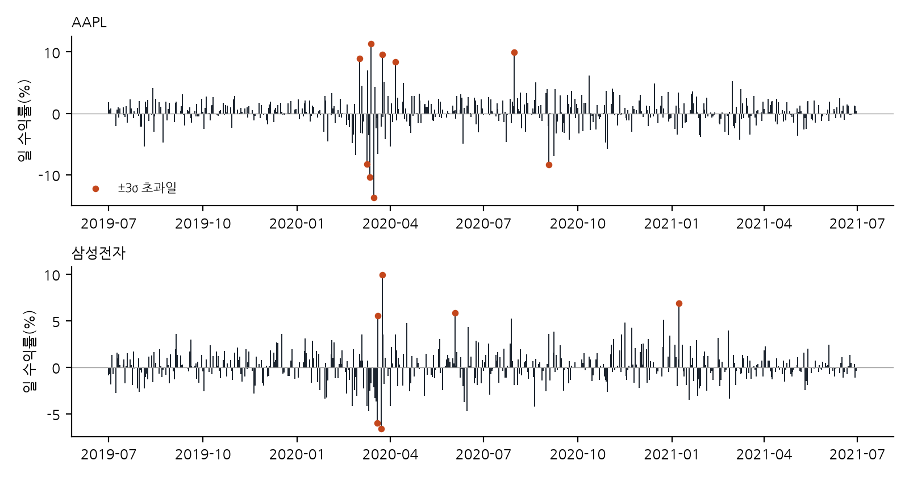
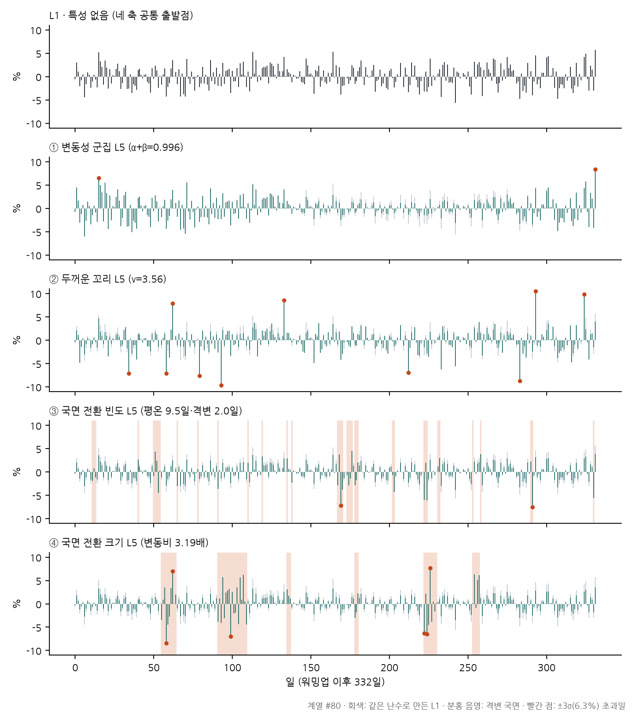

# 제3장 연구 설계

본 장에서는 실험의 설계를 설명한다. 3.1절에서 예측 문제를 정의하고, 3.2절에서 합성 데이터, 3.3절에서 실제 주식 데이터를 다룬다. 3.4절은 비교 모델, 3.5절은 사후보정, 3.6절은 평가 지표와 가설 검정, 3.7절은 사전등록과 검산 절차를 설명한다. 합성 데이터 실험과 실제 주가 실증은 같은 예측 절차와 같은 지표를 쓰며, 다른 것은 데이터뿐이다.

## 3.1 예측 문제

본 연구가 평가하는 대상은 TSFM이 내놓는 내일 로그수익률의 80% 예측구간이다. 매 거래일 t에 과거 L일의 자료만 보고 다음 날 수익률 r_{t+1} = ln(P_{t+1}/P_t)의 분포를 예측하며, 일별 이동 창(rolling window) 방식으로 동일한 예측을 반복한다. 모델은 재학습하지 않는다(제로샷).

**표 3-1. 예측 문제 설정**

| 항목 | 설정 | 근거 |
|---|:---|:---|
| 예측 대상 | 다음 날 로그수익률 | 일 단위 위험 관리(VaR 등)가 실무 표준이며, 기준 연구인 Re(Visiting)도 다음 날을 예측함 |
| 출력 | 0.1, 0.2, …, 0.9 분위수 9개 | 비교 모델 네 개가 공통으로 낼 수 있는 분위수 범위 |
| 평가 구간 | 80% 구간 = [q_{0.1}, q_{0.9}] | 일부 모델(TimesFM-2.5, Moirai-2.0)이 0.1~0.9 분위수만 출력하므로 네 모델이 공유하는 가장 넓은 대칭 구간 |
| 과거 길이 L | 21일(약 한 달), 252일(약 1년) | 단기 정보만 쓰는 경우와 1년치 맥락을 쓰는 경우 비교 |
| 입력 형태 | ① 로그수익률 ② 가격 그대로 | TSFM은 입력을 내부에서 정규화하지만 입력 형태에 따라 출력이 달라질 수 있음. 가격 입력의 출력 분위수 q는 ln(q/P_t)로 바꿔 채점 |
| 에피소드 | 80일 = 준비 20일 + 채점 60일 | 준비 20일은 사후보정 기록을 시작하는 데만 쓰고, 모든 지표는 채점 60일로 계산 |

과거 길이 2가지와 입력 형태 2가지를 교차하여 TSFM마다 4개 조건(한 달·수익률, 한 달·가격, 1년·수익률, 1년·가격)을 구성하고, 모든 실험 결과는 조건별로 구분하여 제시한다.

에피소드 길이 80일은 다음 계산에서 정하였다. 80% 구간은 평균 다섯 날에 한 번 구간을 벗어나므로, 채점 60일 동안 약 12회의 이탈이 누적된다. 사후보정은 과거 이탈 기록을 바탕으로 구간을 조정하는 방식이므로, 이 정도의 이탈 기록이 있어야 보정 효과를 검증할 수 있다.

## 3.2 실측 기반 합성 데이터

### 3.2.1 설계 원칙

합성 데이터 실험의 목적은 금융 데이터의 특성 하나만 강하게 설정했을 때 예측구간이 어떻게 변하는지를 분리해서 보는 것이다. 이를 위해 세 가지 원칙을 지켰다.

첫째, 같은 난수를 공유한다(공통 난수, common random numbers). 계열 번호 s마다 난수(정규난수 z, 균등난수 u·v, 초기 상태 s_0)를 한 번만 뽑고, 모든 시나리오가 이를 함께 쓴다. 따라서 같은 계열 번호의 L1과 L5 차이는 우연이 아니라 특성 설정의 차이에서만 생긴다. 네 축의 L1 모수(α+β = 0, ν = ∞, 전환 없음, 변동비 1)로 데이터를 만들면 모두 같은 L1 계열이 되는지를 생성 코드가 실행할 때마다 점검한다.

둘째, 변동의 크기는 고정한다. 모든 시나리오의 무조건부 평균은 0, 하루 변동(무조건부 표준편차)은 2.11%로 같다. 바뀌는 것은 변동의 형태뿐이다.

셋째, 강도 단계는 실제 주식에서 정한다. 합성 단계를 연구자가 임의로 정하면 실제보다 지나치게 약하거나 강한 조건을 시험하게 된다. 본 연구는 실제 10종목(3.3절)에서 각 특성의 강도를 측정하고, 그 측정값으로 단계를 정하였다.

### 3.2.2 금융 데이터의 세 가지 특성

주식 수익률은 정규분포와 다른 세 가지 성질을 보인다고 널리 알려져 있다. 그림 3-1은 실제 주가에서 이 성질이 어떻게 나타나는지 보여 준다.

**그림 3-1. 실제 주식의 하루 수익률(2019-07 ~ 2021-06)**. 2020년 3월 전후로 큰 움직임이 몰려서 나타나고(변동성 군집), 평소 변동의 3배를 넘는 날(빨간 점)이 정규분포가 예상하는 것보다 훨씬 자주 나타난다(두꺼운 꼬리). 저변동기와 고변동기가 번갈아 나타나는 모습은 국면 전환으로도 볼 수 있다.

① 변동성 군집: 한 번 크게 움직이면 그 뒤 며칠에서 몇 주 동안 계속 크게 움직이는 성질이다. GARCH(1,1) 모형으로 표현하며, 지속성 α+β가 0이면 어제의 변동이 오늘에 영향을 주지 않고, 1에 가까울수록 변동의 영향이 오래 지속된다.

② 두꺼운 꼬리: 평소에는 변동이 작다가 간헐적으로 극단적인 일별 변동이 발생하는 성질이다. 군집과 달리 극단적인 수익률이 특정 시기에 집중되지 않고 무작위로 발생한다. Student-t 분포로 표현하며, 자유도 ν가 작을수록 극단적인 날이 잦다. 표 3-2의 실제 10종목에서 평소 변동의 3배를 넘은 날의 비율은 1.3~1.8%로, 정규분포라면 기대되는 0.27%의 5~7배였다. 5배를 넘은 날은 정규분포에서는 사실상 일어나지 않지만(약 2,900일에 0.002일) 실제로는 종목마다 5~11일 있었다.

③ 국면 전환: 시장이 평온한 상태와 격변 상태를 오가는 성질이다. 2국면 마르코프 전환 모형으로 표현한다. 본 연구는 이 특성을 두 축으로 나눈다. 전환 빈도(국면 지속 기간)와 전환 크기(국면 간 변동성 비율)를 구분하지 않으면 어느 쪽이 영향을 주는지 식별할 수 없기 때문이다. 그 결과 합성 축은 군집·꼬리·전환 빈도·전환 크기의 4개로 구성된다.

### 3.2.3 실제 10종목에서 특성 강도 측정

10종목(3.3절) 각각의 2015-01-02~2026-09-22 일별 로그수익률(×100)에 두 모형을 적합하였다.

- GARCH(1,1)-t, 상수 평균(arch 8.0.0): α+β(군집), ν(꼬리)를 얻는다.
- 2국면 마르코프 전환, 평균·분산 전환(statsmodels 0.15.0): 국면별 평균 지속일 1/(1 − p_ii)와 격변/평온 표준편차 비(변동비)를 얻는다. 무작위 시작값 30개로 추정하여 로그우도가 가장 큰 해를 택하였다.

국면 전환 추정에서 한 가지 문제가 있었다. 한국 종목은 호가 단위 때문에 종가가 전날과 같은 날이 4~7% 있고, 이런 날들이 모여 "분산이 0인 국면"이라는 퇴화해(degenerate solution)를 만들 수 있다. 이런 해는 우도가 무한히 커지는 수학적 특이해로서 실제 시장의 성질이 아니다. 이를 막기 위해 국면 표준편차가 표본 표준편차의 25% 미만인 해는 버리도록 했으며, 최종 추정에서는 10종목 × 30개 시작값 모두 정상 해로 수렴하였다. 거래량이 0인 날(삼성전자 2018년 액면분할 거래정지 3일)은 제외했고, 같은 규칙을 실제 주식 실험에도 적용하였다.

**표 3-2. 실제 10종목의 특성 측정값**

| 종목 | α+β (군집) | ν (꼬리) | 평온 지속(일) | 격변 지속(일) | 변동비 | 일변동(%) | ±3σ 초과(%) |
|---|---|---|---|---|---|---|---|
| AAPL | 0.976 | 4.32 | 19.4 | 7.1 | 2.55 | 1.81 | 1.49 |
| AMZN | 0.972 | 4.46 | 32.3 | 12.4 | 2.52 | 2.07 | 1.49 |
| GOOG | **0.996** | 3.90 | 18.9 | 7.5 | 2.50 | 1.82 | 1.46 |
| JPM | 0.952 | 4.70 | 39.5 | 6.4 | 3.08 | 1.70 | 1.36 |
| META | 0.991 | **3.56** | 24.3 | 5.9 | 3.11 | 2.41 | 1.32 |
| 삼성전자 | 0.993 | 6.51 | 166.6 | 16.8 | **3.19** | 2.11 | 1.67 |
| SK하이닉스 | 0.987 | **7.64** | **275.2** | 36.9 | **2.50** | 2.85 | 1.70 |
| 현대차 | 0.987 | 4.58 | 49.2 | 9.4 | 2.73 | 2.29 | 1.84 |
| 한국전력 | **0.946** | 4.11 | 20.7 | 6.3 | 2.68 | 2.10 | 1.43 |
| 현대모비스 | 0.977 | 4.28 | 40.1 | 6.8 | 2.74 | 2.35 | 1.56 |

굵은 글씨는 단계값의 출처가 된 최솟값·최댓값이다.

### 3.2.4 단계 규칙과 확정 단계값

단계 규칙은 측정 전에 정하여 사전등록 프로토콜에 기록하였다. L1은 특성 없음으로 4축이 공유하는 하나의 시나리오이다. L3은 10종목 중 가장 약한 값, L4는 중앙값, L5는 가장 강한 값이다. L2는 L1과 L3의 중간으로, 꼬리 축은 초과첨도 6/(ν−4)의 중간에 해당하는 ν를 쓴다. 전환 빈도 축의 L5만 예외로, 실측 최대 이탈확률의 2배로 정해 실측 범위를 넘는 스트레스를 주었다.

**표 3-3. 합성 데이터 단계값**

| 단계 | ① 군집 α+β (α:β = 1:9) | ② 꼬리 ν | ③ 전환 빈도 (평온/격변 일수) (변동비 2.70 고정) | ④ 전환 크기: 변동비 (지속 35.6/7.6일 고정) |
|---|---|---|---|---|
| L1 | 0 | ∞ (정규) | 전환 없음 | 1.00 |
| L2 | 0.473 | 11.28 | 550.4 / 117.5 | 1.75 |
| L3 | 0.946 (한국전력) | 7.64 (SK하이닉스) | 275.2 / 58.7 (SK하이닉스) | 2.50 (SK하이닉스) |
| L4 | 0.982 (중앙값) | 4.39 (중앙값) | 35.6 / 7.6 (중앙값) | 2.70 (중앙값) |
| L5 | 0.996 (GOOG) | 3.56 (META) | 9.5 / 2.0 (최대 이탈확률×2) | 3.19 (삼성전자) |

하루 변동은 10종목 중앙값 2.11%, 평온/격변 지속일 비는 중앙값 4.69로 고정하였다. ③과 ④의 L4는 같은 설정이다. ③의 L2·L3은 평온 지속이 계열 길이(532일)와 비슷하거나 길어서 한 계열 안에서 전환이 0~2번에 그친다. 따라서 이 두 단계는 "자주 바뀜"보다 "계열마다 변동 수준이 다름"에 가깝다. 이는 규칙을 그대로 적용한 결과이며, 결과 해석에서 고려한다.

### 3.2.5 생성식

모든 시나리오는 하루 변동 σ = 2.11%, 평균 0을 만족한다.

- 군집(CL): r_t = σ_t z_t, σ_t² = ω + α r_{t−1}² + β σ_{t−1}², α = 0.1(α+β), β = 0.9(α+β), ω = σ²(1 − α − β).
- 꼬리(TL): r_t = σ √((ν−2)/ν) · τ_t, τ_t = z_t / √(χ²_ν(v_t)/ν). 같은 z_t를 쓰므로 ν만 다르고 난수는 같다.
- 국면(RF·RS): 상태 S_t ∈ {평온, 격변}이 평균 지속일에 따른 확률로 바뀌고, r_t = σ_{S_t} z_t. 격변 σ = 변동비 × 평온 σ이며, 정상분포 기준 분산이 σ²가 되도록 두 값을 정한다. 두 국면의 평균은 모두 0이다.

계열 하나는 532일(워밍업 200일 + 과거 252일 + 에피소드 80일)이며, 시나리오 17개(L1 + 4축 × L2~L5) × 계열 100개를 만든다. 그림 3-2는 같은 난수로 만든 한 계열을 L1과 각 축의 L5로 비교한 것이다.

**그림 3-2. 같은 난수로 만든 계열의 L1과 축별 L5.** 군집 L5는 고변동 구간과 저변동 구간이 몰려 나타나고, 꼬리 L5는 극단적인 수익률이 시기와 무관하게 흩어져 나타난다. 전환 빈도 L5는 짧은 격변(음영)이 자주 나타나고, 전환 크기 L5는 격변 구간 안의 변동이 커진다.

### 3.2.6 생성 검증

데이터가 의도대로 만들어졌는지 100개 계열 전체(워밍업 200일을 제외한 계열당 332일 × 100개 = 시나리오당 33,200일)로 확인하였다(표 3-4).

**표 3-4. 합성 데이터 생성 검증**

| 확인 항목 | 목표 | 생성 결과 |
|:---|---|---|
| 하루 변동 (17개 시나리오) | 2.11% | 2.08~2.19% |
| L1의 ±3σ 초과일 비율 | 0.270% (정규분포) | 0.271% |
| 꼬리 L2~L5의 ±3σ 초과일 비율 | 0.676 / 0.879 / 1.264 / 1.379% (이론) | 0.663 / 0.877 / 1.268 / 1.386% |
| 군집 L2~L5의 제곱수익률 자기상관 | 단계가 오를수록 증가 | 0.045 / 0.122 / 0.151 / 0.165 |
| 국면 축의 격변 일수 비율 | 17.6% | 16.6~17.7% |
| 전환 크기 L2~L5의 변동비 | 1.75 / 2.50 / 2.70 / 3.19 | 1.76 / 2.52 / 2.72 / 3.21 |
| 전환 빈도 L4·L5의 평균 지속일 | 35.6/7.6, 9.5/2.0일 | 31.4/7.4, 9.2/2.0일 |

군집 축의 자기상관은 이론값과의 일치 대신 증가 방향만 확인하였다. 계열 길이(332일)에서는 표본 자기상관이 이론값보다 작게 나오고, L5는 4차 적률이 존재하지 않아 이론값 자체가 정의되지 않기 때문이다. 전환 빈도의 실제 지속일이 목표보다 약간 짧은 것도 관측 기간이 끝나면서 마지막 구간이 잘리기 때문이다. 격변 일수 비율과 변동비가 목표와 일치하므로 전환 확률이 의도대로 들어갔다고 판단하였다.

추가로, 생성 과정을 알고 있으므로 각 날짜의 참 조건부 분포(군집: 그날의 σ_t를 아는 정규분포, 꼬리: 스케일된 t분포, 국면: 어제 국면을 알 때 오늘 국면의 혼합정규분포)의 분위수를 계산할 수 있다. 이를 오라클 모형이라 부르며, 데이터 생성과 채점 과정의 오류를 점검하는 기준선으로 활용한다(4.1절).

## 3.3 실제 주식 데이터

**표 3-5. 실제 주식 데이터**

| 항목 | 내용 |
|---|:---|
| 미국 5종목 | AAPL, AMZN, GOOG, JPM, META. 기준 연구(Noguer)와 같은 종목으로 재현 비교가 목적. 모두 2017년 초 미국 시가총액 상위 10위 안의 대형주 |
| 한국 5종목 | 삼성전자, SK하이닉스, 현대차, 한국전력, 현대모비스. 2017-01-02 KOSPI 보통주 시가총액 순위 위에서부터, 그 날 이전 거래 이력이 252일 이상인 종목 5개(우선주 제외, 4위 삼성전자우 제외). 순위 출처는 KRX 일별 시가총액 기록(FinanceData/marcap) |
| 가격 | 2015-01-02~2026-09-22 일별 종가. 미국 yfinance(분할 반영·배당 미반영), 한국 FinanceDataReader(pykrx와 2,878일 전부 일치, 분할 의심 0건) |
| 평가 | 2017-01-02부터 매 거래일 예측(종목당 2,381~2,443일, 총 24,132건). 종목별로 80일씩 연속 에피소드를 만들고, 끝에 80일이 안 되는 나머지는 주분석에서 제외(295개 에피소드, 채점 17,700건) |
| 보조 분석 | ① 에피소드를 끊지 않는 연속 보정 ② 모델 공개 이후 기간만 따로 본 학습 데이터 누출 점검 |

한국 종목을 평가 시작 시점의 시가총액으로 고른 것은 사후 선택 편향을 막기 위해서이다. 2026년 기준으로 고르면 결과적으로 성장한 종목만 포함된다. 미국 종목은 선정 방식이 다르지만(기준 연구 재현), 모두 같은 시점의 대형주이므로 두 시장 모두 "2017년 시점 대형주"라는 공통 기준을 만족한다. 업종 구성은 미국이 기술 4·금융 1, 한국이 기술 2·자동차 2·전력 1로 다르다.

## 3.4 비교 모델

**표 3-6. 비교 모델**

| 구분 | 모델 | 출력 방식 | 조건 |
|---|:---|:---|---|
| TSFM | Chronos-T5 base (amazon/chronos-t5-base) | 표본 200개 → 분위수 | 4조건 |
| TSFM | Chronos-2 (amazon/chronos-2) | 분위수 직접 출력 | 4조건 |
| TSFM | TimesFM-2.5 (google/timesfm-2.5-200m-pytorch) | 평균 + 0.1~0.9 분위수 | 4조건 |
| TSFM | Moirai-2.0-R-small (Salesforce/moirai-2.0-R-small) | 분위수 직접 출력 | 4조건 |
| 기준 모형 | 과거 변동 기준선(랜덤워크 가정, RW) | 과거 L일 수익률의 평균·표준편차를 갖는 정규분포 | 21·252일 |
| 기준 모형 | GARCH(1,1)-t | 매일 재추정한 1일 조건부 t분포 | 252일 |

TSFM 네 개는 기준 연구에서 평가한 모델과 맞추었다. Chronos-T5는 계산 시간 규칙에 따라 large 대신 base를 사용하였다(사전 측정에서 large 예상 19.4시간 > 기준 12시간). 과거 21일 조건에서는 TimesFM-2.5와 Moirai-2.0이 패치 길이보다 짧은 입력을 패딩(padding)하여 처리한다.

과거 변동 기준선(RW)은 "주가는 예측 가능한 방향 없이 움직인다"는 랜덤워크 가정에 따라, 최근 변동 크기만으로 다음 날 수익률의 정규분포를 산출한다. 학습이나 패턴 분석이 전혀 없는 가장 단순한 기준이다. GARCH(1,1)-t는 변동성 군집을 직접 모형화하는 전통적 계량 모형이다. 추정이 실패하거나 값이 비정상이면(유한값이 아님, 분산 ≤ 0, ν ≤ 2) 그날만 RW와 같은 분포로 대체하도록 사전에 정하였다.

모델이 낸 9개 분위수가 오름차순이 아니면(분위수 교차) 오름차순으로 다시 정렬한 뒤 채점하고, 교차 비율을 함께 보고한다.

## 3.5 사후보정

### 3.5.1 ACI-CQR

모델은 그대로 두고 출력 구간만 고치는 사후보정으로 적응형 콘포멀 추론(ACI)과 콘포멀 분위수 회귀(CQR)를 결합한 방식을 쓴다. 즉 전날까지의 구간 이탈 기록에 따라 당일 구간을 넓히거나 좁히는 방식이다.

1. 매일 이탈 점수 s_t = max(l_t − y_t, y_t − u_t) / (u_t − l_t)를 기록한다. 구간 [l_t, u_t] 안에 들어오면 음수, 밖으로 나가면 양수이며, 구간 폭으로 나누어 변동 크기와 무관하게 비교한다.
2. 준비 20일 동안은 점수만 기록한다.
3. 채점일에는 기록 n개 가운데 k = ⌈(n+1)(1−α_t)⌉번째로 작은 점수에 그날 구간 폭을 곱한 만큼 양쪽을 넓힌다(음수면 좁힌다). k > n이면 기록의 최댓값을 쓴다.
4. 실제값을 확인한 뒤 α_{t+1} = clip(α_t + γ(α − err_t), 0.02, 0.50)로 갱신한다(단, err_t는 실제값이 구간을 벗어나면 1, 구간 안에 있으면 0). 이탈이 발생하면 α가 줄어 다음 구간이 넓어지고, 이탈 없이 포함이 이어지면 α가 늘어 구간이 좁아진다.

설정은 α = 0.20, γ = 0.05로 고정하였다. 보정은 에피소드마다 새로 시작하며, 실제 주식에서는 종목별로 끊지 않는 연속 보정을 보조 분석으로 함께 보고한다.

### 3.5.2 대조군

보정의 효과가 단순히 "구간을 넓혀서" 생긴 것인지 확인하기 위해, 원래 구간을 중심 기준으로 일괄 확대한 대조군을 둔다. 확대 배율은 같은 묶음(합성은 모델·조건·시나리오, 실제는 모델·조건) 채점일의 평균 보정폭과 같아지도록 정한다. 이 배율은 결과를 본 뒤에 정한 값이므로 실제 운용에서는 알 수 없다. 즉 대조군은 미래 정보를 일부 사용한 비교 대상에 해당하며, 보정은 매일 그때까지의 실제값만으로 조정한다는 차이가 있다.

## 3.6 평가 지표와 가설 검정

### 3.6.1 지표

- 커버리지(주지표): 실제값이 80% 구간 안에 들어온 날의 비율. 목표는 80%이며, 80%보다 낮으면 구간이 좁아 위험을 과소평가한 것(과소), 높으면 불필요하게 넓은 것(과대)이다.
- 분위수 손실: 9개 분위수의 pinball 손실 평균(CRPS 근사). 구간이 정확하면서 좁을수록 작다.
- 구간 폭: 보조 지표.

모든 지표는 채점 60일로만 계산한다.

### 3.6.2 연구 질문과 가설

**표 3-7. 가설과 검정**

| 연구 질문 | 가설 | 내용 | 비교 | 검정 |
|---|---|:---|:---|:---|
| RQ1 | H1 | 군집이 강해질수록 커버리지 하락 | 같은 계열의 L5−L1, L5−L3 | Wilcoxon 부호순위(양측) |
| RQ1 | H2 | 꼬리가 두꺼울수록 하락 | 〃 | 〃 |
| RQ1 | H3a | 전환이 잦을수록 하락 | 〃 | 〃 |
| RQ1 | H3b | 전환 충격이 클수록 하락 | 〃 | 〃 |
| RQ1 | H4 | 고강도(L4·L5)에서 축마다 결손이 다르다 | 같은 계열 4축 | Friedman → 축 쌍별 Wilcoxon |
| RQ2 | H6 | 실제 주식에서 TSFM이 RW보다 분위수 손실이 작다 | 같은 날·종목, 같은 L | 달력 월 블록 평균 차이의 t검정(양측) |
| RQ3 | H5 | 보정 후 80% 복원 | 커버리지 90% 신뢰구간 ⊂ [0.77, 0.83] | 클러스터 부트스트랩 2,000회 |

H1~H3b는 금융 시계열의 특성이 예측 모델에 불리하게 작용한다는 기존 연구(Sun 외, 2026 등)의 관점을 그대로 가설로 둔 것으로, 이 관점이 사전학습 TSFM의 예측구간에도 성립하는지를 검정한다.

검정 단위는 서로 독립인 묶음이다. 합성은 계열 100개(같은 계열 번호끼리 대응), 실제는 달력 월이다. 같은 날 10종목의 예측은 서로 연관되어 있고 연속된 날도 독립이 아니므로, 날짜를 하나하나 독립 관측으로 쓰지 않는다.

유의성은 Holm 보정 후 p < 0.05로 판단하며, Holm 묶음은 가설·비교마다 TSFM 4개 × 조건 4개 = 16개이다. 유의하더라도 효과가 실질 기준(커버리지 2%p, 분위수 손실 RW 대비 2%)보다 작으면 "통계적으로는 유의하나 작음"으로 구분한다. TSFM마다 4개 조건에서 각각 판정하여, 4조건 모두 성립하면 "조건과 무관", 일부만 성립하면 "조건에 따라 다름", 없으면 "미지지"로 정리한다. 시나리오·모델·조건을 골라서 보고하지 않고 전체 표를 보고한다.

## 3.7 사전등록과 검산

본 연구의 실험은 실행 전에 연구 계획(가설·판정 기준)·코드·단계값을 git 커밋으로 동결하고(동결 시점과 실행 환경은 부록 A), 동결 후의 변경은 이탈 기록과 새 커밋으로만 허용하는 사전등록 절차를 따랐다. 예비 실험에서 확인한 설계상의 한계를 보완하여 본 실험을 설계하고 실행 전에 동결하였으며, 동결 전에는 다음을 확인하였다.

- 누출 점검: 실제·합성 과제 각 600건을 원자료에서 독립적으로 다시 계산하여, 모델에 주는 과거 자료가 예측 대상일 이전에서 끝나는지 확인
- 오라클 모형: 17개 시나리오 모두 커버리지 79.3~80.2%
- 보정기: 별도로 작성한 참조 구현과 200회 일치
- 예비 실행: 실제 GPU 환경에서 소규모 실행(스모크)으로 모든 모델의 호출 확인

실행 후에는 분석 코드와 독립적으로 작성한 코드로 원본 예측 파일에서 모든 지표와 검정을 다시 계산하여 일치함을 확인하였다(최대 차이 1.5×10⁻¹⁴).

본 연구는 투명성을 위해 다음 사항을 밝힌다. 첫째, 동결 전 전체 규모 사전 시험에서 기준 모형(RW, GARCH-t)의 실제 주가 결과가 함께 산출되었으나, 이를 본 뒤 설정은 바꾸지 않았다. 둘째, 동결 후 검산에서 GARCH-t가 합성 데이터 136,000건 중 2건에서 비정상 값을 낸 것을 발견하였으며, 가설 검정에는 영향이 없고 민감도 분석을 6.5절에 보고한다.

실행 환경은 Python 3.11.17, PyTorch 2.5.1(CUDA 12.1), NVIDIA RTX 3080 10GB, chronos-forecasting 2.3.2, timesfm 3.0.2, uni2ts 2.0.0, arch 8.0.0이다. 주요 패키지 버전은 부록 A.2에 싣는다.
