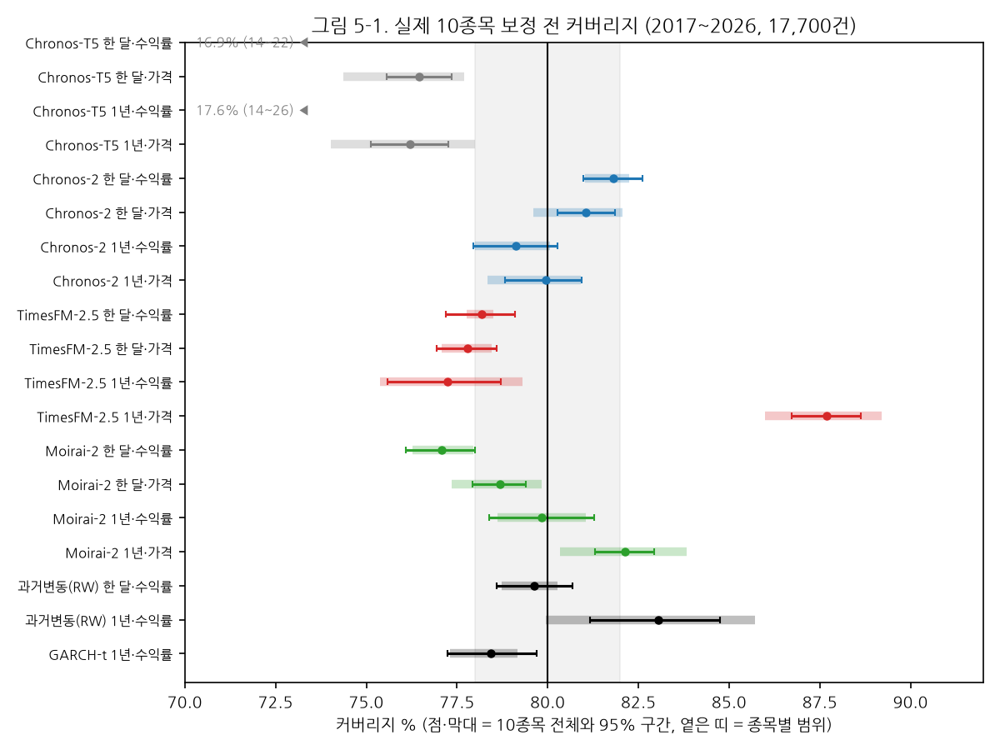
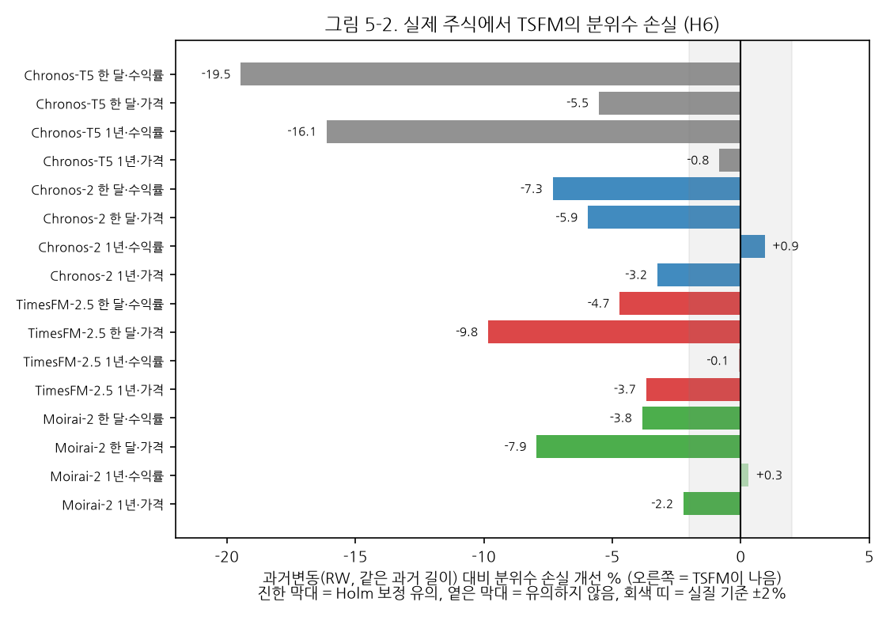
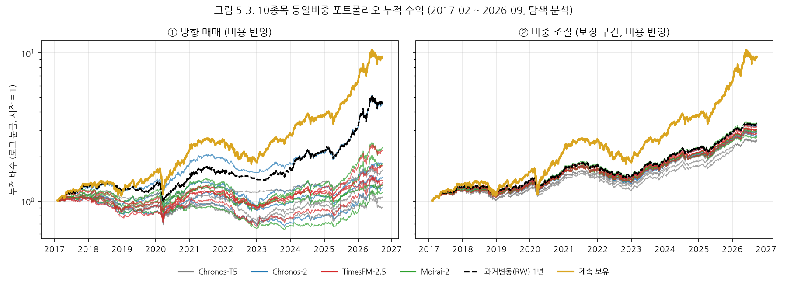

# 제5장 현실 평가: 실제 주식에서 TSFM 예측구간 (RQ2)

이 장은 실제 10종목(미국 5, 한국 5)에서 2017년 1월부터 2026년 9월까지 매 거래일 낸 예측을 평가한다. 5.1절은 커버리지, 5.2절은 정확도(분위수 손실)를 과거변동(RW)과 비교한 H6, 5.3절은 모델 공개 이후 기간만 본 점검, 5.4절은 실험실 결과와의 대응을 다룬다. 5.5절은 사전등록 밖의 탐색 분석으로, 이 예측구간을 실제 투자 규칙에 썼을 때 어떤 차이가 생기는지를 본다.

## 5.1 커버리지: 실험실 L1과 거의 같은 자리

**표 5-1. 실제 10종목의 보정 전 커버리지 (채점 17,700건)**

| 모델 | 조건 | 전체 % [95% 구간] | 미국 % | 한국 % | 종목별 범위 % | 평균 폭 %p |
|---|---|---|---|---|---|---|
| Chronos-T5 | 한 달·수익률 | 16.9 [16.2, 17.5] | 14.5 | 19.3 | 13.5~22.2 | 0.78 |
| Chronos-T5 | 한 달·가격 | 76.5 [75.6, 77.4] | 76.4 | 76.5 | 74.4~77.7 | 5.03 |
| Chronos-T5 | 1년·수익률 | 17.6 [16.7, 18.6] | 15.6 | 19.6 | 14.4~26.1 | 0.68 |
| Chronos-T5 | 1년·가격 | 76.2 [75.1, 77.3] | 76.6 | 75.8 | 74.0~78.0 | 4.33 |
| Chronos-2 | 한 달·수익률 | 81.8 [81.0, 82.6] | 82.0 | 81.6 | 81.0~82.2 | 5.75 |
| Chronos-2 | 한 달·가격 | 81.1 [80.3, 81.9] | 81.6 | 80.5 | 79.6~82.1 | 5.78 |
| Chronos-2 | 1년·수익률 | 79.1 [77.9, 80.3] | 79.1 | 79.1 | 78.0~80.1 | 4.65 |
| Chronos-2 | 1년·가격 | 80.0 [78.8, 80.9] | 79.8 | 80.1 | 78.3~80.9 | 5.02 |
| TimesFM-2.5 | 한 달·수익률 | 78.2 [77.2, 79.1] | 78.2 | 78.1 | 77.8~78.5 | 5.00 |
| TimesFM-2.5 | 한 달·가격 | 77.8 [76.9, 78.6] | 77.8 | 77.8 | 77.1~78.4 | 5.32 |
| TimesFM-2.5 | 1년·수익률 | 77.2 [75.6, 78.7] | 76.4 | 78.1 | 75.4~79.3 | 4.43 |
| TimesFM-2.5 | 1년·가격 | 87.7 [86.7, 88.6] | 87.1 | 88.4 | 86.0~89.2 | 6.27 |
| Moirai-2 | 한 달·수익률 | 77.1 [76.1, 78.0] | 77.3 | 76.8 | 76.3~77.9 | 4.85 |
| Moirai-2 | 한 달·가격 | 78.7 [77.9, 79.4] | 79.2 | 78.2 | 77.4~79.8 | 5.64 |
| Moirai-2 | 1년·수익률 | 79.8 [78.4, 81.3] | 80.1 | 79.6 | 78.6~81.1 | 4.69 |
| Moirai-2 | 1년·가격 | 82.1 [81.3, 82.9] | 83.0 | 81.2 | 80.3~83.8 | 5.20 |
| 과거변동(RW) | 한 달·수익률 | 79.6 [78.6, 80.7] | 79.9 | 79.3 | 78.7~80.3 | 4.93 |
| 과거변동(RW) | 1년·수익률 | 83.0 [81.2, 84.7] | 84.5 | 81.6 | 79.9~85.7 | 5.08 |
| GARCH-t | 1년·수익률 | 78.4 [77.2, 79.7] | 78.6 | 78.3 | 77.3~79.2 | 4.54 |

주: 95% 구간은 달력 월 클러스터 부트스트랩 2,000회. 종목별 범위는 10종목 각각의 커버리지 최솟값~최댓값.

실제 주가에서도 제4장의 패턴이 그대로 나타났다.

- **Chronos-T5 수익률 입력은 17~18%**로 구간이 붕괴했다. 종목별로도 14~26%로, 어느 종목에서도 회복되지 않는다.
- **TimesFM-2.5 1년·가격은 88%**로 구간이 지나치게 넓다(10종목 모두 86~89%).
- 나머지 13개 TSFM 조건은 76~82%다. 가장 목표에 가까운 것은 Chronos-2(79~82%)와 Moirai-2 1년·수익률(79.8%)이다.
- **미국과 한국의 차이는 작다.** 같은 TSFM 조건에서 두 시장의 커버리지 차이는 Chronos-T5 수익률(한국이 약 4~5%p 높음)을 빼면 모두 2%p 이내다. 종목별 범위도 대부분 4%p 폭 안에 들어온다. 시장이나 종목보다 모델·조건이 결과를 정한다.

기준 모형 중 RW 1년은 83.0%로 약간 넓고(미국 84.5%), RW 한 달은 79.6%, GARCH-t는 78.4%다.

## 5.2 정확도: TSFM은 과거변동(RW)보다 나은가 (H6)

커버리지는 구간 하나만 본다. 분포 전체의 정확도는 9개 분위수의 분위수 손실로 본다. H6은 "TSFM이 같은 과거 길이의 RW보다 분위수 손실이 작다"는 가설이다.

**표 5-2. RW 대비 분위수 손실 개선율 (양수 = TSFM이 나음)**

| 모델 | 조건 | RW 대비 손실 개선 % | Holm p | 판정 |
|---|---|---|---|---|
| Chronos-T5 | 한 달·수익률 | -19.5 | 3.8e-50 | 반대(RW 우위) |
| Chronos-T5 | 한 달·가격 | -5.5 | 2.7e-18 | 반대(RW 우위) |
| Chronos-T5 | 1년·수익률 | -16.1 | 6.7e-43 | 반대(RW 우위) |
| Chronos-T5 | 1년·가격 | -0.8 | 2.4e-02 | 반대(RW 우위) |
| Chronos-2 | 한 달·수익률 | -7.3 | 1.4e-38 | 반대(RW 우위) |
| Chronos-2 | 한 달·가격 | -5.9 | 1.2e-15 | 반대(RW 우위) |
| Chronos-2 | 1년·수익률 | +0.9 | 4.3e-05 | 유의하나 작음 |
| Chronos-2 | 1년·가격 | -3.2 | 8.9e-09 | 반대(RW 우위) |
| TimesFM-2.5 | 한 달·수익률 | -4.7 | 9.3e-27 | 반대(RW 우위) |
| TimesFM-2.5 | 한 달·가격 | -9.8 | 5.7e-27 | 반대(RW 우위) |
| TimesFM-2.5 | 1년·수익률 | -0.1 | 8.8e-01 | 차이 없음 |
| TimesFM-2.5 | 1년·가격 | -3.7 | 1.4e-13 | 반대(RW 우위) |
| Moirai-2 | 한 달·수익률 | -3.8 | 1.7e-24 | 반대(RW 우위) |
| Moirai-2 | 한 달·가격 | -7.9 | 2.1e-16 | 반대(RW 우위) |
| Moirai-2 | 1년·수익률 | +0.3 | 1.8e-01 | 차이 없음 |
| Moirai-2 | 1년·가격 | -2.2 | 3.5e-06 | 반대(RW 우위) |

주: 개선율 = 1 − (TSFM 손실 / RW 손실). 검정은 달력 월별 평균 손실 차이(114개월)의 t검정(양측), Holm 보정(16개 묶음). 판정 기준 2%.

H6은 **지지되지 않았다.** 16개 조건 중 13개에서 TSFM이 RW보다 유의하게 **나빴고**(−0.8 ~ −19.5%), 2개 조건(TimesFM 1년·수익률, Moirai-2 1년·수익률)은 차이가 없었으며, Chronos-2 1년·수익률만 +0.9%로 유의하게 나았지만 실질 기준(2%)에는 못 미쳤다.

이 결과는 두 가지로 읽어야 한다. 첫째, TSFM이 RW를 이기지 못한다는 것은 놀라운 결과가 아니다. 일별 주가 수익률은 방향을 거의 예측할 수 없고(5.5절의 자기상관 참조), 이 상황에서 정답에 가장 가까운 것은 "최근 변동 크기로 그린 분포"다. RW가 바로 그것이다. 둘째, 1년 과거를 수익률로 넣은 조건(Chronos-2, TimesFM, Moirai-2)에서 TSFM은 RW와 **같은 수준**에 도달했다. 즉 TSFM은 별도 학습 없이도 이 단순하지만 강한 기준과 같은 정확도를 낼 수 있으나, 그보다 나아지지는 않았다. 반대로 과거 한 달만 보거나 가격을 넣은 조건에서는, Chronos-T5를 제외한 9개 조건에서 RW보다 2~10% 나빴다. Chronos-T5는 수익률 입력에서 16~20% 나빴는데, 4.2절에서 본 구간 붕괴가 분포 전체의 정확도에도 그대로 나타난 것이다.

## 5.3 모델 공개 이후 기간 점검

TSFM은 대규모 공개 시계열로 사전학습되었으므로, 평가 기간의 주가가 학습 데이터에 들어 있을 수 있다(누출). 이를 점검하기 위해 각 모델이 공개된 이후 기간만 따로 계산하였다.

**표 5-3. 모델 공개 이후 기간의 결과**

| 모델 | 조건 | 공개 이후 시작 | 예측 수 | 커버리지 % (전체 → 공개 후) | RW 대비 개선 % (전체 → 공개 후) |
|---|---|---|---|---|---|
| Chronos-T5 | 한 달·수익률 | 2024-04-01 | 4,291 | 16.9 → 16.2 | -19.5 → -19.5 |
| Chronos-T5 | 한 달·가격 | 2024-04-01 | 4,291 | 76.5 → 75.9 | -5.5 → -6.5 |
| Chronos-T5 | 1년·수익률 | 2024-04-01 | 4,291 | 17.6 → 15.8 | -16.1 → -17.3 |
| Chronos-T5 | 1년·가격 | 2024-04-01 | 4,291 | 76.2 → 74.6 | -0.8 → -2.1 |
| Chronos-2 | 한 달·수익률 | 2025-11-01 | 1,295 | 81.8 → 82.2 | -7.3 → -7.1 |
| Chronos-2 | 한 달·가격 | 2025-11-01 | 1,295 | 81.1 → 80.7 | -5.9 → -9.1 |
| Chronos-2 | 1년·수익률 | 2025-11-01 | 1,295 | 79.1 → 78.3 | +0.9 → +0.2 |
| Chronos-2 | 1년·가격 | 2025-11-01 | 1,295 | 80.0 → 79.2 | -3.2 → -5.0 |
| TimesFM-2.5 | 한 달·수익률 | 2025-10-01 | 1,478 | 78.2 → 77.0 | -4.7 → -4.5 |
| TimesFM-2.5 | 한 달·가격 | 2025-10-01 | 1,478 | 77.8 → 77.0 | -9.8 → -13.7 |
| TimesFM-2.5 | 1년·수익률 | 2025-10-01 | 1,478 | 77.2 → 71.8 | -0.1 → -0.8 |
| TimesFM-2.5 | 1년·가격 | 2025-10-01 | 1,478 | 87.7 → 84.0 | -3.7 → -6.6 |
| Moirai-2 | 한 달·수익률 | 2025-09-01 | 1,678 | 77.1 → 75.3 | -3.8 → -3.2 |
| Moirai-2 | 한 달·가격 | 2025-09-01 | 1,678 | 78.7 → 77.5 | -7.9 → -15.4 |
| Moirai-2 | 1년·수익률 | 2025-09-01 | 1,678 | 79.8 → 76.0 | +0.3 → +0.0 |
| Moirai-2 | 1년·가격 | 2025-09-01 | 1,678 | 82.1 → 80.8 | -2.2 → -2.5 |

공개 이후에도 패턴은 같다. Chronos-T5 수익률의 붕괴(16%), TimesFM 1년·가격의 과대(84%)가 그대로 나타나고, RW 대비 손실은 전체 기간과 같거나 약간 더 나쁘다. TimesFM 1년·수익률(77.2 → 71.8%)과 Moirai-2 1년·수익률(79.8 → 76.0%)은 커버리지가 3~5%p 떨어졌는데, 공개 이후 기간이 1,300~1,700건(약 1년)으로 짧고 2025년 하반기 이후의 시장 상황이 함께 반영된 것이어서 원인을 단정할 수 없다. 적어도 "학습 데이터에 들어 있던 기간이라서 좋아 보였다"는 증거는 없다.

## 5.4 실험실과 현실의 대응

제4장에서 실험실의 오차는 대부분 모델·설정에서 오고 금융 특성의 효과는 작았다. 그렇다면 실제 주가의 커버리지는 **특성이 하나도 없는 L1의 커버리지**로 상당 부분 예측되어야 한다. 실제로 그렇다.

- 16개 TSFM 조건과 기준 모형 3개를 합한 19개에서 합성 L1 커버리지와 실제 커버리지의 상관은 0.998이다(Chronos-T5 수익률이 극단값이므로 이를 빼도 0.90).
- Chronos-T5 수익률 2개를 뺀 17개 조건에서 두 값의 차이는 평균 1.0%p, 최대 3.6%p(RW 1년: 79.4 → 83.0%)다.

실제 주가에는 군집·꼬리·국면 전환이 모두 섞여 있는데도, 정규분포 L1에서 측정한 커버리지와 평균 1%p 차이밖에 나지 않는다. 이는 제4장의 결론, 즉 **예측구간의 오차를 정하는 것은 금융 특성보다 모델과 입력 설정**이라는 해석을 현실 데이터가 뒷받침한다는 뜻이다. 또한 실험실 설계(실제 10종목에서 측정한 특성 강도)가 현실과 동떨어지지 않았다는 근거이기도 하다.

## 5.5 탐색 분석: 예측구간과 투자 성과

> 이 절은 사전등록 밖의 탐색 분석이다. 분석 규칙은 계산 전에 별도 문서(v4 경제적 가치 분석 계획)로 고정하였고, 새 예측 없이 본 실행의 실제 주식 예측만 사용하였다.

주가를 예측하는 궁극적 목적은 투자 판단이다. 이 절은 "예측구간의 질이 투자 성과와 어떻게 연결되는가"를 세 가지 단순한 규칙으로 살펴본다. 공통 가정은 다음과 같다. 전날까지의 정보로 그날 비중을 정해 전날 종가에 체결하고, 10종목에 같은 금액을 나눈다. 거래비용은 미국 0.01%(한쪽), 한국은 수수료 0.015%(한쪽)에 매도 시 증권거래세·농특세를 날짜별 세율(0.30%에서 시작해 2025년 0.15%, 2026년 0.20%)로 적용하였다. 보정 구간은 실제 운용과 같은 정보 조건이 되도록 종목별로 끊지 않고 연속 적용하였다. 표본은 2017년 2월부터 2026년 9월까지다.

### 5.5.1 ① 방향 매매: 중앙값이 오를 것이라면 산다

규칙: 예측 중앙값(q₀.₅)이 0보다 크면 그날 보유(비중 1), 아니면 현금(비중 0).

**표 5-4. 방향 매매 결과 (10종목 동일비중 포트폴리오)**

| 전략 | 조건 | 연수익률 % (비용 반영) | 연수익률 % (비용 0) | 샤프 | 최대 낙폭 % | 평균 비중 | 연 회전율(배) |
|---|---|---|---|---|---|---|---|
| 계속 보유 | - | 25.4 | 25.4 | 1.25 | -33.5 | 1.00 | 0 |
| Chronos-T5 | 한 달·수익률 | 2.7 | 9.1 | 0.29 | -37.4 | 0.50 | 87 |
| Chronos-T5 | 한 달·가격 | -1.0 | 5.8 | -0.03 | -36.0 | 0.45 | 93 |
| Chronos-T5 | 1년·수익률 | 5.0 | 7.0 | 0.59 | -18.2 | 0.31 | 47 |
| Chronos-T5 | 1년·가격 | 0.6 | 9.1 | 0.11 | -36.0 | 0.53 | 115 |
| Chronos-2 | 한 달·수익률 | 2.1 | 8.3 | 0.24 | -38.2 | 0.49 | 81 |
| Chronos-2 | 한 달·가격 | 3.8 | 8.6 | 0.40 | -27.5 | 0.43 | 64 |
| Chronos-2 | 1년·수익률 | 16.4 | 18.4 | 1.10 | -25.1 | 0.65 | 21 |
| Chronos-2 | 1년·가격 | 6.0 | 11.0 | 0.55 | -34.1 | 0.51 | 64 |
| TimesFM-2.5 | 한 달·수익률 | 2.9 | 9.2 | 0.31 | -36.6 | 0.53 | 80 |
| TimesFM-2.5 | 한 달·가격 | 5.7 | 11.8 | 0.50 | -32.3 | 0.47 | 77 |
| TimesFM-2.5 | 1년·수익률 | 8.3 | 11.8 | 0.69 | -28.1 | 0.58 | 47 |
| TimesFM-2.5 | 1년·가격 | 3.3 | 8.4 | 0.34 | -31.5 | 0.49 | 66 |
| Moirai-2 | 한 달·수익률 | 1.4 | 6.9 | 0.19 | -41.2 | 0.44 | 74 |
| Moirai-2 | 한 달·가격 | 2.5 | 7.5 | 0.29 | -31.9 | 0.41 | 66 |
| Moirai-2 | 1년·수익률 | 6.0 | 10.7 | 0.51 | -29.7 | 0.59 | 55 |
| Moirai-2 | 1년·가격 | 8.7 | 12.9 | 0.68 | -34.9 | 0.65 | 48 |
| 과거변동(RW) | 한 달·수익률 | 12.0 | 13.9 | 0.99 | -29.8 | 0.57 | 23 |
| 과거변동(RW) | 1년·수익률 | 16.7 | 17.1 | 1.08 | -25.4 | 0.69 | 5 |
| GARCH-t | 1년·수익률 | 20.7 | 21.2 | 1.27 | -23.1 | 0.66 | 4 |

**모든 TSFM 방향 매매가 계속 보유보다 못했다.** 비용을 넣으면 연 −1.0~16.4%로 계속 보유(25.4%)에 크게 못 미쳤고, 비용을 빼도 5.8~18.4%였다. 방향을 맞힌 비율은 49.3~51.6%로, 매일 "오른다"고 답했을 때의 적중률(실제 상승일 비율 50.1%)과 다르지 않다. 실제 수익률의 하루 자기상관은 종목별로 −0.10~+0.04로, 어제의 움직임이 오늘의 방향을 거의 알려 주지 않는다. 방향 신호가 자주 바뀌어 연 회전율이 21~115배에 달하므로 비용이 성과를 크게 깎는다.

### 5.5.2 ② 비중 조절: 예측 변동이 크면 덜 산다

규칙: 80% 구간 폭으로 내일의 변동(σ̂ = 폭 ÷ 2.5631)을 추정하고, 비중을 w = min(1, 1% ÷ σ̂)로 정한다. 하루 변동을 1% 안팎으로 맞추려는 변동성 목표 전략이며, 차입은 하지 않는다. 이 규칙은 방향이 아니라 **구간의 폭**, 즉 이 연구가 평가한 대상을 직접 쓴다.

**표 5-5. 비중 조절(변동성 목표 1%) 결과 (비용 반영)**

| 전략 | 조건 | 샤프 (원래) | 샤프 (보정) | 최대 낙폭 % (원래) | 최대 낙폭 % (보정) | 실현변동/목표 (원래) | 실현변동/목표 (보정) | RW 대비 샤프 차 [95% 구간] (원래 / 보정) |
|---|---|---|---|---|---|---|---|---|
| 계속 보유 | - | 1.25 | | -33.5 | | 2.26 | | |
| Chronos-T5 | 한 달·수익률 | 1.24 | 1.12 | -34.0 | -24.3 | 2.21 | 1.11 | -0.08 [-0.35, +0.18] / -0.23 [-0.36, -0.09] ✕ |
| Chronos-T5 | 한 달·가격 | 1.17 | 1.15 | -22.4 | -22.1 | 1.12 | 1.06 | -0.15 [-0.25, -0.04] ✕ / -0.20 [-0.32, -0.09] ✕ |
| Chronos-T5 | 1년·수익률 | 1.25 | 1.17 | -34.2 | -21.3 | 2.23 | 1.14 | +0.07 [-0.13, +0.26] / -0.16 [-0.24, -0.07] ✕ |
| Chronos-T5 | 1년·가격 | 1.20 | 1.24 | -25.1 | -23.5 | 1.22 | 1.12 | +0.02 [-0.16, +0.20] / -0.09 [-0.19, +0.00] |
| Chronos-2 | 한 달·수익률 | 1.30 | 1.33 | -19.0 | -19.8 | 0.99 | 1.05 | -0.02 [-0.09, +0.07] / -0.02 [-0.11, +0.06] |
| Chronos-2 | 한 달·가격 | 1.21 | 1.23 | -22.6 | -24.0 | 1.03 | 1.07 | -0.11 [-0.25, +0.04] / -0.12 [-0.27, +0.04] |
| Chronos-2 | 1년·수익률 | 1.26 | 1.32 | -21.3 | -22.5 | 1.15 | 1.13 | +0.09 [-0.08, +0.24] / -0.01 [-0.09, +0.07] |
| Chronos-2 | 1년·가격 | 1.20 | 1.25 | -22.6 | -23.5 | 1.09 | 1.09 | +0.03 [-0.15, +0.19] / -0.07 [-0.16, +0.01] |
| TimesFM-2.5 | 한 달·수익률 | 1.33 | 1.33 | -20.8 | -20.2 | 1.09 | 1.07 | +0.01 [-0.04, +0.06] / -0.02 [-0.08, +0.05] |
| TimesFM-2.5 | 한 달·가격 | 1.32 | 1.30 | -20.7 | -21.3 | 1.09 | 1.05 | -0.00 [-0.11, +0.11] / -0.05 [-0.17, +0.07] |
| TimesFM-2.5 | 1년·수익률 | 1.27 | 1.31 | -21.1 | -22.0 | 1.20 | 1.12 | +0.09 [-0.01, +0.18] / -0.01 [-0.07, +0.04] |
| TimesFM-2.5 | 1년·가격 | 1.21 | 1.30 | -17.1 | -23.1 | 0.88 | 1.10 | +0.04 [-0.12, +0.18] / -0.03 [-0.12, +0.06] |
| Moirai-2 | 한 달·수익률 | 1.30 | 1.32 | -22.2 | -20.6 | 1.14 | 1.08 | -0.02 [-0.10, +0.06] / -0.02 [-0.11, +0.06] |
| Moirai-2 | 한 달·가격 | 1.20 | 1.21 | -24.9 | -24.4 | 1.08 | 1.07 | -0.13 [-0.27, +0.02] / -0.14 [-0.29, +0.02] |
| Moirai-2 | 1년·수익률 | 1.27 | 1.37 | -19.7 | -21.6 | 1.12 | 1.13 | +0.09 [-0.01, +0.18] / +0.04 [-0.01, +0.10] |
| Moirai-2 | 1년·가격 | 1.27 | 1.28 | -20.8 | -22.2 | 1.04 | 1.10 | +0.09 [-0.10, +0.29] / -0.04 [-0.14, +0.05] |
| 과거변동(RW) | 한 달·수익률 | 1.32 | 1.35 | -20.4 | -20.5 | 1.12 | 1.12 | 기준 / 기준 |
| 과거변동(RW) | 1년·수익률 | 1.18 | 1.33 | -21.4 | -21.0 | 1.09 | 1.14 | 기준 / 기준 |
| GARCH-t | 1년·수익률 | 1.29 | 1.31 | -21.0 | -22.6 | 1.17 | 1.14 | +0.12 [-0.02, +0.26] / -0.02 [-0.09, +0.05] |

주: RW 대비는 같은 과거 길이의 RW 구간을 쓴 같은 전략과 비교(달력 월 블록 부트스트랩 2,000회). ✕ = 95% 구간이 0보다 작음(RW보다 나쁨), ○ = 0보다 큼(해당 없음). 계속 보유의 실현변동/목표는 참고값.

비중 조절은 수익률을 낮추는 대신 **위험을 크게 줄였다.** 계속 보유의 최대 낙폭 −33.5%가 비중 조절에서는 −17~−25%로 줄었고, 샤프 비율은 1.12~1.37로 계속 보유(1.25)와 비슷하거나 높았다. 그러나 TSFM 구간을 쓴 경우가 RW 구간을 쓴 경우보다 나은 조건은 없었고(샤프 차이의 95% 구간이 0보다 큰 경우 0개), Chronos-T5의 4개 경우에서는 유의하게 나빴다. 5.2절에서 TSFM의 분포 정확도가 RW 수준이었던 것과 같은 결과다.

여기서 **구간이 잘못되었을 때의 비용**이 분명하게 드러난다. Chronos-T5 수익률 입력의 원래 구간은 폭이 실제의 7분의 1이므로 "내일 변동이 아주 작다"고 판단해 늘 비중 1을 택했다. 그 결과 실현 변동이 목표의 2.2배였고 낙폭도 계속 보유와 같았다(−34%). 같은 예측에 사후보정을 하면 실현 변동이 목표의 1.1배로 돌아오고 낙폭은 −21~−24%로 줄었다. 위험 관리에 쓰는 구간에서 커버리지가 맞지 않으면, 전략은 의도한 위험 수준을 지키지 못한다.

### 5.5.3 ③ 위험 한도(VaR 10%): 하단을 넘는 손실이 10%인가

규칙: 80% 구간의 하단(q₀.₁)을 "10% 확률로만 이보다 더 잃는다"는 위험 한도(VaR 10%)로 쓰고, 실제로 넘은 날의 비율(위반율)을 검정한다. 위반율이 10%인지는 Kupiec 검정, 위반이 몰려 오지 않는지는 Christoffersen 독립성 검정으로 보았다(종목별, 유의수준 5%).

**표 5-6. 위험 한도(VaR 10%) 백테스트 (보정 전 → 보정 후)**

| 모델 | 조건 | 위반율 % (목표 10) | 위반율 검정 통과 종목 (10개 중) | 독립성 검정 통과 종목 (10개 중) |
|---|---|---|---|---|
| Chronos-T5 | 한 달·수익률 | 42.4 → 9.9 | 0 → 9 | 0 → 8 |
| Chronos-T5 | 한 달·가격 | 9.8 → 8.6 | 10 → 2 | 9 → 8 |
| Chronos-T5 | 1년·수익률 | 39.5 → 9.2 | 0 → 8 | 8 → 9 |
| Chronos-T5 | 1년·가격 | 11.7 → 9.9 | 4 → 10 | 9 → 9 |
| Chronos-2 | 한 달·수익률 | 8.8 → 9.9 | 5 → 10 | 8 → 7 |
| Chronos-2 | 한 달·가격 | 9.3 → 9.5 | 5 → 7 | 0 → 3 |
| Chronos-2 | 1년·수익률 | 10.3 → 10.0 | 10 → 10 | 8 → 9 |
| Chronos-2 | 1년·가격 | 9.0 → 9.1 | 6 → 7 | 2 → 6 |
| TimesFM-2.5 | 한 달·수익률 | 10.3 → 9.7 | 10 → 9 | 7 → 5 |
| TimesFM-2.5 | 한 달·가격 | 9.8 → 9.0 | 10 → 5 | 0 → 0 |
| TimesFM-2.5 | 1년·수익률 | 11.3 → 10.0 | 5 → 10 | 8 → 10 |
| TimesFM-2.5 | 1년·가격 | 5.5 → 9.0 | 0 → 6 | 5 → 8 |
| Moirai-2 | 한 달·수익률 | 11.9 → 10.5 | 0 → 10 | 6 → 7 |
| Moirai-2 | 한 달·가격 | 10.1 → 9.4 | 7 → 8 | 0 → 0 |
| Moirai-2 | 1년·수익률 | 10.8 → 10.8 | 9 → 10 | 10 → 10 |
| Moirai-2 | 1년·가격 | 9.2 → 10.2 | 8 → 9 | 6 → 9 |
| 과거변동(RW) | 한 달·수익률 | 9.8 → 9.9 | 10 → 10 | 4 → 6 |
| 과거변동(RW) | 1년·수익률 | 8.5 → 10.0 | 3 → 10 | 3 → 9 |
| GARCH-t | 1년·수익률 | 10.6 → 9.9 | 7 → 10 | 7 → 10 |

결과는 사후보정의 실무적 의미를 보여 준다. Chronos-T5 수익률의 원래 하단은 위반율 40~42%로 위험 한도로 쓸 수 없지만, 보정 후 9~10%로 돌아왔다. 19개 모델·조건 중 10종목 중 8종목 이상이 위반율 검정을 통과한 경우는 보정 전 7개에서 보정 후 14개로 늘었다. 다만 보정 전에 이미 위반율이 맞던 일부 조건(Chronos-T5 한 달·가격, TimesFM 한 달·가격)은 보정 후 위반율이 8.6~9.0%로 오히려 10%보다 낮아져 통과 종목이 줄었다(10 → 2, 10 → 5). 보정은 빗나감 기록에 따라 구간을 계속 조정하므로, 이미 맞던 구간에는 작은 흔들림을 더할 수 있다. 반면 한 달·가격 조건(Chronos-2, Moirai-2, TimesFM)은 보정 후에도 위반이 몰려 오는 문제(독립성 통과 0~3종목)가 남았다. 사후보정은 위반의 **비율**은 맞추지만 위반이 **언제** 오는지까지는 고치지 못한다.

### 5.5.4 해석과 한계

세 분석을 합치면 다음과 같다. 일별 TSFM 예측으로 **방향을 맞혀 돈을 버는 것은 어렵다**(①). 그러나 예측구간을 **위험 크기 측정**에 쓰면 낙폭을 줄이는 실질적 효과가 있고(②), 그 효과는 구간의 커버리지가 맞을 때에만 의도대로 나타난다(②, ③). 이것이 이 연구가 방향이 아닌 예측구간을 평가한 이유이며, 제6장의 사후보정이 실무적으로 중요한 이유다. 다만 TSFM 구간이 RW 구간보다 나은 투자 성과를 낸 경우는 없었다.

이 분석은 탐색적이며 다음 한계가 있다. 전날 종가 체결은 실제보다 유리한 가정이고, 시장 충격 비용과 세금 외 비용은 넣지 않았다. 대상은 2017년 기준 대형주 10종목이며 표본 기간에 강세장(계속 보유 연 25.4%)이 포함되어 있어, 현금 비중을 갖는 전략은 수익률에서 불리할 수밖에 없다.
