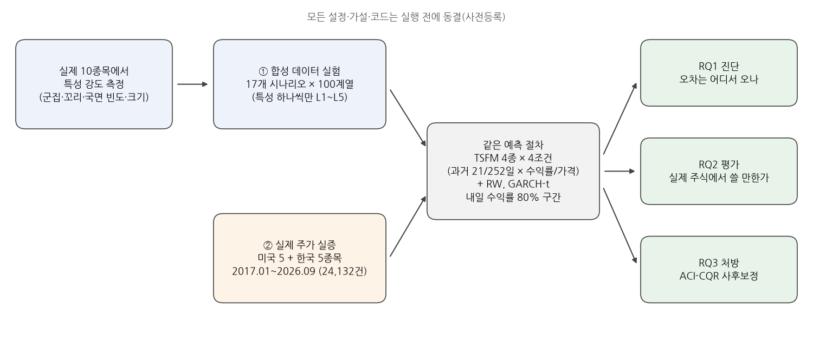
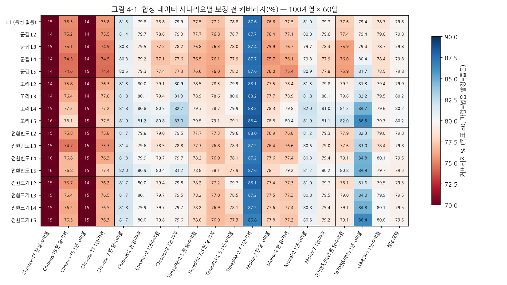
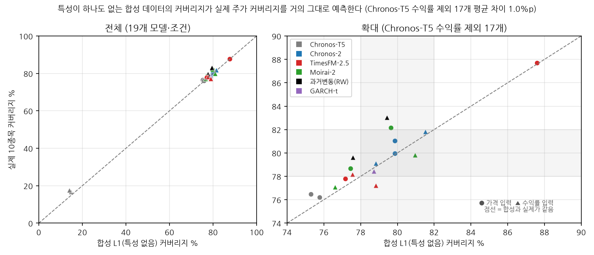
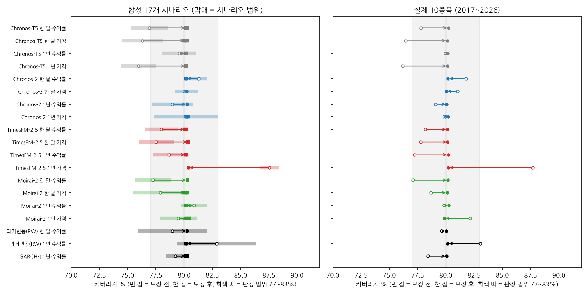

# 석사학위논문 초고 요약

인공지능융합학과 김승민 · 2026년 10월

---

## 한 줄 요약

사전학습 시계열 모델(TSFM)이 내는 주가 수익률 80% 예측구간의 오차는 금융 데이터의 특성보다 모델과 입력 설정에서 오며, 실측 기반 합성 데이터 실험으로 실제 주가의 커버리지를 미리 가늠할 수 있습니다(19개 모델·조건 평균 차이 1.1%p). 재학습 없는 사후보정으로 모든 경우 평균 커버리지가 80%로 복원되므로, 분포 정확도가 단순 기준 모형(RW) 수준인 TSFM은 수익률 예측기보다 보정을 거친 위험 측정 도구로 쓰는 것이 적절합니다.

제목(안): 사전학습 시계열 모델의 금융 수익률 예측구간: 오차의 출처와 재학습 없는 사후보정 (부제: 실측 기반 합성 데이터 통제 실험과 미국·한국 대형주 실증)

---

## 1. 연구 배경과 연구 질문

시계열 파운데이션 모델(TSFM)을 금융 위험 관리에 활용하려면 예측구간이 명목 확률(예: 80%)을 실제로 지키는지가 중요하나, 기존 금융 TSFM 연구는 점 예측 정확도에 집중해 왔습니다. 본 연구는 다음 세 가지 질문에 답합니다.

- RQ1 (진단): 금융 데이터의 특성(변동성 군집, 두꺼운 꼬리, 국면 전환의 빈도와 크기)이 강해질수록 TSFM 80% 예측구간의 커버리지가 떨어지는가, 아니면 모델과 입력 설정에서 이미 오차가 발생하는가? 특성 중에서는 어떤 것이 가장 불리한가?
- RQ2 (실증 평가): 실제 미국·한국 대형주에서 TSFM 예측구간의 커버리지와 분포 정확도는 어떠하며, 단순 기준 모형(과거 변동성 기반 정규분포, RW)보다 나은가?
- RQ3 (처방): 모델을 재학습하지 않는 온라인 사후보정(ACI-CQR)으로 커버리지를 80%로 복원할 수 있는가? 그에 수반되는 구간 폭의 확대는 어느 정도인가?

---

## 2. 연구 설계

- 합성 데이터 실험: 실제 10종목에서 측정한 특성 강도로 합성 데이터 17개 시나리오를 만들었습니다(특성 없음 1개 + 4개 특성 × 4단계). 같은 난수와 같은 평균 변동을 쓰고 특성 하나만 바꿔, 차이가 그 특성 때문임을 보장합니다. 참 분포를 알기 때문에 오라클 모형(참 분포)으로 채점 절차를 검증했습니다(17개 시나리오 모두 79.3~80.2%).
- 실제 주가 실증: 같은 절차를 실제 10종목 24,132건에 적용했습니다.
- 평가: 80% 구간의 커버리지(실제값이 구간에 들어온 비율, 목표 80%)와 분위수 손실(분포 전체의 정확도).

---

## 3. 주요 결과

### 결과 1. 오차는 특성이 아니라 모델·설정에서 온다 (RQ1)

- 특성이 하나도 없는 데이터(맨 윗줄)에서 이미 TSFM 커버리지가 75~88%로 퍼져 있고, 16개 조건 중 절반이 실질 기준(80% ± 2%p)을 벗어났습니다. 같은 모델도 입력 형태와 과거 길이에 따라 다릅니다(TimesFM-2.5: 1년·가격 88%, 1년·수익률 79%).
- 실험 과정에서는 설정 하나의 영향이 특성보다 훨씬 크다는 것도 발견했습니다. Chronos-T5를 라이브러리 기본 샘플링 설정(확률 상위 50칸에서만 추출) 그대로 쓰면 수익률 입력의 커버리지가 14%로 무너졌고, 이 제한을 풀면 76~79%였습니다. 본문 결과는 제한을 푼 설정 기준이며, 점검 과정과 바로잡기 전 결과는 부록 A.3에 밝혔습니다.
- 특성을 실제 종목 중 가장 강한 수준(L5)으로 설정해도 변화는 대부분 3%p 이내입니다. 그림에서 색은 세로(모델·설정)로 바뀌고 가로(특성)로는 거의 바뀌지 않습니다.
- 가설과 다른 점: 변동성 군집만 일부 조건에서 커버리지를 낮췄고(실질 하락 2개 조건, −2.0~−2.5%p), 두꺼운 꼬리와 잦은 국면 전환 특성은 오히려 커버리지를 높였습니다(전환 크기는 영향 없음). 이는 꼬리가 두꺼운 분포에서 분산 기반 80% 구간이 넓어지는 수학적 성질로 설명됩니다(정규분포 기반 구간을 t분포 데이터에 적용하면 이론 커버리지 82~87%, 단순 기준 모형이 이 이론값을 그대로 따름). 단, 이 현상은 80% 구간에 한정되며, 99% 구간에서는 반대로 커버리지가 97.8%로 낮아져 한도를 넘는 날이 1%에서 2.2%로 늘어나므로 극단 위험에는 그대로 적용할 수 없습니다(본문 표 4-3).

### 결과 2. 합성 데이터 실험 결과가 실제 주가에서 재현된다 (RQ2)

- 특성 없는 합성 데이터의 커버리지와 실제 주가의 커버리지는 19개 모델·조건에서 평균 1.1%p(최대 3.6%p) 차이이고, 상관은 0.90입니다. 실제 주가의 오차도 대부분 모델·설정에서 온다는 뜻입니다.
- 분포 정확도를 나타내는 분위수 손실은 16개 조건 중 12개에서 RW보다 컸고, 가장 나은 조건(네 모델의 1년·수익률)에서 RW와 같은 수준이었습니다. 점 예측 연구에서 보고된 한계가 분포 예측에서도 나타난 것입니다. 모델 공개 이후 기간만 따로 봐도 같습니다.

### 결과 3. 사후보정으로 모든 경우 평균 커버리지 80% 복원 (RQ3)

- 적응형 콘포멀 분위수 보정(ACI-CQR)으로 합성 340개, 실제 19개 모델·조건 모두 평균 커버리지가 80%로 돌아왔습니다(보정 후 79.8~80.7%). 너무 좁은 구간은 넓히고, 너무 넓은 구간(TimesFM 88%)은 좁혔습니다.
- 그에 상응하여 보정된 구간의 폭은 이상적인 구간보다 5~48% 넓어졌습니다.
- 탐색 분석(가설 검정과 별개인 보조 분석): 보정 전 구간을 위험 한도(VaR 10%)로 쓰면 위반율이 5.5~11.9%로 조건마다 달랐고, 보정 후 8.6~10.8%로 모였습니다. 10종목 중 8종목 이상이 위반율 검정을 통과한 조건은 보정 전 8개에서 보정 후 14개로 늘었습니다. 다만 위반이 몰려 오는 문제는 일부 조건(한 달·가격)에 남았습니다. 변동성 목표 전략에서는 보정 후 실현 변동이 모든 모델·조건에서 목표의 1.05~1.14배였으며, 예측 중앙값의 부호로 매매하는 단순 규칙은 모두 계속 보유보다 못했습니다.

---

## 4. 한계

80% 구간만 평가하였고(일부 모델이 극단 분위수를 출력하지 않음), 다음 날 예측과 미국·한국 대형주 10종목에 한정됩니다. 입력은 종가에서 얻은 단변량 계열이며 거래량 등 외부 변수는 쓰지 않았습니다(커버리지 오차는 거래량이 없는 합성 데이터에서도 같게 나타남). Chronos-T5는 계산 시간 문제로 base 크기를 사용하였습니다.
